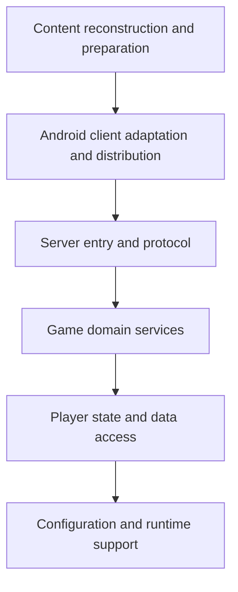

# Architecture Specification

> Generated by openlore v1.2.0 on 2026-11-07 15:24

## Purpose

This document describes the architectural patterns and structure of the system.

## Architecture Style

Layered architecture, with a content and client preparation toolchain feeding a server runtime that
handles protocol requests, game services, player state, and persistence. The analysis labels the
architecture as layered, though the large service set, high fan-out functions, and reported
dependency cycles suggest that boundaries are not consistently enforced.

## Requirements

### Requirement: LayeredArchitecture

The system SHALL maintain separation between:
- Content reconstruction and preparation (Decode, import, restore, validate, and package game data and assets for offline use.)
- Android client adaptation and distribution (Prepare the Android client for local play, adapt its UI and networking, and assemble offline distributions.)
- Server entry and protocol (Start the synthetic game server, receive client HTTP requests, and construct protocol-compatible replies.)
- Game domain services (Implement gameplay operations across battles, missions, gacha, events, shops, friends, arena, raids, and related modes.)
- Player state and data access (Own canonical player data, apply mutations, derive reply projections, and persist active state.)
- Configuration and runtime support (Resolve data paths and season configuration, diagnose prerequisites, and prepare headless server execution.)

#### Scenario: LayerSeparation
- **GIVEN** a request from the presentation layer
- **WHEN** business logic is needed
- **THEN** the presentation layer delegates to the business layer
- **AND** direct database access from presentation is prohibited

### Requirement: SecurityModel

The system SHALL implement security via: The analysis identifies protocol encryption and certificate generation/checking for the local FFBE lab server, including AES request/reply handling and configured certificate subject alternative names. It does not establish a user authentication or authorization scheme, so those aspects are uncertain from the available evidence.

#### Scenario: AuthenticatedAccess
- **GIVEN** an unauthenticated request
- **WHEN** accessing protected resources
- **THEN** access is denied

## System Diagram

## Layer Structure

### Content reconstruction and preparation

**Purpose**: Decode, import, restore, validate, and package game data and assets for offline use.
**Location**: `ClientDataDecodeService, ClientCacheImporter, EventBattleReconstructionService, Event Data Restoration Service, Field Treasure Importer, ContentVerificationService, Offline Cache Preparation, ReleaseDataBuilder`

### Android client adaptation and distribution

**Purpose**: Prepare the Android client for local play, adapt its UI and networking, and assemble offline distributions.
**Location**: `OfflineCodePreparation, AndroidBuild, AdaptiveDisplay, LocalConnection, TitleMenu, FriendsMenu, DistributionBuildService, DistributionFinalizer`

### Server entry and protocol

**Purpose**: Start the synthetic game server, receive client HTTP requests, and construct protocol-compatible replies.
**Location**: `CaptureServer, LocalGame, ReplyPipeline, ServerResponseFixtures, WireProbe`

### Game domain services

**Purpose**: Implement gameplay operations across battles, missions, gacha, events, shops, friends, arena, raids, and related modes.
**Location**: `BattleContentService, PlayerService, GachaService, Gacha Box Service, Shop and Item Service, EventPolicyService, ArenaService, ColosseumService, RaidProgressService, ExviusFieldTreasures`

### Player state and data access

**Purpose**: Own canonical player data, apply mutations, derive reply projections, and persist active state.
**Location**: `PlayerState, ServerState, Player, PlayerState entity, PartyDeck, InventoryItem`

### Configuration and runtime support

**Purpose**: Resolve data paths and season configuration, diagnose prerequisites, and prepare headless server execution.
**Location**: `DataPaths, Season, Application Bootstrap and Configuration, Environment Diagnostics, Headless Data Preparation, Headless Server Lifecycle, RuntimeDataDependencyChecker`

## Data Flow

Game assets, archives, authored definitions, and client data → decode/import/reconstruction and
validation tools → offline data files and client assets → configured server state and player state →
CaptureServer receives client HTTP requests → domain services read or mutate game/player state →
ReplyPipeline produces protocol replies → client receives responses; player state persistence is
managed by PlayerState and ServerState. Exact storage technology is not specified in the supplied
analysis.

## External Integrations

| System | Purpose |
|--------|---------|
| Final Fantasy Brave Exvius Android client and its encrypted wire protocol | External integration |
| Android APK and client resource archives | External integration |
| Game data tables, assets, and localized records | External integration |
| Archived event and wiki reference data | External integration |
| OpenSSL CLI or Python cryptography backend for AES operations | External integration |
| Optional artifact upload destination for distribution publishing; the specific system is not identified | External integration |
