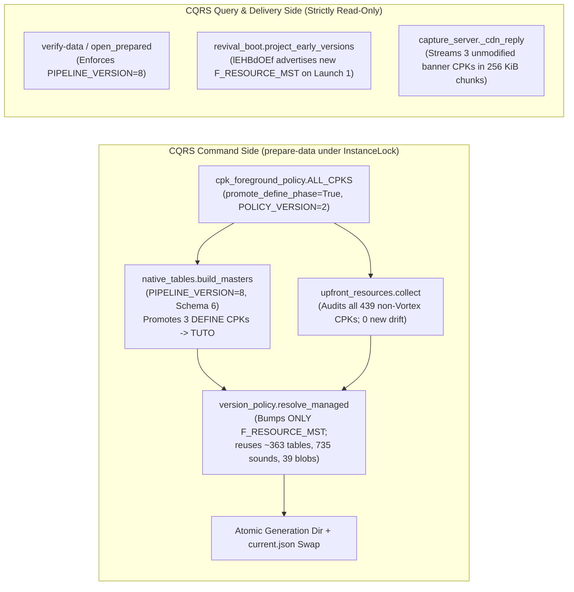

# iOS `DEFINE` Banner CPKs Foreground Promotion & Static Bundle PNG Boundary — SOLID / CQRS Plan

## 1. Triage of the 14 Observed CDN Requests

Inspecting the 14 captured `CriFsWebInstaller/2.01.08 (iOS_ARMv8_A64)` requests against `source/out/browser-data`, `F_RESOURCE_MST`, and `source/server/ffbe_player.py` splits them into **two fundamentally different native download mechanisms**:

### Group A — 3 `'DEFINE'`-Phase Banner CPKs (Actionable: Move to Foreground `InitialDownloadScene`)

| `F_RESOURCE_MST` ID (`9ZCEWn0z`) | Request Path | Shipped Phase (`81fTkEDP`) | Version (`OzT5lSz3` / `86SWOBTb`) | Disk / Checksum Size | Drift |
|---|---|---|---|---|---|
| `116002` | `/common_lang/sd/banner/Ver1_banner2_common.cpk` | `'DEFINE'` | `1` (`common_lang`) | `2,864,093 B` / `2,864,093 B` | `0 B` |
| `116501` | `/en/sd/banner/Ver17_banner_home1.cpk` | `'DEFINE'` | `17` (`en`) | `60,220 B` / `60,220 B` | `0 B` |
| `9400512` | `/en/sd/banner/Ver1_banner2.cpk` | `'DEFINE'` | `1` (`en`) | `4,722 B` / `4,722 B` | `0 B` |

- **Exact root cause**: These 3 rows are the **entire** `'DEFINE'`-phase population in `F_RESOURCE_MST` (528 total rows: 441 `.cpk`, 6 `.usm`, 81 `.acb`). In [source/ios_server/cpk_foreground_policy.py](../source/ios_server/cpk_foreground_policy.py#L30-L35), `ALL_CPKS` currently sets `promote_define_phase=False` pending physical-iPhone confirmation. Because their `81fTkEDP` phase remained `'DEFINE'`, `LoginScene::STATE_INIT` (`TUTO`/`tuto`, `MODE=fore`) skipped them and they leaked out of `InitialDownloadScene`.
- **Total transfer**: `2,929,035 B` (~2.79 MiB), **0 drifted** (zero new blobs staged in `assets/upfront/blobs/`).

### Group B — 11 Static Banner Bundle PNGs (Server-Only Boundary: Cannot Enter `InitialDownloadScene`)

| Request Path (all `/banner/.../sd/static_banner/bundle/...`) | Size | Source |
|---|---|---|
| `common_lang/.../IronChestofAbundanceUpdatedicon.png` | `73,582 B` | `revival_bundles.json` (`990000102`, `990000001`) `cSUSxGZA` |
| `{en,common_lang}/.../edc81ebfd5095c3b049b5a3f3ff67e60.png` (×2) | `31,459 B` each | `revival_bundles.json` (`990000103`) `hJs2B3X5` + `cSUSxGZA` |
| `{en,common_lang}/.../283_20201102051012.png` (×2) | `30,846 B` each | `revival_bundles.json` (`990000104`) `hJs2B3X5` + `cSUSxGZA` |
| `{en,common_lang}/.../439c24261bed48dd44a2ea605faa9fcf.png` (×2) | `35,780 B` each | `revival_bundles.json` (`990000105`) `hJs2B3X5` + `cSUSxGZA` |
| `{en,common_lang}/.../0c855c16012a2e67899dd28fd2a28c3e.png` (×2) | `34,579 B` each | `revival_bundles.json` (`990000106`) `hJs2B3X5` + `cSUSxGZA` |
| `common_lang/.../3658_20240822042728.png` | `33,609 B` | `revival_bundles.json` (`990000108`–`990000112`, `990000114`) `cSUSxGZA` |
| `common_lang/.../80117_20220314031715.png` | `34,170 B` | `revival_bundles.json` (`990000113`, `990000115`–`990000126`) `cSUSxGZA` |

- **Why they appear with `ua=CriFsWebInstaller/2.01.08`**: Stock iOS FFBE uses CRIWARE's `CriFsWebInstaller` HTTP client for **both** `F_RESOURCE_MST` packs and dynamic banner PNGs. When `X07iYtp5` (`GetUserInfo`) delivers `fMohhKK8` (`BundleInfo` rows built by [source/server/ffbe_player.py](../source/server/ffbe_player.py#L94-L203)), the client reads `cSUSxGZA` (`setBundleIcon`) and `hJs2B3X5` (`setBannerIcon`) and fetches those unversioned `.png` URLs into its banner-image cache.
- **Why server-only changes cannot move these 11 PNGs into `InitialDownloadScene`**:
  1. `F_RESOURCE_MST` contains **zero** `.png` rows (`{'.cpk': 441, '.usm': 6, '.acb': 81}`). Stock `InitialDownloadScene` (`MODE=fore`) exclusively downloads versioned `/{locale}/sd/{3LHdc6Qa}/Ver{version}_{pJ56sAEo}` entries and installs them via `CriFileSystem::installFile` / `CriUtilFileLoader`.
  2. Static bundle PNGs are requested under the unversioned `/banner/{locale}/sd/static_banner/bundle/{name}.png` URL prefix and stored in a separate static-banner cache read by `BundleInfo`.
  3. Injecting synthetic `.png` rows into `F_RESOURCE_MST` would request `/{locale}/sd/.../Ver1_<name>.png`, would **not** populate the `/banner/.../static_banner/bundle/` cache, and risks native CRIWARE archive-install errors on non-CPK/ACB/USM payloads.
- **Operational reality**: All 11 PNGs already return `200` via `capture_server.py` (`banner-art basename`), total ~400 KB combined, and are cached on-device after first fetch.

---

## 2. Architecture Overview (CQRS + SOLID)



### CQRS Boundary

- **Command Side (Explicit Writes Only)**:
  - `prepare-data` (under `InstanceLock(config.root)`): classifies the 3 `'DEFINE'` banner CPKs to `'TUTO'` via `cpk_foreground_policy.ALL_CPKS`, writes the updated `F_RESOURCE_MST` into a new immutable Schema-6 generation (`PIPELINE_VERSION = 8`), carries forward every unchanged table/sound/Vortex/upfront-CPK version via `version_policy`, and atomically swaps `assets/tables/current.json`.
  - Zero new blobs are written to `assets/upfront/blobs/` because all 3 `'DEFINE'` banner CPKs already match `F_RESOURCE_CHECKSUM_MST` byte-for-byte.
- **Query & Delivery Side (Strictly Read-Only, Zero Persistence)**:
  - `verify-data` and `open_prepared`: validate `PIPELINE_VERSION = 8` and Schema-6 invariants without writing to disk.
  - `revival_boot.project_early_versions` (`lEHBdOEf`): already advertises `F_RESOURCE_MST`, `F_RESOURCE_VERSION_MST_LOCALIZE`, and `F_RESOURCE_CHECKSUM_MST` on Launch 1 for returning initialized devices with zero player-state mutations.
  - HTTP delivery (`table_delivery.serve` -> `capture_server._cdn_reply`): streams the 3 unmodified stock banner CPKs in 256 KiB chunks with `Connection: close`.

### SOLID Mapping

| Principle | Concrete Design |
|---|---|
| **Single Responsibility (S)** | `cpk_foreground_policy.py` remains the sole owner of `F_RESOURCE_MST` foreground phase classification; `native_tables.py` only bumps `PIPELINE_VERSION = 8` to invalidate stale `PIPELINE_VERSION = 7` snapshots; `upfront_resources.py` and `revival_boot.py` require zero logic changes. |
| **Open/Closed (O)** | No branching hacks in `native_tables.py` or `upfront_resources.py`: promotion is achieved purely by setting `promote_define_phase=True` on `ALL_CPKS` while preserving an explicit named `ALL_EMPTY_CPKS` (`promote_define_phase=False`) descriptor alongside `LEGACY_MENU_AND_UNITS` for clean rollback or comparison. |
| **Liskov Substitution (L)** | All three `ForegroundCpkPolicy` descriptors (`ALL_CPKS`, `ALL_EMPTY_CPKS`, `LEGACY_MENU_AND_UNITS`) obey the exact same `target_phase` / `should_audit_upfront` contract: every row promoted to `'TUTO'` is guaranteed to be audited by `should_audit_upfront`. |
| **Interface Segregation (I)** | Callers continue depending only on `target_phase(row, policy)` and `should_audit_upfront(row, policy, exclude_resources=...)`; no filesystem, manifest, or HTTP concerns leak into the policy module. |
| **Dependency Inversion (D)** | `build_masters`, `collect`, and `prepare_data` depend on the immutable `ForegroundCpkPolicy` abstraction, enabling deterministic offline unit/BDD testing of `ALL_CPKS`, `ALL_EMPTY_CPKS`, and `PIPELINE_VERSION = 7 -> 8` upgrades without device or network I/O. |

---

## 3. Planned File Changes

### Production Code (2 files)

1. **[source/ios_server/cpk_foreground_policy.py](../source/ios_server/cpk_foreground_policy.py)**
   - Bump `POLICY_VERSION = 2`.
   - Update `ALL_CPKS` to `promote_define_phase=True`:
     ```python
     ALL_CPKS = ForegroundCpkPolicy(
         name='all-cpks',
         promote_empty_phase=True,
         promote_define_phase=True,
         audit_all_cpks=True,
     )
     ```
   - Export `ALL_EMPTY_CPKS` (`promote_empty_phase=True, promote_define_phase=False, audit_all_cpks=True`) so the prior `PIPELINE_VERSION = 7` behavior remains addressable by name for tests and instant rollback if needed.
2. **[source/ios_server/native_tables.py](../source/ios_server/native_tables.py)**
   - Bump `PIPELINE_VERSION = 8` (retaining manifest schema `version = 6`).
   - Why a pipeline bump is required: `preparation.py` and `native_inputs.py` key freshness and `verify-data` staleness off `rules.PIPELINE_VERSION`. Bumping `7 -> 8` forces `prepare-data` to rebuild `F_RESOURCE_MST` while Schema-6 incremental versioning carries forward every unchanged artifact.

### Tests (2 files)

3. **[source/exvius/test_ios_foreground_cpk_download.py](../source/exvius/test_ios_foreground_cpk_download.py)**
   - Update `ForegroundCpkClassification` to assert `ALL_CPKS` promotes `'DEFINE'` banner CPKs (`116002`, `116501`, `9400512`) to `'TUTO'`, while `ALL_EMPTY_CPKS` preserves `'DEFINE'` and `.acb` audio rows remain untouched under all policies.
   - Update `ForegroundCpkPreparation` to assert `banner2_common.cpk` (`'DEFINE'`) becomes `'TUTO'` in prepared `F_RESOURCE_MST`.
   - Add an incremental upgrade BDD test (`PIPELINE_VERSION = 7` with `ALL_EMPTY_CPKS` -> `PIPELINE_VERSION = 8` with `ALL_CPKS`) proving that **only `F_RESOURCE_MST`** bumps version, while all other master/text tables, sounds, Vortex pack, and drifted upfront CPKs reuse their prior `version_generation`.
4. **[source/exvius/test_ios_full_tables.py](../source/exvius/test_ios_full_tables.py)**
   - Update `test_given_background_unit_art_and_movie_packs_when_prepared_then_promote_all_empty_cpks_and_preserve_define_and_sounds` (line 314) to assert `'DEFINE'` banner CPKs are promoted to `'TUTO'` under default `ALL_CPKS` (and preserved under `ALL_EMPTY_CPKS`).

### OpenSpec, ADR & Documentation (3 files)

5. **[openspec/specs/ios-server/spec.md](../openspec/specs/ios-server/spec.md)**
   - Update `PromoteAllVersionedCpksToForegroundDownload` for `PIPELINE_VERSION = 8` (`ALL_CPKS` promotes both `''` and `'DEFINE'` `.cpk` rows to `'TUTO'`, preserving `PRE_TUTO`, `TUTO`, `tuto`, and `.acb` audio rows).
6. **[openspec/decisions/adr-0018-foreground-all-cpk-downloads-and-early-resource-catalog.md](../openspec/decisions/adr-0018-foreground-all-cpk-downloads-and-early-resource-catalog.md)**
   - Add an addendum recording the physical-iPhone observation of the 3 `'DEFINE'` banner CPKs downloading outside `InitialDownloadScene`, the `PIPELINE_VERSION = 8` (`promote_define_phase=True`) update, and the explicit server-only boundary for `/banner/.../static_banner/bundle/*.png`.
7. **[source/ios_server/README.md](../source/ios_server/README.md)**
   - Update `PIPELINE_VERSION = 8` notes to reflect promotion of `'DEFINE'` banner CPKs alongside empty-phase CPKs.

---

## 4. Verification & Physical iPhone Acceptance Gate

### Phase 1 — Offline Automated Tests (`.venv-ios/bin/python -B`)

Run the iOS native preparation and foreground download suites:
- `source/exvius/test_ios_foreground_cpk_download.py`
- `source/exvius/test_ios_full_tables.py`
- `source/exvius/test_ios_incremental_versioning.py`
- `source/exvius/test_ios_preparation.py`
- `source/exvius/test_ios_update_native.py`

### Phase 2 — Real-Data Preparation & Carry-Forward Check

1. Run `prepare-data --vortex-art --sounds` (or `./Refresh_Exvius_iOS_Data.command`) and `verify-data`.
2. Confirm `verify-data` reports `ok: True` and `pipeline_version == 8`.
3. Confirm `version_reuse` shows **1 bumped table** (`F_RESOURCE_MST`) and **0 newly bumped** sounds, Vortex packs, or upfront CPKs.

### Phase 3 — Physical iPhone Device Gate

1. Launch FFBE on the iPhone after publishing the `PIPELINE_VERSION = 8` generation:
   - Confirm `lEHBdOEf` advertises the bumped `F_RESOURCE_MST`.
   - Confirm `Ver1_banner2_common.cpk`, `Ver17_banner_home1.cpk`, and `Ver1_banner2.cpk` download inside `InitialDownloadScene` (`MODE=fore`) before `HomeScene` opens (or are skipped if already installed at those exact versions).
   - Confirm **no regression** on `HomeScene` / banner rendering (verifying stock iOS does not require the literal `'DEFINE'` phase tag at runtime).
2. Confirm the 11 `/banner/.../static_banner/bundle/*.png` assets continue loading cleanly on `HomeScene` / Shop (`200`, ~400 KB total) and remain cached on subsequent launches.

---

## 5. Risk & Rollback

| Risk | Likelihood | Impact | Mitigation / Rollback |
|---|---|---|---|
| Stock iOS filters banner CPKs by the literal `'DEFINE'` phase string at runtime, causing missing home/shop banner textures | Low–Medium | Medium | Test `HomeScene` and banner UI immediately on the physical iPhone in Phase 3. Instant rollback: point `ALL_CPKS` back to `promote_define_phase=False` (or pass `ALL_EMPTY_CPKS`) and bump `PIPELINE_VERSION` — Schema-6 carry-forward only re-bumps `F_RESOURCE_MST`. |
| Expectation that `/banner/.../static_banner/bundle/*.png` will also appear inside `InitialDownloadScene` | N/A (client architecture) | Clarified upfront | Documented explicitly in Section 1: stock iOS downloads `static_banner/bundle/*.png` from `BundleInfo` (`fMohhKK8`), not `F_RESOURCE_MST`. Moving them into `InitialDownloadScene` is impossible server-only without patching the iOS client binary. |
