# Native iOS Vortex Event-Gate Calendar Facts Performance Plan

**Status:** Proposed, plan only

**Date:** 2026-11-26
**Scope:** Small to medium; optimize one replay-calendar projection on the native iOS request path.

## 1. Goals & Measured Bottleneck

The native iOS Vortex gate projection builds the full summon catalogue to obtain a few replay-calendar facts. On an application-cache-cold request, that unnecessary work dominates the measured adapter path while the canonical server lock is held.

Affected path:

`source/exvius/macos_ios_server.py start` → `ios_server.cli.serve()` → `Service.start()` → `Gameplay.start()` → `Engine(config, prepared=True)` → `Engine.initialize(lease=lease)` → `capture_server.main(in_process=True)` → `ios_server.game_http.handler()` → `capture_server.Handler.do_POST()` / `_handle()` under `STATE_LOCK` → `ffbe_pipeline.reply_pipeline()` → `serve_event_gate` → `ffbe_player.serve_event_gate()` → `event_availability.ReplayAvailability.gate_source()` → `revival_events.plan()` → `revival_summons.event_context()` → `revival_summons.plan()` / full catalogue identity generation.

The proposed change supplies only the event-gate projection with the replay facts it reads: saved-anchor status, current replay week and window end, finished-history status, and the holiday needed for event selection. The existing full `revival_events.plan()` and summon APIs remain in place for exchanges and other consumers.

### Targets for the implementation phase

| Metric | Baseline | Falsifiable target |
|---|---:|---:|
| Application-cache-cold event-gate projection plus response JSON encoding | 703.118 ms median | ≤350 ms median and at least 50% below a paired, freshly measured baseline |
| Warm projection plus response JSON encoding | 27.158 ms median of process medians | At least 6% below a paired, freshly measured baseline median (primary gate) and ≤25.5 ms, with no retained result cache |
| Event-gate result | 802 rows; 566,753 encoded bytes for this fixture | Byte-for-byte parity for the same fixture and JSON encoder |
| Full summon-catalogue work on the normal event-gate path | 1,342 offer-identity encodings on the cold profiled call | No `revival_summons.plan()` or `_catalogue_offer_identities()` call when the active event holiday is represented in event history |

These are implementation targets, not projected or measured gains. Because warm host latency varies with CPU frequency and background load (independent runs can fall below 25.5 ms before optimization), the paired relative reduction is the primary falsifiable warm gate rather than the absolute ceiling alone.

### Non-goals

- No economy, gameplay eligibility, reward, retry, RNG, saved-calendar, or save-format change.
- No changes to `legacy`, Android, browser, encrypted request/reply fields, CLI contracts, TLS, asset delivery, or preparation.
- No new process-wide result cache, asset cache, background work, service lifecycle operation, or external dependency.
- No removal, narrowing, or relocation of the existing request `STATE_LOCK`.
- No optimization of gate-window deep copies or the mission-table reader in this change; profiling shows these as remaining costs after the selected hotspot.

## 2. Baseline Measurements & Reproduction

### Environment and workload

- Prepared interpreter: `.venv-ios/bin/python -B`; Python 3.12.13 on Darwin arm64.
- Fourteen sequential fresh child processes, each with a separate disposable runtime root and synthetic `state.json` under a temporary directory.
- The synthetic campaign is produced by `campaign()` in `source/exvius/test_ios_summons.py`, anchored twelve weeks before the fixed query time. The query uses a frozen `revival_summons.clock`.
- `State.player` is a lightweight frozen `SimpleNamespace` over that synthetic campaign and an empty switch set. The adapter reads the same `data`/switch projection fields it needs in production, but this benchmark does not measure state loading or model every `PlayerState` operation.
- The process reads the current event/summon metadata and the read-only shared `source/out/browser-data/mst_decoded/F_MISSION_MST.ndjson` corpus (17,690 lines; 14,944,672 bytes). No synthetic mission corpus is used.
- Imports and profile binding happen before measurement. Each process then clears application-level event, summon, update-document, event-calendar, art, and mission-table caches. (`revival_deals`, `revival_history`, and `raid_summon` `lru_cache`s are already empty in each fresh child process; if `clear_application_caches()` is ever reused inside a single process, clear those as well.) Thus the first sample is application-cache-cold, but not Python-import-cold or OS-filesystem-cache-cold. The filesystem page cache was not flushed.
- Each child measures one first call and nine warm repeats (126 warm calls total). `tracemalloc` records peak traced Python allocations on one additional warm call. This is not RSS.
- The timer covers `ffbe_player.serve_event_gate()` and `json.dumps(...).encode('utf-8')` under the actual `capture_server.STATE_LOCK`, using the production JSON encoder settings. It excludes request decryption, reply encryption, the rest of the reply pipeline, socket/TLS time, and the iPhone.
- An audit hook rejects query-time file-write opens, create/rename/remove events, and socket bind/connect events. The disposable save bytes, in-memory campaign, RNG state, and input carrier are checked before and after. No server, listener, active campaign, DNS, certificate, or prepared asset was touched.

### Exact reproduction command

Run from the repository root. The outer process launches the fourteen fresh workers and reports median/range values; the worker returns only to stdout and creates all writable inputs under the temporary directory.

```sh
.venv-ios/bin/python -B - <<'PY'
import json, os, statistics, subprocess, sys, tempfile
from pathlib import Path

repo = Path.cwd()
worker = r'''
import sys, json, copy, time, random, hashlib, tracemalloc
from pathlib import Path
from datetime import datetime, timedelta, timezone
from types import SimpleNamespace

repo, runtime = map(Path, sys.argv[1:3])
sys.path[:0] = [str(repo / 'source/server'), str(repo / 'source/exvius')]
from engine_profile import select_profile, IOS_REVIVAL
select_profile('ios-revival')
from test_ios_summons import campaign

query_time = datetime(2026, 11, 26, 17, tzinfo=timezone.utc)
data = campaign(query_time - timedelta(weeks=12))
save = runtime / 'state/state.json'
save.parent.mkdir(parents=True)
save.write_text(json.dumps(data), encoding='utf-8')
data = json.loads(save.read_text(encoding='utf-8'))

import capture_server, ffbe_state, ffbe_player, player_state
import revival_events, revival_summons, revival_update, revival_content
import event_calendar, exvius_raid_progress
from ffbe_config import EVENT_GATE_TAG, EVENT_GATE_CARRIERS

revival_summons.clock = lambda: query_time
ffbe_state.State.player = SimpleNamespace(data=data, switches={}, mode='frozen', dirty=False)
carrier = {EVENT_GATE_TAG: []}
original = copy.deepcopy(carrier)
rng_before = random.getstate()
save_before = save.read_bytes()

def clear_application_caches():
    revival_events.history.cache_clear()
    revival_events.catalogue.cache_clear()
    revival_events._art.cache_clear()
    revival_content.encounters.cache_clear()
    revival_update.document.cache_clear()
    revival_summons.catalogue.cache_clear()
    revival_summons._standard.cache_clear()
    revival_summons.unit_dates.cache_clear()
    revival_summons._catalogue_identity_cache = None
    event_calendar.metadata.cache_clear()
    player_state._TABLES.clear()
    ffbe_player._EVENT_GATE_ART_CACHE.clear()
    exvius_raid_progress._PERSONAL_EVENTS = None

clear_application_caches()

def audit(event, args):
    if event in ('socket.connect', 'socket.bind', 'os.mkdir', 'os.rename', 'os.remove', 'os.unlink'):
        raise AssertionError('query attempted I/O: ' + event)
    if event == 'open' and len(args) > 2 and isinstance(args[2], int) and args[2] & (1|2|8|64|512|1024):
        raise AssertionError('query attempted a write open: ' + repr(args[0]))

sys.addaudithook(audit)

def query():
    with capture_server.STATE_LOCK:
        result = ffbe_player.serve_event_gate(copy.deepcopy(carrier), EVENT_GATE_CARRIERS[0])
        return json.dumps(result).encode('utf-8')

start = time.perf_counter()
raw = query()
first = time.perf_counter() - start
warm = []
for _ in range(9):
    start = time.perf_counter()
    assert query() == raw
    warm.append(time.perf_counter() - start)

tracemalloc.start()
query()
_, peak = tracemalloc.get_traced_memory()
tracemalloc.stop()
assert data == json.loads(save_before)
assert save.read_bytes() == save_before
assert random.getstate() == rng_before
assert carrier == original
print(json.dumps({
    'first_s': first, 'warm_s': warm, 'peak_python_bytes': peak,
    'rows': len(json.loads(raw)[EVENT_GATE_TAG]), 'json_bytes': len(raw),
    'sha256': hashlib.sha256(raw).hexdigest(), 'pure': True,
}))
'''

samples = []
with tempfile.TemporaryDirectory(prefix='ios-event-gate-baseline-') as temporary:
    for index in range(14):
        runtime = Path(temporary) / f'private-{index}'
        env = {k: v for k, v in os.environ.items() if not k.startswith((
            'FFBE_', 'EXVIUS_', 'STATE_', 'CDN_', 'OUT_', 'GACHA_', 'EVENT_', 'FRIENDS_'))}
        env.update({
            'EXVIUS_ENGINE_PROFILE': 'ios-revival',
            'FFBE_IOS_ROOT': str(runtime),
            'FFBE_IOS_CONTENT_ROOT': str(repo / 'source/out/browser-data'),
            'FFBE_DATA': str(runtime),
            'STATE_FILE': str(runtime / 'state/state.json'),
            'OUT_REQUESTS': str(runtime / 'requests'),
            'STATE_MODE': 'frozen', 'STATE': '0',
        })
        run = subprocess.run(
            [sys.executable, '-B', '-c', worker, str(repo), str(runtime)],
            env=env, capture_output=True, text=True, timeout=60)
        if run.returncode:
            raise SystemExit(run.stderr)
        samples.append(json.loads(run.stdout))

first_ms = [sample['first_s'] * 1000 for sample in samples]
warm_ms = [value * 1000 for sample in samples for value in sample['warm_s']]
worker_medians = [statistics.median(sample['warm_s']) * 1000 for sample in samples]
peaks = [sample['peak_python_bytes'] for sample in samples]
print(json.dumps({
    'fresh_processes': len(samples), 'warm_repeats_per_process': 9,
    'cold_ms': {'median': statistics.median(first_ms), 'min': min(first_ms), 'max': max(first_ms)},
    'warm_ms': {
        'median_of_process_medians': statistics.median(worker_medians),
        'process_median_min': min(worker_medians), 'process_median_max': max(worker_medians),
        'all_call_min': min(warm_ms), 'all_call_max': max(warm_ms),
    },
    'warm_peak_traced_bytes': {
        'median': statistics.median(peaks), 'min': min(peaks), 'max': max(peaks),
    },
    'gate_rows': samples[0]['rows'], 'json_bytes': samples[0]['json_bytes'],
    'same_digest': len({sample['sha256'] for sample in samples}) == 1,
    'query_pure': all(sample['pure'] for sample in samples),
}, indent=2))
PY
```

For attribution, the separate cold `cProfile` run calls the same `serve_event_gate()` projection under `capture_server.STATE_LOCK` in a new process after the same cache reset. The warm profile first runs one untimed warm-up, then profiles one additional projection. Profiler-instrumented durations below are not mixed into the `perf_counter` results.

### Baseline results

| Measurement | Result |
|---|---:|
| Application-cache-cold first call | 703.118 ms median; 699.720–708.553 ms across fourteen fresh processes |
| Warm calls | 27.158 ms median of fourteen process medians; process-median range 26.974–29.904 ms. Individual calls ranged 26.718–43.913 ms, with one high outlier among 126 calls. |
| Warm peak traced Python allocations | 1,904,668 bytes median; 1,904,118–1,906,688 bytes |
| Output workload | 802 gate rows; 566,753 bytes from the production-style `json.dumps(...).encode('utf-8')` call |
| Purity and repeatability | All fourteen workers reported unchanged save/campaign/RNG/input carrier, no audited query write or socket activity, and the same output digest. |

Cold `cProfile` (projection only) attributed 0.630 s cumulative to `revival_summons.event_context()` and its `revival_summons.plan()` call in a 0.823 s profiled request. `revival_summons.catalogue()` took 0.313 s; `_catalogue_offer_identities()` took 0.301 s and called `_offer_identity()` / JSON encoding 1,342 times. This identifies full summon catalogue construction as the dominant cold cost. The same profile also attributed about 0.108 s to `_append_mission_rows()` / 0.099 s to loading the actual mission corpus; that separate cost remains in scope only as a measurement caveat.

Warm `cProfile` took 0.073 s with instrumentation. `EventPlan.gate_windows()` accounted for 0.035 s and recursive `deepcopy` calls for 0.028 s; `event_context()` / `revival_summons.plan()` still accounted for 0.023 s. (Warm wall-clock and instrumented timings fluctuate noticeably with host CPU state—a verification run on an idle host measured 19.027 ms warm median and 0.046 s warm `cProfile` with 0.006 s in `event_context()`—which is why warm evaluation relies on a paired before/after run.) These warm costs are smaller and not a reason to broaden this plan into a second optimization.

### What this measurement proves and does not prove

It proves the real iOS replay event-gate adapter, called under the canonical server lock against current repository event/summon metadata and the actual mission corpus, repeats full summon planning that the gate query does not consume. The stable output also gives a same-input parity target.

It does not measure Python imports, full `Engine(config, prepared=True).initialize(lease=...)`, TLS/encryption, the entire `reply_pipeline`, host-to-iPhone transfer, client parsing/rendering, process RSS, or cold storage. It is a host-side projection microbenchmark, not an end-to-end iPhone speed claim.

## 3. Architecture Overview (CQRS + SOLID)

```mermaid
flowchart LR
    Launcher["macos_ios_server.py start"] --> CLI["ios_server.cli / Service"]
    CLI --> Gameplay["Gameplay.start"]
    Gameplay --> Engine["Engine(config, prepared=True).initialize()"]
    Engine --> Handler["capture_server.Handler"]
    Handler -->|existing STATE_LOCK| Pipeline["ffbe_pipeline.reply_pipeline"]
    Pipeline --> Gate["ffbe_player.serve_event_gate"]
    Gate --> Availability["event_availability.ReplayAvailability"]
    Availability --> Planner["revival_events.plan_for_gate"]
    Planner --> Facts["GateCalendarFactsProvider Protocol"]
    Facts --> Replay["revival_summons.gate_calendar_facts"]
    Replay --> Calendar["replay_calendar + update metadata"]
    Planner --> Rows["existing event row selection and window projection"]
```



### CQRS boundary

- The event-gate path is a read-only query projection carried by an encrypted game request. Its HTTP `POST` transport does not change its query semantics.
- The query reads the already-loaded campaign and pinned event/summon metadata. It does not initialize or repair campaigns, advance replay state, persist receipts, download content, prepare assets, start/stop services, or open network connections.
- The handler continues to hold the existing `STATE_LOCK` so its surrounding game request observes one consistent player state. The planned projection takes no additional lock and does not move state-dependent work outside the existing critical section.
- `source/ios_server/queries.py` and diagnostics remain separate and do not import engine initialization to use these facts. The full event/summon projection for queries that need summon IDs remains unchanged.
- Preparation remains explicit. `start` continues to require validated prepared artifacts; `serve` remains a connectivity check.

### SOLID mapping

| Principle | Concrete design |
|---|---|
| **Single Responsibility (S)** | `revival_summons.py` exposes one frozen `GateCalendarFacts` projection and its replay-fact provider; `revival_events.py` owns event row selection; `event_availability.py` selects the profile strategy; `ffbe_player.serve_event_gate()` remains the native carrier adapter. |
| **Open/Closed (O)** | A narrow `GateCalendarFactsProvider` in `revival_summons.py` lets a focused test provider or future edition strategy supply facts without changing event row selection or adding profile branches to `ffbe_player.py`. |
| **Liskov Substitution (L)** | The fast provider must return the same calendar decisions as the existing full `event_context()` for equal campaign, time, and event-history inputs. It returns `None` only when current holiday coverage is insufficient, so the caller uses the existing full-context path. |
| **Interface Segregation (I)** | `GateCalendarFactsProvider` receives only `(data, now, event_keys)` and returns anchored status, replay window end, finished status, `RotationWeek`, and holiday. It has no catalogue, save, command, service, network, or preparation operations. |
| **Dependency Inversion (D)** | `ReplayAvailability` receives the provider through a constructor collaborator, with `revival_summons.gate_calendar_facts` as the production default. `revival_events.plan_for_gate()` consumes the narrow provider contract and can be tested with deterministic facts. |

### Cache, concurrency & compatibility invariants

- Add no cache for facts or selected events. The facts depend on campaign state, query time, event keys, and update settings, so recompute them for every request. The frozen DTO lives only for one projection.
- Keep current module caches with their current owners and lifetimes: pinned event/summon metadata remains in the event/summon modules; mission rows stay in `player_state._TABLES`, bound to the process's selected content root. No cache is shared across profile or content-root changes; the engine must continue to bind those in a fresh process.
- No new cache key is needed for root, profile, prepared generation, player state, or time because the planned facts are not retained. Do not cache replay eligibility or infer freshness from save metadata.
- Keep the one existing `STATE_LOCK` behavior. The provider is stateless, and all input campaign dictionaries and catalogue rows remain read-only.
- `revival_events.plan()` retains its existing full `context['summons']` contract. `revival_exchanges.ExchangePolicy` reads summon IDs from it; notice and marquee projections also depend on full plans. Only `ReplayAvailability.gate_source()` switches to the internal gate-only planner.
- Preserve output row membership, order, event windows, wire field names, standard JSON behavior, encrypted request/reply envelope, `GET`/`HEAD`, and all legacy/browser behavior. The change does not touch asset bytes, advertised sizes/checksums, bootstrap metadata, or path handling.

## 4. Planned Modules & File Changes

### Modify `source/server/revival_summons.py`

- Add a frozen `GateCalendarFacts` dataclass containing only `anchored`, `replay_to`, `finished`, `week: RotationWeek`, and `holiday`.
- Add a `GateCalendarFactsProvider(Protocol)` with a read-only `__call__(data, now, event_keys)` contract.
- Add the default `gate_calendar_facts()` implementation. Reuse `preview()`, `read_anchor()`, `rotation_week()`, `update_settings()`, `unit_dates()`, and the existing holiday-week calculation. Do not call `catalogue()`, `plan()`, or `_catalogue_offer_identities()`.
- Return `None` when the active holiday week has no event-history key for that holiday. That preserves the existing summon-only holiday fallback by telling the caller to use full `event_context()`.

### Modify `source/server/revival_events.py`

- Extract the event-selection body shared by `plan()` into one internal selector that accepts normalized calendar facts, so event ordering, clone filtering, update rules, holiday/permanent rotation, known-area behavior, and date windows still have one implementation.
- Keep public `plan(data, ...)` and its complete `SummonPlan`-backed `context` unchanged for exchanges, notices, marquee, rotation views, and other callers.
- Add a gate-only `plan_for_gate(data, now=None, *, rows=None, art=None, until=None, facts_provider=None)` entry point matching `plan()`'s optional defaults. It computes the same event-history keys; when facts are complete, it passes the lightweight facts to the shared selector. If the provider returns `None`, it calls the existing full `event_context()` path before selecting rows.
- Keep `EventPlan.can_enter()` and `gate_windows()` behavior byte-for-byte equivalent. Because `EventPlan.can_enter()` currently reads `self.context['summons'].anchored`, read `anchored` from an internal/optional calendar-facts field (falling back to `self.context['summons'].anchored` when present) so calling `can_enter()` on a `plan_for_gate()` result never raises `KeyError: 'summons'`, while leaving the normal `plan()` `EventPlan.context` contract unchanged.

### Modify `source/server/event_availability.py`

- Give `ReplayAvailability` an optional provider collaborator and route only `gate_source()` through `revival_events.plan_for_gate()`.
- Leave `can_enter()` and `weekly_events()` on the full planning path to keep this change scoped strictly to the measured event-gate path (neither consumes full `SummonPlan` data beyond `anchored`, so they can adopt the lightweight facts separately if profiled later); leave `AnnualAvailability` untouched.
- Keep `GateSource` fields, prune/order/window functions, and the profile registry contract unchanged.

### Modify `source/exvius/test_ios_events.py`

- Add BDD coverage for output parity, the fast-path call boundary, incomplete-holiday fallback, read-only behavior, concurrent deterministic calls, and fresh-process replay behavior. Keep transaction/retry assertions that already cover pending Vortex attempts.
- Use synthetic campaigns, injected event rows, and disposable state files. Do not use the active campaign or real listeners.

This is a contained small-to-medium change: one small DTO/provider seam, one shared-selector extraction, one profile-adapter reroute, and focused regression coverage. It does not change the canonical command/persistence layer.

## 5. Verification, Benchmark & BDD Test Plan

### Given / When / Then scenarios

- **Equivalent gate output:** Given a frozen campaign, explicit time, event rows, art map, and carrier, when the normal full planner and gate-only planner are run, then selected areas, mission rows, row order, date bounds, known areas, and serialized carrier bytes are identical.
- **Catalogue boundary:** Given event metadata for the active holiday, when `ReplayAvailability.gate_source()` is called, then `revival_summons.plan()`, `catalogue()`, and `_catalogue_offer_identities()` are not called, while event row selection still matches the full-plan oracle.
- **Missing holiday coverage:** Given a holiday in the current replay week but no event-history key for that holiday, when the gate planner runs, then it deliberately falls back to full `event_context()` and produces the existing summon-derived holiday behavior.
- **Missing or malformed anchor:** Given an uninitialized campaign, when the fast planner runs, then it uses the existing provisional week and reports `anchored=False`; given a malformed saved anchor, then it raises the same validation error rather than repairing or resetting the calendar.
- **Read-only query:** Given a disposable saved campaign and a player whose `save()` fails if called, when the gate projection runs, then it never calls `save()`, changes no campaign/save bytes/RNG/input carrier, performs no network operation, and adds no lock beyond the existing handler lock.
- **State/time are not cached:** Given identical metadata but changed anchor, update settings, or explicit query time, when the gate projection repeats, then the second answer matches the full-plan oracle for the new input without stale selection from the previous request.
- **Concurrent reads:** Given the stateless provider and fixed input pairs, when parallel calls request the same and adjacent replay weeks, then each result matches its own full-plan oracle and no caller observes another call's calendar facts.
- **Restart and pending retry:** Given a saved anchor and an already-pending attempt, when a fresh process serves the gate after rollover, then the gate reflects the new query time while existing `can_enter(..., resume=True)` and attempt/reward behavior remain unchanged. No query creates or advances a save receipt.
- **Save/publish failures:** Not applicable to the optimized query because it performs no save or publish operation. The regression assertion is that no persistence collaborator is reachable from the gate-facts provider; existing command transaction tests remain the authority for save-before-publish behavior.
- **Legacy behavior:** Given a legacy-profile server request, when the same carrier passes through the regular event path, then annual availability and captured gate rows remain unchanged.

### Implementation-phase verification commands

Run these after implementing the plan, starting with the iOS server foundation suite:

```sh
.venv-ios/bin/python -B source/exvius/test_ios_server.py
.venv-ios/bin/python -B source/exvius/test_event_calendar.py
.venv-ios/bin/python -B source/exvius/test_ios_events.py
.venv-ios/bin/python -B source/exvius/test_ios_summons.py
.venv-ios/bin/python -B source/exvius/test_ios_authored_content.py
.venv-ios/bin/python -B source/exvius/test_mission_repeat.py
.venv-ios/bin/python -B source/exvius/test_local_game.py
```

These commands are planned verification; they were not run for this plan-only task.

### Before/after benchmark protocol

- Run the reproduction command above before and after implementation with the same Python 3.12 environment, synthetic campaign, query time, content corpus, and serializer.
- Keep fourteen fresh processes and nine warm calls per process (matching the reproduction command above); compare cold first-call and warm distributions separately, using paired relative reductions rather than relying on the absolute warm ceiling alone. Report median, process-median range, all-call min/max, output row/byte counts, and `tracemalloc` bytes.
- Run `cProfile` in separate fresh processes after the same app-cache reset; never mix instrumented timings into the latency table. Do not flush OS caches or call Python imports “cold startup.”
- Require byte-identical output and unchanged save/campaign/RNG. A faster result that drops validation, changes replay eligibility, or changes the output is a failure.
- On the eventual implementation diff, run `git -c core.whitespace=cr-at-eol diff --check`; separately inspect the new test and plan files. Keep unrelated dirty and untracked files intact.
- CLI stdout JSON/stderr diagnostic contracts are unaffected because this change adds no CLI route or output field.

## 6. Risks, Tradeoffs & Manual iPhone Validation

- The fast facts must exactly preserve the less-common holiday fallback. The explicit `None` fallback is mandatory; never treat missing event history as “no holiday.”
- The cold projection still reads the mission master while constructing mission rows. Profiling attributed about 0.1 s to that first lazy read, so the plan does not promise that all cold cost disappears.
- Warm requests still spend time building event windows, deep-copying gate rows, and encoding a large response. Those are visible in the profile but outside this single optimization.
- Do not introduce a retained per-player or per-time result cache to chase a larger benchmark delta. If later evidence justifies one, it needs bounded ownership and explicit invalidation for campaign state, query time, profile, content root, and prepared generation.
- The dated device record in `plans/IOS_DEVICE_ACCEPTANCE.md` includes Vortex recovery after relaunch and companion-battle checks, but it does not measure gate-query latency. After implementation, manually launch the prepared iOS service on the existing supported setup, open Home → Vortex, verify visible event order/art/date windows and tap an active event into its expected area, then close/reopen and confirm the saved replay calendar remains consistent. Do not infer physical-device speed from this host microbenchmark.
- Native compatibility remains a release check: compare an actual iPhone response and rendering after implementation. The benchmark and host suites alone do not establish physical-iPhone acceptance.
