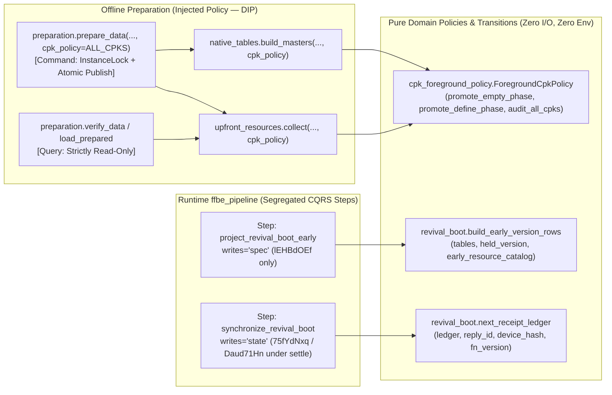

# iOS Foreground CPK Download & Early Catalog — SOLID / CQRS Review Remediation Plan

## 1. Context & Goal

Follow-up remediation plan for the OpenLore code review of the Phase 1–2 uncommitted implementation of [IOS_FOREGROUND_CPK_DOWNLOAD_SOLID_CQRS_PLAN.md](IOS_FOREGROUND_CPK_DOWNLOAD_SOLID_CQRS_PLAN.md).

This plan addresses every correctness defect, SOLID violation, CQRS boundary leak, direct test coverage gap, and working-tree / spec hygiene finding before committing, while keeping 100% backward compatibility for existing callers and manifest schemas 1–6.

---

## 2. Target Architecture (Post-Remediation)



---

## 3. Workstream 1 — Pure Policy Contract & LSP Invariant Fix

**Target**: [source/ios_server/cpk_foreground_policy.py](../source/ios_server/cpk_foreground_policy.py)

1. **Explicit `audit_all_cpks` descriptor field (OCP + LSP)**:
   - Update `ForegroundCpkPolicy`:
     ```python
     @dataclass(frozen=True)
     class ForegroundCpkPolicy:
         name: str
         promote_empty_phase: bool
         promote_define_phase: bool = False
         audit_all_cpks: bool = False
     ```
   - `ALL_CPKS = ForegroundCpkPolicy(name='all-cpks', promote_empty_phase=True, promote_define_phase=False, audit_all_cpks=True)`
   - `LEGACY_MENU_AND_UNITS = ForegroundCpkPolicy(name='legacy-menu-and-units', promote_empty_phase=False, promote_define_phase=False, audit_all_cpks=False)`
   - Remove the unused `LEGACY_UPFRONT` alias.
2. **Consistent `None` / empty phase handling in `target_phase`**:
   - Normalize `upper = str(phase or '').upper()` and check `if upper == '':` instead of `if phase == '':` so `{'81fTkEDP': None}` behaves identically to `{'81fTkEDP': ''}`.
3. **Enforce LSP invariant in `should_audit_upfront`**:
   - Guarantee that **every** `.cpk` row promoted to `'TUTO'` / `'PRE_TUTO'` by `target_phase(row, active)` is audited by `should_audit_upfront(row, active)`:
     ```python
     def should_audit_upfront(row, policy: ForegroundCpkPolicy | None = None, *, exclude_resources=()) -> bool:
         active = ALL_CPKS if policy is None else policy
         if not is_cpk_row(row):
             return False
         if row.get('9ZCEWn0z', '') in exclude_resources:
             return False
         if active.audit_all_cpks:
             return True
         return str(target_phase(row, active) or '').upper() in ('TUTO', 'PRE_TUTO') or is_upfront_pack(row)
     ```
   - Fixes both findings: `ForegroundCpkPolicy(..., promote_empty_phase=False, promote_define_phase=True)` now audits promoted `DEFINE` rows, and `ALL_CPKS`'s full-CPK audit scope is explicit rather than overloaded onto `promote_empty_phase`.

---

## 4. Workstream 2 — Dependency Inversion & SRP Cleanup in Preparation

**Targets**:
- [source/ios_server/native_tables.py](../source/ios_server/native_tables.py)
- [source/ios_server/upfront_resources.py](../source/ios_server/upfront_resources.py)
- [source/ios_server/preparation.py](../source/ios_server/preparation.py)
- [source/ios_server/vortex_art.py](../source/ios_server/vortex_art.py)

1. **Inject `cpk_policy` across preparation boundaries (DIP + OCP)**:
   - Add keyword parameter `cpk_policy=cpk_foreground_policy.ALL_CPKS` (default preserves backward compatibility) to:
     - `native_tables.build_masters(..., cpk_policy=cpk_foreground_policy.ALL_CPKS)` -> calls `cpk_foreground_policy.target_phase(row, cpk_policy)`.
     - `native_tables.build(..., cpk_policy=cpk_foreground_policy.ALL_CPKS)` -> forwards `cpk_policy` to `build_masters`.
     - `upfront_resources.collect(config, sources, *, exclude_resources=(), cpk_policy=cpk_foreground_policy.ALL_CPKS)` -> calls `cpk_foreground_policy.should_audit_upfront(row, cpk_policy, exclude_resources=excluded)`.
     - `preparation._complete_inputs(config, vortex_art=False, sounds=False, *, cpk_policy=cpk_foreground_policy.ALL_CPKS)` and `preparation.prepare_data(..., cpk_policy=cpk_foreground_policy.ALL_CPKS)` -> forward `cpk_policy` to both `upfront_resources.collect` and `rules.build_masters`.
2. **Remove dead re-exports & indirection (SRP)**:
   - In [source/ios_server/native_tables.py](../source/ios_server/native_tables.py), remove unused re-exports (`MENU_PACKS`, `UNIT_ART_PACK`, `UPFRONT_PACKS`, `is_promoted_menu_pack`, `is_upfront_pack`) and import only `EARLY_PACKS` alongside `cpk_foreground_policy`.
   - In [source/ios_server/upfront_resources.py](../source/ios_server/upfront_resources.py), reference `cpk_foreground_policy.EARLY_PACKS` directly instead of `rules.EARLY_PACKS`.
3. **Decouple `vortex_art.validate` schema version from `PIPELINE_VERSION`**:
   - In [source/ios_server/vortex_art.py](../source/ios_server/vortex_art.py), define `MANIFEST_SCHEMA_VERSION = 6` and default `validate(..., schema_version=MANIFEST_SCHEMA_VERSION)` instead of `rules.PIPELINE_VERSION` (`7`).

---

## 5. Workstream 3 — Strict CQRS & ISP Segregation in Boot Receipts & Early Catalog

**Targets**:
- [source/server/revival_boot.py](../source/server/revival_boot.py)
- [source/server/ffbe_pipeline.py](../source/server/ffbe_pipeline.py)

1. **Segregated Policy & Narrow Identity Extractor (DIP + ISP)**:
   - Add frozen `EarlyCatalogPolicy(early_resource_catalog: bool = True)` and edge resolver `resolve_early_catalog_policy(override=None) -> EarlyCatalogPolicy` reading `EARLY_RESOURCE_CATALOG` and `os.environ.get('FFBE_IOS_EARLY_RESOURCE_CATALOG', '1')` **at the adapter edge**, never inside the pure projection.
   - Narrow `_extract_device_hash(plaintext: str, expected_user_id: str) -> str | None` to accept `expected_user_id` instead of the full `player` object.
2. **Pure Query Side (Read-Only Projection)**:
   - `build_early_version_rows(tables, held_version, *, early_resource_catalog: bool) -> list[dict[str, str]]`:
     - Pure function with zero `os.environ` / `state` / `player` access.
     - Defensively verifies `'version'` is present (`isinstance(entry, dict) and entry.get('version') is not None`) before stringifying.
   - `project_early_versions(spec, prepared, ledger, device_hash, *, early_resource_catalog=None)`:
     - Resolves policy once via `resolve_early_catalog_policy(early_resource_catalog)` and delegates row construction to `build_early_version_rows`.
     - **Non-destructive merge**: if `spec.get('c1qYg84Q')` is already a list, preserve unrelated existing rows and overlay/append the projected table rows by `a4hXTIm0` rather than blindly overwriting `spec['c1qYg84Q']`.
   - `project_for_reply(spec, reply_id, plaintext, state, *, early_resource_catalog=None)`:
     - Dedicated read-only pipeline entry point handling **only** `reply_id == 'lEHBdOEf'`.
3. **Pure State Transition + Explicit Command Side**:
   - `next_receipt_ledger(ledger, reply_id, device_hash, fn_version) -> dict`:
     - Pure transition function with **explicit `elif reply_id == 'Daud71Hn' and updated['pending'].get(device_hash) == fn_version:`** (fixes the wildcard `elif` defect).
     - Enforces the bounded 8-entry eviction policy per bucket (`pending`, `held`).
   - `record_receipt(player, state, reply_id, device_hash, fn_version) -> bool`:
     - Delegates transition to `next_receipt_ledger`, mutates `player.data[LEDGER]` and `player.dirty` only for `player.mode == 'live'` when the ledger changed, and only sets `state.state_dirty = True` when `state is not None`.
   - `synchronize(spec, reply_id, plaintext, state, path, persist)`:
     - Scoped exclusively to command replies `('75fYdNxq', 'Daud71Hn')`; returns `spec` untouched for `lEHBdOEf` or `persist=False`, and executes live receipt writes inside `revival_battle_commands.settle`.
   - Retain `step(spec, reply_id, plaintext, state)` as a thin backward-compatible facade (`lEHBdOEf` -> `project_for_reply`, `75fYdNxq`/`Daud71Hn` -> `_record_for_reply`) so existing tests in [source/exvius/test_ios_update_native.py](../source/exvius/test_ios_update_native.py) remain green.
4. **Pipeline-Level CQRS Registration ([source/server/ffbe_pipeline.py](../source/server/ffbe_pipeline.py))**:
   - Split the mixed `synchronize_revival_boot` step into two explicit CQRS steps:
     - `Step("project_revival_boot_early", lambda c: __import__('revival_boot').project_for_reply(c.spec, c.reply_id, c.plaintext, State), "spec", "c1qYg84Q", "read-only early table projection for returning iOS devices on lEHBdOEf")`
     - `Step("synchronize_revival_boot", lambda c: __import__('revival_boot').synchronize(c.spec, c.reply_id, c.plaintext, State, st.STATE_FILE, st.STATE_PERSIST), "state", "State.player.ios_native_boot", "login/home receipt commands under atomic settle")`
   - Declare explicit `Edge("serve_version_table", "project_revival_boot_early", "c1qYg84Q", "early projection runs after canonical version-table overlay")` alongside existing `Edge("serve_version_table", "synchronize_revival_boot", ...)`.

---

## 6. Workstream 4 — Direct Test Coverage Remediation (TDD / BDD)

**Target**: [source/exvius/test_ios_foreground_cpk_download.py](../source/exvius/test_ios_foreground_cpk_download.py)

1. **Eliminate global monkey-patching in Pipeline 6 -> 7 upgrade test**:
   - Replace `patch.object(policy, 'ALL_CPKS', policy.LEGACY_MENU_AND_UNITS)` with explicit `prep.prepare_data(self.config, vortex_art=True, sounds=True, cpk_policy=policy.LEGACY_MENU_AND_UNITS)`.
2. **Add `cpk_foreground_policy` matrix & invariant tests**:
   - `ForegroundCpkPolicy('define-only', promote_empty_phase=False, promote_define_phase=True, audit_all_cpks=False)` promotes `DEFINE` to `'TUTO'` **and** returns `True` from `should_audit_upfront`.
   - `phase=None` is promoted under `ALL_CPKS` and preserved under `LEGACY_MENU_AND_UNITS`.
   - `should_audit_upfront(..., policy=LEGACY_MENU_AND_UNITS)` excludes movies, monsters, `DEFINE`, and `BACKGROUND` while including `TUTO`, `PRE_TUTO`, `MENU_PACKS`, and `UNIT_ART_PACK`.
3. **Add direct `upfront_resources.collect` unit tests (HIGH-risk coverage gap)**:
   - Call `upfront_resources.collect(config, sources, exclude_resources=('6108101',), cpk_policy=...)` directly covering `PRE_TUTO`, `TUTO`, `DEFINE`, `''`, `BACKGROUND`, `.acb`, missing CPK file, overlay precedence, and Vortex exclusion.
4. **Add direct `revival_boot` CQRS & boundary tests**:
   - `record_receipt` / `next_receipt_ledger`: verify `'lEHBdOEf'` or an unknown `reply_id` after `'75fYdNxq'` never promotes `pending` -> `held`.
   - `project_early_versions`: verify pre-existing unrelated `c1qYg84Q` rows in `spec` are preserved (non-destructive merge) and missing `'version'` keys fail safely without `KeyError`.
   - `synchronize` vs. `project_for_reply`:
     - `synchronize(..., '75fYdNxq', ..., persist=False)` writes nothing and does not invoke `settle`.
     - `synchronize(..., '75fYdNxq', ..., persist=True)` leaves `player.data` untouched when `candidate.save()` fails.
     - `project_for_reply(..., 'lEHBdOEf', ...)` emits early catalog rows without calling `settle` or mutating `player.data` / `dirty`.
   - `ffbe_pipeline.validate_pipeline() == []` with both segregated steps registered.

---

## 7. Workstream 5 — Hygiene, Specs & Verification Gate

1. **Working-tree hygiene**:
   - Keep the unrelated [docs/journals/bolt.md](../docs/journals/bolt.md) entry untouched by this remediation so it can be stashed or committed separately.
2. **OpenSpec alignment**:
   - Update implementation anchors in [openspec/specs/ios-server/spec.md](../openspec/specs/ios-server/spec.md) (`audit_all_cpks`, `build_early_version_rows`, `next_receipt_ledger`, `project_for_reply`).
   - Add a brief cross-reference anchor in [openspec/specs/server/spec.md](../openspec/specs/server/spec.md) referencing `revival_boot.py` / `ios-server/spec.md` to clear OpenLore spec drift.
3. **Verification gate**:
   ```bash
   .venv-ios/bin/python -B -m unittest discover -s source/exvius -p "test_ios_foreground_cpk_download.py" \
   && .venv-ios/bin/python -B -m unittest discover -s source/exvius -p "test_ios_update_native.py" \
   && .venv-ios/bin/python -B -m unittest discover -s source/exvius -p "test_ios_incremental_versioning.py" \
   && .venv-ios/bin/python -B -m unittest discover -s source/exvius -p "test_ios_preparation.py" \
   && .venv-ios/bin/python -B -m unittest discover -s source/exvius -p "test_pipeline_isolated.py"
   ```
   Re-run OpenLore `blast_radius` after edits to verify zero uncovered HIGH-risk symbols and zero spec drift.
