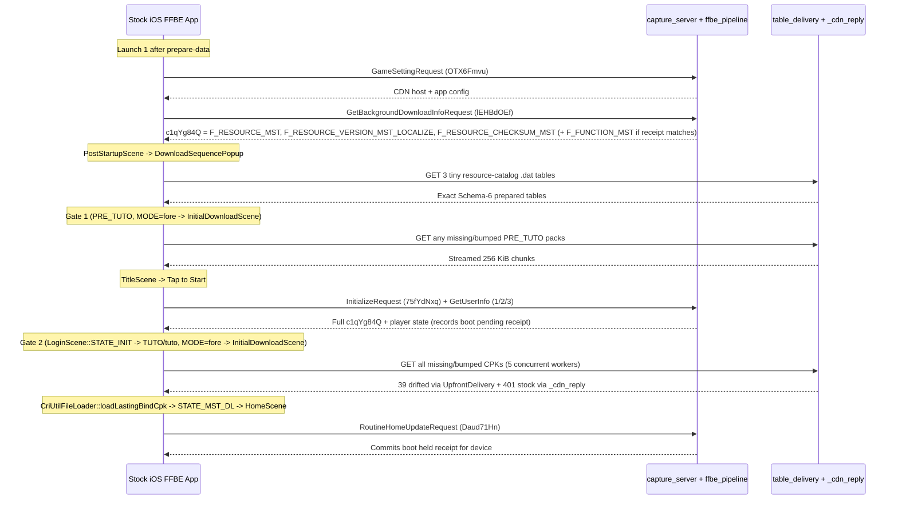
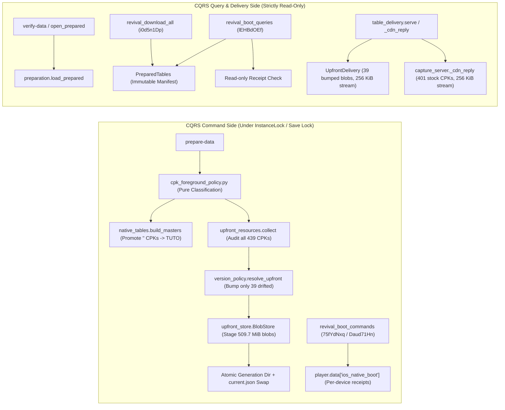

# iOS Foreground CPK Download & Download-All — SOLID / CQRS Plan

## 1. Problem Statement & Confirmed Requirements

Physical iPhone diagnostic reports (`report-99c095bf8d4e45c1a59ec64b79f9408a.json`, lines 5061–5179) and the November 18 Vortex investigation ([docs/reviews/2026-11-18-ios-vortex-crash.md](../docs/reviews/2026-11-18-ios-vortex-crash.md)) establish the exact stock iOS download state machine and **two distinct reasons** CPK files currently leak into background downloads (`MODE=bg`) on `HomeScene` instead of keeping the player on the blocking `InitialDownloadScene` progress screen:

1. **Background CPK classification (`F_RESOURCE_MST.81fTkEDP == ''`)**:
   - In `source/out/browser-data`, `F_RESOURCE_MST` contains **440 versioned `.cpk` packs** totaling **5,091.9 MiB** (`missing = 0`):
     - `PRE_TUTO`: 4 packs
     - `TUTO`: 25 packs
     - `tuto`: 26 packs
     - `DEFINE`: 3 small banner packs (`banner2_common.cpk`, `banner_home1.cpk`, `banner2.cpk`, ~2.9 MiB)
     - `''` (empty / background): **382 packs**
   - Currently, only `EARLY_PACKS` (2), `MENU_PACKS` (3), `spdungeon1.cpk` (1 via `vortex_art`), and `UNIT_ART_PACK` (33) are promoted to `'TUTO'`. The remaining **349** empty-phase packs (`monster*`, `battlebg*`, `area*`, `beast*`, `item*`, `visioncard*`, `LBMovie*`, `mapEffect*`, `town*`, `event/SP4*`, etc.) remain `''`.
   - Stock iOS **never** checks `''`-phase CPKs during `PostStartupScene` (`PRE_TUTO`) or `LoginScene::STATE_INIT` (`TUTO`/`tuto`). They only start downloading in `LoginScene::STATE_BACKGROUND_DOWNLOAD` (`MODE=bg`) after `HomeScene` opens.
   - Additionally, auditing all 440 CPKs reveals **39 drifted CPKs (`size != advertised`, 509.7 MiB total)** across `unit` (16), `monster` (11), `beast` (2), `item` (2), `battleEffect` (2), `event/SP4` (2), `visioncard` (2), `effectResource` (1), and `resources` (1) — 16 more drifted packs than the 23 currently covered by upfront reconciliation.
2. **Launch-1 resource-catalog ordering gap (`lEHBdOEf` vs. `LoginScene::STATE_MST_DL`)**:
   - Stock iOS already has two blocking foreground download gates (`BackgroundDownloader ... MODE=fore` -> `DownloadSequencePopup` -> `DlcConfirmScene` -> `InitialDownloadScene` -> `CriUtilFileLoader::loadLastingBindCpk`):
     - **Gate 1 (`PostStartupScene`, before `TitleScene`)**: calls `GetBackgroundDownloadInfoRequest` (`lEHBdOEf`), runs `DownloadSequencePopup` #1 on whatever tables `lEHBdOEf.c1qYg84Q` advertises, then checks all **`PRE_TUTO`** rows in the currently loaded resource tables.
     - **Gate 2 (`LoginScene::STATE_INIT`, after tapping `TitleScene`, before `STATE_MST_DL` and `HomeScene`)**: checks all **`TUTO` / `tuto`** rows in the **currently loaded** resource tables.
   - Today, [source/server/revival_boot.py](../source/server/revival_boot.py) only attaches `F_FUNCTION_MST` on `lEHBdOEf`, and only when a returning device's receipt matches the exact current `F_FUNCTION_MST` version.
   - Therefore, on **Launch 1** after publishing a new prepared generation (`prepare-data`), `lEHBdOEf` advertises **no** updates for `F_RESOURCE_MST`, `F_RESOURCE_VERSION_MST_LOCALIZE`, or `F_RESOURCE_CHECKSUM_MST`. Both Gate 1 and Gate 2 evaluate stale cached tables, see zero missing/updated CPKs, skip `InitialDownloadScene`, and only discover the new CPKs after `STATE_MST_DL` inside `STATE_BACKGROUND_DOWNLOAD` (`MODE=bg` on `HomeScene`). Only a cold restart (**Launch 2**) hits `InitialDownloadScene`.
3. **Unauthored manual "Download All" endpoint (`ResourceAllDownloadRequest` / `i0d5n1Dp`)**:
   - [source/server/endpoints.json](../source/server/endpoints.json) maps `ResourceAllDownloadRequest` to `request_id = "i0d5n1Dp"`, `encode_key = "fL07ojUc"`, `url = "/actionSymbol/Vtx9kFg0.php"`.
   - [source/server/responses.json](../source/server/responses.json) has no entry for `i0d5n1Dp`, so [source/server/capture_server.py](../source/server/capture_server.py) returns an empty encrypted body (`reply:EMPTY`).

### Confirmed Decisions

1. **Target CPK scope**: Force **every versioned CPK in `F_RESOURCE_MST` including movies** (all 440 CPKs, ~5,091.9 MiB total) to download on the blocking foreground download screen.
2. **Allowed change surface**: **Server-only** (stock unpatched iOS FFBE app — all changes remain strictly inside `source/ios_server/` and `source/server/`).
3. **Foreground gate timing**: **Keep both native foreground gates on Launch 1** (`PRE_TUTO` before `TitleScene` in `PostStartupScene`, and `TUTO` right after `TitleScene` in `LoginScene::STATE_INIT`, before `HomeScene`).
4. **Protocol scope**: Cover **all CPK files** (plus the 3 tiny resource-catalog tables needed to discover them before `InitialDownloadScene`) **and** design an authored, read-only **`ResourceAllDownloadRequest` (`i0d5n1Dp`)** handler gated by wire-contract verification.

### Explicit Scope Boundaries (Server-Only Reality)

- **Non-startup `mst/*.dat` master tables**: As documented in [docs/reviews/2026-11-18-ios-vortex-crash.md](../docs/reviews/2026-11-18-ios-vortex-crash.md#L56-L64), `DownloadSequencePopup::requestMstDownload` downloads only the client's hardcoded startup master subset in the foreground; remaining `mst/*.dat` tables run in `LoginScene::procStateBackgroundDownload` (`MODE=bg`). Under Schema-6 content-preserving versioning ([plans/IOS_INCREMENTAL_VERSIONING_SOLID_CQRS_PLAN.md](IOS_INCREMENTAL_VERSIONING_SOLID_CQRS_PLAN.md)), routine updates only re-version the 1–3 tables that actually changed (<1 MB), keeping background master installs sub-second while this plan eliminates the multi-gigabyte background CPK queue entirely.
- **BGM `.acb` sound tracks**: Core `PRE_TUTO`/`TUTO`/`tuto` `.acb` tracks already block in `InitialDownloadScene`; the 69 `class='sound/bgm'` tracks remain out of scope per confirmed decision #4.

---

## 2. Target Launch-1 Native State Machine



---

## 3. Architecture Overview (CQRS + SOLID)



### CQRS Boundary

- **Command Side (Explicit Writes Only)**:
  - `prepare-data` (under `InstanceLock(config.root)`): classifies all versioned CPKs via a pure policy, promotes eligible background CPKs to `'TUTO'` in `F_RESOURCE_MST`, audits all 439 non-Vortex CPKs for size/SHA-256 drift, stages only bumped drifted blobs (`509.7 MiB`) into `assets/upfront/blobs/<sha256>.cpk`, and atomically swaps `assets/tables/current.json`.
  - `revival_boot.synchronize` on `75fYdNxq` (`InitializeRequest`) and `Daud71Hn` (`RoutineHomeUpdateRequest`) under `revival_battle_commands.settle`: records bounded hashed per-device boot receipts (`pending` -> `held`) in `player.data['ios_native_boot']`.
- **Query & Projection Side (Strictly Read-Only, Zero Persistence)**:
  - `verify-data`, `load_prepared`, `open_prepared`: zero disk writes, zero locks; validate schema-6 manifests, foreground policy provenance, and pinned blob integrity.
  - `lEHBdOEf` early-catalog projection (`revival_boot.project_early_versions`): strictly read-only projection of `PreparedTables.manifest['tables']` + read-only inspection of `player.data['ios_native_boot']`. Never mutates `player.data`, `dirty`, or `state_dirty`.
  - `i0d5n1Dp` Download-All query (`revival_download_all.project`): strictly read-only projection from `PreparedTables` + prepared `F_RESOURCE_*` catalog. Never mutates player state or shared CDN files.
  - HTTP delivery (`table_delivery.serve` + `capture_server._cdn_reply`): strictly read-only streaming in 256 KiB chunks with `O_NOFOLLOW` containment and zero whole-CPK RAM retention.

### SOLID Mapping

| Principle | Concrete Design |
|---|---|
| **Single Responsibility (S)** | `ios_server/cpk_foreground_policy.py` owns pure CPK foreground classification rules (which `F_RESOURCE_MST` rows are promoted/audited and how `DEFINE` is handled); `server/revival_boot.py` splits cleanly into read-only early-version projection (`project_early_versions`) vs. command-side receipt transitions (`record_receipt`); `server/revival_download_all.py` exclusively owns the `i0d5n1Dp` read-only projection. |
| **Open/Closed (O)** | Foreground promotion policies (`ALL_CPKS`, `LEGACY_MENU_AND_UNITS`) are modeled as explicit frozen policy descriptors in `cpk_foreground_policy.py` rather than ad-hoc regexes scattered across `native_tables.py` and `upfront_resources.py`. Schema-6 manifest structure stays closed to structural breakage while `PIPELINE_VERSION = 7` marks policy evolution. |
| **Liskov Substitution (L)** | All 439 upfront-audited CPKs obey the exact same `UpfrontBlobReader` / `UpfrontDelivery` (for the 39 drifted packs) and stock `_cdn_reply` (for the 401 unmodified packs) streaming contracts: bounded 256 KiB chunks, single-FD `fstat`/verification, `Connection: close`, 404 for superseded bumped versions, 500 for corrupt blobs. |
| **Interface Segregation (I)** | `revival_boot` separates `EarlyVersionReader` (takes read-only `(prepared_tables, held_devices, policy)` and returns `c1qYg84Q` rows) from `BootReceiptWriter` (updates `pending`/`held` only on `75fYdNxq`/`Daud71Hn`). `revival_download_all` depends only on a narrow read-only `PreparedCatalogView` protocol (`tables`, `resource_rows`), never on `PlayerState` writers or filesystem handles. |
| **Dependency Inversion (D)** | `native_tables.py`, `upfront_resources.py`, `revival_boot.py`, and `revival_download_all.py` depend on pure frozen policy/catalog dataclasses and narrow protocols, enabling 100% deterministic offline TDD/BDD tests with synthetic fixtures and zero network/device dependencies. |

---

## 4. Detailed Component Design

### Component A: Pure CPK Foreground Classification (`source/ios_server/cpk_foreground_policy.py`)

Replaces duplicated pack-matching logic in `native_tables.py` (`EARLY_PACKS`, `MENU_PACKS`, `UNIT_ART_PACK`, `is_promoted_menu_pack`, `is_upfront_pack`) and `upfront_resources.py`.

#### Policy Contract

- Frozen dataclass `ForegroundCpkPolicy(name: str, promote_empty_phase: bool, promote_define_phase: bool = False)`
  - Default active policy: `ALL_CPKS = ForegroundCpkPolicy(name='all-cpks', promote_empty_phase=True, promote_define_phase=False)`
- Pure functions (zero I/O, zero engine imports):
  1. `is_cpk_row(row) -> bool`: `isinstance(name, str) and name.endswith('.cpk')`
  2. `target_phase(row, policy=ALL_CPKS) -> str`:
     - Non-CPK rows (`.acb` sounds): return original `row.get('81fTkEDP', '')` untouched.
     - Existing foreground phases (`upper in ('PRE_TUTO', 'TUTO')`): preserve verbatim (`'PRE_TUTO'`, `'TUTO'`, `'tuto'`).
     - Empty phase `''`: return `'TUTO'` when `policy.promote_empty_phase` is `True` (promotes all **382** `''` `.cpk` rows — units, monsters, battleBg, areas, beasts, visioncards, items, LBMovie, beastMovie, etc. — into Gate 2 `LoginScene::STATE_INIT`).
     - `'DEFINE'` phase (3 rows: `116002 banner2_common.cpk`, `116501 banner_home1.cpk`, `9400512 banner2.cpk`, ~2.9 MiB total, 0 drifted):
       - **Preserved as `'DEFINE'`** by default (`promote_define_phase=False`) so we do not break any native client lookup that filters banner CPKs by the literal `'DEFINE'` phase tag.
       - If physical-device logs show any of these 3 banner packs downloading in `MODE=bg`, flipping `promote_define_phase=True` promotes them cleanly without changing module structure.
  3. `should_audit_upfront(row, policy=ALL_CPKS) -> bool`:
     - Returns `True` for **every** versioned `.cpk` row (including `PRE_TUTO`, `TUTO`, `tuto`, `DEFINE`, and promoted `''` rows), excluding `vortex_art.RESOURCE_ID` (`'6108101'`) when `--vortex-art` is active.
     - Guarantees all **439** non-Vortex CPKs (and **440** total with `spdungeon1.cpk`) have exact `F_RESOURCE_CHECKSUM_MST` byte sizes and automatic version-bumping for all **39 drifted CPKs** (`509.7 MiB`).

#### Preparation & Versioning Impact (Measured on `source/out/browser-data`)

- **Manifest compatibility**: Keep manifest schema `version = 6` unchanged; bump `native_tables.PIPELINE_VERSION = 7`.
- **Fingerprint & freshness invariant**: `sources['upfront']` naturally expands from 93 files to 439 files (`missing: []`, `corrected: 38` non-Vortex + `1` Vortex = `39` total), changing `fingerprint` cleanly from current inputs alone (no prior-generation dependency in `fingerprint`, `sources`, or `preparation`).
- **Incremental transition from current generation**:
  - ~361/364 master/text tables: **reused** (unchanged bytes keep existing versions).
  - 735/735 sound banks: **reused** (0 bytes re-downloaded).
  - `spdungeon1.cpk` (253 MiB): **reused** (0 bytes re-downloaded).
  - 23 previously bumped upfront CPKs: **reused** (blobs already in `assets/upfront/blobs/`).
  - Only `F_RESOURCE_MST`, `F_RESOURCE_VERSION_MST_LOCALIZE`, `F_RESOURCE_CHECKSUM_MST`, and the **16 newly discovered drifted CPKs** receive new managed versions!
  - Host disk cost for `assets/upfront/blobs/`: **509.7 MiB** total (39 drifted blobs); the 401 unmodified stock CPKs (4.58 GiB) are **not** duplicated.
  - Measured full SHA-256 verification time for all 440 CPKs (5,091.9 MiB): **~2.3s** on Apple Silicon SSD (`stat` alone: 0.04s). Keeping full SHA-256 hashing preserves 100% cryptographic freshness guarantees in `prepare-data`, `verify-data`, and `open_prepared` without introducing stale-mtime cache bugs.

---

### Component B: Launch-1 Early Resource-Catalog Projection (`source/server/revival_boot.py`)

Solves Root Cause 2 so that **Launch 1** after `prepare-data` immediately enters `InitialDownloadScene` (`MODE=fore`) for `PRE_TUTO` (Gate 1) and `TUTO` (Gate 2) instead of leaking to `HomeScene` (`MODE=bg`) until Launch 2.

#### Why Existing `revival_boot.py` Alone Is Insufficient

Currently [source/server/revival_boot.py](../source/server/revival_boot.py) tracks `TABLE = 'F_FUNCTION_MST'` and only emits `c1qYg84Q` on `lEHBdOEf` when:
```python
(ledger.get('held') or {}).get(device) == version
```
When a new generation changes `F_RESOURCE_MST`, `F_RESOURCE_VERSION_MST_LOCALIZE`, or `F_RESOURCE_CHECKSUM_MST`:
- Those three tables are **never** emitted on `lEHBdOEf` at all.
- Even if `F_FUNCTION_MST` also changed, `(ledger['held'][device] == version)` becomes `False`, suppressing `lEHBdOEf` until Launch 2.

#### Segregated Command / Query Design

1. **Constants & Policy**:
   - `FUNCTION_TABLE = 'F_FUNCTION_MST'` (existing receipt-matched table).
   - `RESOURCE_CATALOG_TABLES = ('F_RESOURCE_MST', 'F_RESOURCE_VERSION_MST_LOCALIZE', 'F_RESOURCE_CHECKSUM_MST')`.
   - Explicit rollback/feature toggle `EARLY_RESOURCE_CATALOG` (default `True` once Phase-1 physical-iPhone check passes; configurable via `FFBE_IOS_EARLY_RESOURCE_CATALOG=0` for instant zero-code rollback if device testing reveals an issue).
2. **Command-side receipt writer (`record_receipt`)** — runs ONLY on `75fYdNxq` (`InitializeRequest`) and `Daud71Hn` (`RoutineHomeUpdateRequest`) when `player.mode == 'live'` and `persist=True` (via `revival_battle_commands.settle`):
   - Preserves the exact bounded per-device SHA-256 ledger (`max 8` devices per `pending`/`held` map) in `player.data['ios_native_boot']`.
   - **No breaking save-schema migration**: `held[device]` continues storing the last completed `F_FUNCTION_MST` version string, which already proves the device is a **returning, initialized iOS device** that has completed at least one `Initialize -> Home` lifecycle!
3. **Query-side early projection (`project_early_versions`)** — runs ONLY on `lEHBdOEf` (`GetBackgroundDownloadInfoRequest`), strictly read-only:
   - Requires valid non-empty `device` (`<= 512` chars) and matching `user == str(player.data['identity']['user_id'])` (never fires for `user in ('', '0')` or another campaign).
   - Checks `held_version = (ledger.get('held') or {}).get(device_hash)`.
   - **Brand-new / uninitialized device (`held_version is None`)**: emits **nothing** on `lEHBdOEf` (preserves safe cold-install `InitializeRequest` bootstrap; a brand-new install already runs full initial download after `75fYdNxq`).
   - **Returning initialized device (`held_version is not None`)**:
     - Builds deterministic `rows = []`:
       1. If `held_version == str(tables['F_FUNCTION_MST']['version'])`: append `{'a4hXTIm0': 'F_FUNCTION_MST', 'wM9AfX6I': fn_version}` (preserves `RecordNativeBootstrapAndCarryFacts` **100% verbatim**!).
       2. If `EARLY_RESOURCE_CATALOG` is enabled and all 3 `RESOURCE_CATALOG_TABLES` exist in `prepared.manifest['tables']`: append `{'a4hXTIm0': name, 'wM9AfX6I': str(tables[name]['version'])}` for each of the 3 tables — **regardless of whether their versions advanced since the last boot**!
     - If `rows` is non-empty, returns `{**spec, 'c1qYg84Q': rows}` (shallow-copying `spec`, never mutating `responses.json` or `player.data`).
   - **Why this is safe against `MST_LOAD_FAILED`**:
     - `lEHBdOEf` only advertises up to 4 verified, prepared tables (all present in `PreparedTables.files` with exact SHA-256/MD5/size).
     - `F_RESOURCE_MST`, `F_RESOURCE_VERSION_MST_LOCALIZE`, and `F_RESOURCE_CHECKSUM_MST` are small (~300 KB combined) and independent of `F_LOCALIZED_TEXT_MST`.
     - **Important Physical-Device Verification Gate**: Because stock iOS `PostStartupScene`'s `DownloadSequencePopup` #1 has been observed on-device receiving `F_FUNCTION_MST` (same-version) and running `PRE_TUTO`, we **must** confirm on the physical iPhone that `PostStartupScene` actually downloads and reloads updated `F_RESOURCE_*` versions from `lEHBdOEf.c1qYg84Q` *before* checking `PRE_TUTO` / `LoginScene::STATE_INIT` without triggering `MST_LOAD_FAILED`. If `PostStartupScene` only reads `o5sRL2Sa` (`AllResourceVersionMstResponse`) or defers `c1qYg84Q` reload until `STATE_MST_DL`, the `EARLY_RESOURCE_CATALOG` toggle allows instant isolation while `AllResourceVersionMstResponse` (`o5sRL2Sa`) is evaluated.

---

### Component C: Authored `ResourceAllDownloadRequest` (`i0d5n1Dp`) — `source/server/revival_download_all.py`

Provides an explicit, read-only server response for the in-game "Download All" / "Re-Download Data" flow (`/actionSymbol/Vtx9kFg0.php`, `request_id = "i0d5n1Dp"`, `encode_key = "fL07ojUc"`).

#### Known Verified Wire Facts vs. Required Phase-0 Contract Gate

- **Verified from workspace**:
  - [source/server/endpoints.json](../source/server/endpoints.json#L788-L793): `ResourceAllDownloadRequest` -> `request_id: "i0d5n1Dp"`, `encode_key: "fL07ojUc"`, `url: "/actionSymbol/Vtx9kFg0.php"`.
  - [source/docs/analysis/unhandled_request_fields.json](../source/docs/analysis/unhandled_request_fields.json#L2890-L2897): `ResourceAllDownloadRequest::createBody` emits **zero custom body tokens** (`tokens: [], calls: [], params: []`).
  - [source/docs/reference/tbmonkey_api_calls/response_tag_map.json](../source/docs/reference/tbmonkey_api_calls/response_tag_map.json):
    - `o5sRL2Sa` -> `AllResourceVersionMstResponse` (currently sent as empty `[]` on `lEHBdOEf` in `responses.json`)
    - `Y6j0NJho` -> `ResourceVersionMstResponse`
    - `c1qYg84Q` -> `VersionInfoResponse`
- **Unverified (Phase-0 Gate — DO NOT GUESS)**:
  - The exact response group tag(s) and field tokens read by `ResourceAllDownloadRequest`'s callback and `AllResourceVersionMstResponse::readParam` in the client binary are **not yet recorded** in `source/docs/analysis/`.
  - Per [docs/reviews/2026-11-18-ios-vortex-crash.md](../docs/reviews/2026-11-18-ios-vortex-crash.md#L62-L64), we MUST NOT ship fabricated wire tokens for `i0d5n1Dp`.

#### Phase-0 Wire-Contract Verification Procedure (Before Coding `revival_download_all.py`)

1. Inspect the client contract for `ResourceAllDownloadRequest`, `DownloadSequencePopup::requestFullDownload`, and `AllResourceVersionMstResponse::readParam` (`o5sRL2Sa`) via either:
   - Disassembly of the reference `libgame.so` (if mounted externally) to extract exact `readParam` group tags and field tokens, **and/or**
   - Live physical-iPhone trigger (Options -> "Download Data" / Title -> "Re-Download Data") while `OUT_REQUESTS` and opt-in client reports (`report-*.json`) capture the exact incoming `i0d5n1Dp` plaintext and the client's response-parser behavior against a minimal `{}` vs. `c1qYg84Q` vs. `o5sRL2Sa` probe.
2. Record the verified wire schema in a new analysis note (`source/docs/analysis/resource_all_download_contract.md`) before enabling production rows.

#### CQRS / SOLID Module Structure (`source/server/revival_download_all.py`)

Once Phase 0 locks the exact wire schema:
- **Pure Catalog Projection**:
  - `REQUEST_ID = 'i0d5n1Dp'`
  - `project(spec, reply_id, state) -> dict | None`:
    - Guards: returns `spec` untouched unless `current_profile().name == 'ios-revival'` and `reply_id == REQUEST_ID` and `getattr(state, 'native_tables', None) is not None`.
    - Reads **only** from the already-verified immutable `PreparedTables` snapshot in memory (`state.native_tables.manifest['tables']`, and if `o5sRL2Sa` requires per-resource rows, a pre-validated frozen resource summary built once during `load_prepared` — zero disk reads per HTTP request!).
    - Projects the verified response group(s) (e.g., `c1qYg84Q` version rows and/or `o5sRL2Sa` rows derived strictly from the prepared `F_RESOURCE_MST` / `F_RESOURCE_VERSION_MST_LOCALIZE` / `F_RESOURCE_CHECKSUM_MST` bytes, never hand-hardcoded versions).
    - Strictly read-only: zero player state writes, zero save mutations, zero CDN writes.
- **Pipeline Registration ([source/server/ffbe_pipeline.py](../source/server/ffbe_pipeline.py))**:
  - Add a dedicated `"spec"` step `serve_revival_download_all` directly before `serve_version_table` (or after `serve_version_table` if `i0d5n1Dp` builds `c1qYg84Q` so `prepared.project_versions` stays the single authority for `c1qYg84Q`!).
  - Add an explicit `Edge` in `PIPELINE_EDGES` documenting the ordering invariant so `test_pipeline` / pipeline graph checks validate it automatically.
  - Because [source/server/capture_server.py](../source/server/capture_server.py#L400-L406) already supports transform-served endpoints without requiring a static `responses.json` blob, legacy Android/browser profiles (`current_profile().name != 'ios-revival'`) remain 100% unchanged!

---

## 5. Streaming, Concurrency & Stability Analysis (5.09 GiB Foreground Pass)

Verified directly from [source/ios_server/table_delivery.py](../source/ios_server/table_delivery.py), [source/ios_server/upfront_store.py](../source/ios_server/upfront_store.py), and [source/server/capture_server.py](../source/server/capture_server.py#L629-L669):

1. **Concurrent download workers**: Physical iPhone logs (`report-99c095bf`, lines 5082–5087 and 5152–5157) prove `sgCriFsWebInstaller` opens **5 parallel HTTP connections** during `InitialDownloadScene`.
2. **Bounded memory**:
   - **39 bumped drifted CPKs (509.7 MiB)**: served by `UpfrontDelivery.open_verified`, which verifies on a single `O_NOFOLLOW` descriptor and streams in **256 KiB** chunks (`Connection: close`, `Cache-Control: no-store`).
   - **401 unmodified stock CPKs (4.58 GiB)**: fall through `table_delivery.serve` to `capture_server._cdn_reply`, which opens a single descriptor, reads `os.fstat(fd).st_size`, and streams in **256 KiB** chunks (`Connection: close`).
   - Peak server RAM across 5 simultaneous 100+ MiB movie CPK downloads stays under **~2 MiB** of I/O buffers.
3. **One-time download guarantee**:
   - Under Schema 6 (`version_policy.py`), once the iPhone completes the ~5.09 GiB foreground download, every subsequent `prepare-data` run carries forward all unchanged stock and managed versions — **zero repeated 5 GiB downloads** on routine updates!
4. **Device operational guidance (for first-time ~5 GiB download)**:
   - Keep the iPhone on Wi-Fi with Auto-Lock prevented (or keep FFBE active in foreground) during the initial ~1–3 minute LAN transfer. If interrupted mid-download, `InitialDownloadScene` resumes cleanly on relaunch because `CriFileSystem::installFile` persists each completed CPK incrementally (`part=k/N`).

---

## 6. Planned Modules & File Changes

### New Modules

1. **[source/ios_server/cpk_foreground_policy.py](../source/ios_server/cpk_foreground_policy.py)**
   - Pure frozen `ForegroundCpkPolicy` (`ALL_CPKS`, `LEGACY_UPFRONT`), `is_cpk_row`, `target_phase`, `should_audit_upfront`, and `POLICY_VERSION`.
2. **[source/server/revival_download_all.py](../source/server/revival_download_all.py)** *(implemented after Phase-0 wire-contract verification)*
   - Pure read-only `i0d5n1Dp` (`ResourceAllDownloadRequest`) projection from `PreparedTables`.
3. **[source/docs/analysis/resource_all_download_contract.md](../source/docs/analysis/resource_all_download_contract.md)** *(Phase-0 output)*
   - Verified binary/capture evidence for `i0d5n1Dp` / `o5sRL2Sa` response tags and field tokens.

### Modified Modules

4. **[source/ios_server/native_tables.py](../source/ios_server/native_tables.py)**
   - Bump `PIPELINE_VERSION = 7`.
   - Delegate `resource()` phase promotion in `build_masters()` to `cpk_foreground_policy.target_phase(row)` (replacing `is_promoted_menu_pack` / `is_upfront_pack` ad-hoc rules while preserving `EARLY_PACKS` presence validation).
5. **[source/ios_server/upfront_resources.py](../source/ios_server/upfront_resources.py)**
   - Delegate CPK selection in `collect()` to `cpk_foreground_policy.should_audit_upfront(row)` (still excluding `vortex_art.RESOURCE_ID` when `--vortex-art` is enabled).
   - Keep `validate()`, `resolve()`, `project()`, and `verify_manifest()` unchanged for schema 6 (`policy == 2`).
6. **[source/server/revival_boot.py](../source/server/revival_boot.py)**
   - Split cleanly into pure read-only `project_early_versions(spec, prepared, ledger, device_hash, *, early_resource_catalog=...)` and command-side `record_receipt(player, state, reply_id, device_hash, fn_version)`.
   - On `lEHBdOEf` for returning devices (`device_hash in ledger['held']`), advertise `RESOURCE_CATALOG_TABLES` (`F_RESOURCE_MST`, `F_RESOURCE_VERSION_MST_LOCALIZE`, `F_RESOURCE_CHECKSUM_MST`) at their current prepared versions alongside receipt-matched `F_FUNCTION_MST`.
   - Keep `synchronize()` wrapping only `75fYdNxq` and `Daud71Hn` in `revival_battle_commands.settle`.
7. **[source/server/ffbe_pipeline.py](../source/server/ffbe_pipeline.py)** *(after Phase 0)*
   - Wire `serve_revival_download_all` as a read-only `"spec"` step with explicit `PIPELINE_EDGES` entry.

### OpenSpec, ADR & Documentation Updates

8. **[openspec/specs/ios-server/spec.md](../openspec/specs/ios-server/spec.md)**
   - Update `RecordNativeBootstrapAndCarryFacts` and add requirements/scenarios:
     - `PromoteAllVersionedCpksToForegroundDownload`
     - `AdvertiseResourceCatalogEarlyForReturningDevices`
     - `ProjectAuthoritativeResourceAllDownloadCatalog` (after Phase 0)
9. **New ADR: `openspec/decisions/adr-0018-foreground-all-cpk-downloads-and-early-resource-catalog.md`**
   - Document root causes (background `''` phase + Launch-1 `lEHBdOEf` vs. `STATE_MST_DL` ordering gap), decision (promote all 382 `''` CPKs to `TUTO`, preserve 3 `DEFINE` banner CPKs, advertise 3 resource-catalog tables on `lEHBdOEf` for returning devices, author read-only `i0d5n1Dp` after wire verification), disk/hashing tradeoffs (509.7 MiB blobs, ~2.3s verification), and server-only scope limits (`mst/*.dat`).
10. **[source/ios_server/README.md](../source/ios_server/README.md)**
    - Document full-CPK foreground behavior, Launch-1 early resource-catalog projection, `FFBE_IOS_EARLY_RESOURCE_CATALOG` rollback switch, and `ResourceAllDownloadRequest` support.

---

## 7. Phased Rollout & Verification Plan (TDD / BDD + Physical iPhone Gates)

### Implementation Status (2026-11-23)

- **Phase 0 — Deferred**: `libgame.so` is not present locally; `ResourceAllDownloadRequest` (`i0d5n1Dp`) / `AllResourceVersionMstResponse` (`o5sRL2Sa`) wire-contract verification remains deferred pending external binary disassembly or live physical-iPhone capture.
- **Phase 1 — Implemented & Verified Offline**:
  - Added [source/ios_server/cpk_foreground_policy.py](../source/ios_server/cpk_foreground_policy.py) (`ForegroundCpkPolicy`, `ALL_CPKS`, `LEGACY_MENU_AND_UNITS`, `LEGACY_UPFRONT`, `is_cpk_row`, `target_phase`, `should_audit_upfront`).
  - Updated [source/ios_server/native_tables.py](../source/ios_server/native_tables.py) (`PIPELINE_VERSION = 7`, `build_masters` delegates phase promotion to `cpk_foreground_policy.target_phase`).
  - Updated [source/ios_server/upfront_resources.py](../source/ios_server/upfront_resources.py) (`collect` delegates row selection to `cpk_foreground_policy.should_audit_upfront`).
  - Verified read-only against `source/out/browser-data`: `upfront_resources.coverage` reports `{'checked': 439, 'corrected': 39, 'missing': []}` (with Vortex `6108101` excluded).
- **Phase 2 — Implemented & Verified Offline**:
  - Refactored [source/server/revival_boot.py](../source/server/revival_boot.py) into read-only `project_early_versions` (`lEHBdOEf`) and command-side `record_receipt` (`75fYdNxq` / `Daud71Hn`), emitting `F_RESOURCE_MST`, `F_RESOURCE_VERSION_MST_LOCALIZE`, and `F_RESOURCE_CHECKSUM_MST` for returning initialized devices alongside receipt-matched `F_FUNCTION_MST`, with `EARLY_RESOURCE_CATALOG` / `FFBE_IOS_EARLY_RESOURCE_CATALOG=0` rollback toggle.
- **Phase 3 — Deferred (Blocked on Phase 0)**: `revival_download_all.py` and `ffbe_pipeline.py` registration remain deferred until Phase 0 locks the wire contract.
- **Documentation & OpenSpec — Updated for Phases 1–2**:
  - Updated [openspec/specs/ios-server/spec.md](../openspec/specs/ios-server/spec.md) (`PreloadSynchronousSummonDependencies`, `PromoteAllVersionedCpksToForegroundDownload`, `RecordNativeBootstrapAndCarryFacts`, `AdvertiseResourceCatalogEarlyForReturningDevices`, `PreserveUnchangedNativeVersionsAcrossGenerations`).
  - Created [openspec/decisions/adr-0018-foreground-all-cpk-downloads-and-early-resource-catalog.md](../openspec/decisions/adr-0018-foreground-all-cpk-downloads-and-early-resource-catalog.md).
  - Updated [source/ios_server/README.md](../source/ios_server/README.md).
- **Automated Test Verification (2026-11-23)**:
  - `test_ios_foreground_cpk_download.py`: **8/8 OK**
  - `test_ios_update_native.py`: **8/8 OK**
  - `test_ios_incremental_versioning.py`: **12/12 OK**
  - `test_ios_preparation.py`: **22/22 OK**
  - `test_ios_hosting.py`: **18/18 OK**
  - `test_ios_vortex_art.py`: **30/31** (1 pre-existing `engine.py` `--sounds` requirement failure in `test_given_art_engine_when_initialized...`; `108010` fixture updated with `F_RESOURCE_CHECKSUM_MST` row)
  - `test_ios_sound_delivery.py`: **27/28** (1 pre-existing `engine.py` `--vortex-art` requirement failure in `test_given_prepared_engine_when_initialized...`)
  - `test_ios_full_tables.py`: **27/28** (1 pre-existing `engine.py` `--vortex-art --sounds` requirement failure in `test_given_prepared_engine_when_initialized...`)

### Phase 0 — `ResourceAllDownloadRequest` (`i0d5n1Dp`) Wire-Contract Verification (Deferred — Mandatory Before Implementing Component C)

- Verify exact `i0d5n1Dp` response tag(s) (`o5sRL2Sa` / `c1qYg84Q` / `Y6j0NJho` / `{}`) and field schema from client binary inspection and/or captured iPhone `OUT_REQUESTS` + client diagnostic logs.
- Write `source/docs/analysis/resource_all_download_contract.md`. Do **not** guess wire tokens.

### Phase 1 — Pure Policy + Full-CPK Foreground Promotion (Completed)

- **New unit/BDD tests**: [source/exvius/test_ios_foreground_cpk_download.py](../source/exvius/test_ios_foreground_cpk_download.py) — **8/8 passing**.
  - **Classification (`cpk_foreground_policy`)**:
    - Given `F_RESOURCE_MST` rows with phases `PRE_TUTO`, `TUTO`, `tuto`, `DEFINE`, and `''` (including `unit*`, `monster*`, `battlebg*`, `area*`, `LBMovie*`, `beastMovie*`) plus `.acb` sound rows (`sound/bgm`), when `target_phase` runs, then every `''` `.cpk` row becomes `'TUTO'`, `PRE_TUTO`/`TUTO`/`tuto`/`DEFINE` remain unchanged, and `.acb` rows remain unchanged.
    - Given `upfront_resources.collect` with `vortex_art=True`, then every non-Vortex `.cpk` row is audited (`checked` includes movies/areas/monsters/units/etc.), `vortex_art.RESOURCE_ID` (`6108101`) stays exclusively owned by `vortex_art`, and every `size != advertised` CPK is bumped into `upfront_packs` + `assets/upfront/blobs/`.
  - **Incremental carry-forward**:
    - Given a prior schema-6 generation (`PIPELINE_VERSION = 6`), when `prepare-data` runs with `PIPELINE_VERSION = 7` (`ALL_CPKS`), then unchanged tables, sound banks, `spdungeon1.cpk`, and previously bumped upfront CPKs keep their prior `version_generation` (zero re-download), while only `F_RESOURCE_MST`, `F_RESOURCE_VERSION_MST_LOCALIZE`, `F_RESOURCE_CHECKSUM_MST`, and newly discovered drifted CPKs bump.
  - **Existing test updates**:
    - Updated [source/exvius/test_ios_full_tables.py](../source/exvius/test_ios_full_tables.py) (`test_given_background_summon_dependencies_when_prepared_then_preload_exact_packs_and_bind_sizes` and `test_given_background_unit_art_and_movie_packs_when_prepared_then_promote_all_empty_cpks_and_preserve_define_and_sounds`) and [source/exvius/test_ios_vortex_art.py](../source/exvius/test_ios_vortex_art.py) (`inner_icons` checksum row for `108010`).

### Phase 2 — Launch-1 Early Resource-Catalog Projection (`revival_boot.py`) (Completed)

- **New BDD tests in [source/exvius/test_ios_foreground_cpk_download.py](../source/exvius/test_ios_foreground_cpk_download.py) & [source/exvius/test_ios_update_native.py](../source/exvius/test_ios_update_native.py)** — **all passing**.
  - **Fresh / uninitialized device**: on `lEHBdOEf` before any `75fYdNxq` -> `Daud71Hn` receipt, returns `spec` unchanged (zero `c1qYg84Q` rows injected) and writes nothing to `player.data`.
  - **Returning device, same generation**: on `lEHBdOEf` after `75fYdNxq` -> `Daud71Hn`, advertises `F_FUNCTION_MST` + `F_RESOURCE_MST` + `F_RESOURCE_VERSION_MST_LOCALIZE` + `F_RESOURCE_CHECKSUM_MST` with exact prepared versions, without mutating `player.data` or `dirty`.
  - **Returning device, AFTER new generation (`prepare-data`)**: when `F_RESOURCE_*` versions bump (and even if `F_FUNCTION_MST` also bumps), `lEHBdOEf` omits `F_FUNCTION_MST` (preserving `RecordNativeBootstrapAndCarryFacts` receipt match) **and** advertises the new prepared versions of `F_RESOURCE_MST`, `F_RESOURCE_VERSION_MST_LOCALIZE`, and `F_RESOURCE_CHECKSUM_MST` so Launch 1 discovers them before `InitialDownloadScene`.
  - **Rollback toggle (`EARLY_RESOURCE_CATALOG = False` / `FFBE_IOS_EARLY_RESOURCE_CATALOG=0`)**: reverts `lEHBdOEf` to exact legacy `F_FUNCTION_MST`-only behavior.
  - **Non-iOS profile / wrong user / frozen player**: returns `spec` unchanged and writes nothing.

### Phase 3 — Authored `ResourceAllDownloadRequest` (`i0d5n1Dp`) *(Deferred — Post-Phase 0)*

- **New BDD tests in `source/exvius/test_ios_foreground_cpk_download.py`**:
  - Encrypted/pipeline round-trip for `i0d5n1Dp` under `ios-revival` returns verified catalog matching `PreparedTables` without mutating `player.data`, `dirty`, or disk.
  - Non-`ios-revival` profiles leave `i0d5n1Dp` untouched.
  - `ffbe_pipeline` edge validation passes cleanly.

### Phase 4 — Real-Data Dry Run & Physical iPhone Acceptance Gate (Automated Tests + Read-Only Dry Run Done; Live Prepare & Device Gates Pending)

1. **Automated test suite** (via `.venv-ios/bin/python -B`):
   - `test_ios_foreground_cpk_download.py`, `test_ios_update_native.py`, `test_ios_full_tables.py`, `test_ios_incremental_versioning.py`, `test_ios_preparation.py`, `test_ios_vortex_art.py`, `test_ios_sound_delivery.py`, `test_ios_hosting.py`.
2. **Real-data preparation & verification** (`./Refresh Exvius iOS Data.command` or explicit CLI):
   - Read-only check on `source/out/browser-data` confirmed `upfront_resources.coverage`: `checked == 439`, `corrected == 39`, `missing == []` (+ `1` Vortex pack = 440 total CPKs).
   - Live `prepare-data --vortex-art --sounds` + `verify-data` on the Mac runtime root remains to be run prior to physical iPhone testing.
   - Confirm `version_reuse` preserves ~361 tables, 735 sounds, `spdungeon1.cpk`, and prior bumped blobs.
   - Confirm `verify-data` returns `ok: True`.
3. **Physical iPhone acceptance checklist** (verified via server HTTP logs + iPhone `report-*.json`):
   - **Test 1 (Launch-1 foreground blocking)**: After publishing the new generation and launching FFBE once on the iPhone, verify:
     1. `lEHBdOEf` delivers the 3 updated `F_RESOURCE_*` table versions.
     2. `PostStartupScene` downloads the 3 `.dat` tables without `MST_LOAD_FAILED`.
     3. Gate 1 (`PRE_TUTO`) and Gate 2 (`LoginScene::STATE_INIT`, `TUTO`) log `BackgroundDownloader: Download file ... MODE=fore` and stay inside `InitialDownloadScene` until all missing/drifted CPKs complete (`CriFileSystem::installFile END part=N/N`).
     4. `HomeScene` opens with **zero** `MODE=bg` `.cpk` downloads running.
     5. Verify whether the 3 `DEFINE` banner CPKs stay silent or appear in `MODE=bg` (decide whether `promote_define_phase` remains `False` or flips to `True`).
   - **Test 2 (Launch-2 zero re-download)**: Force-close and relaunch FFBE with no new generation -> verify 0 CPK downloads and immediate entry to `HomeScene`.
   - **Test 3 (Subsequent unrelated generation)**: Bump 1 unrelated table and relaunch -> verify 0 CPK re-downloads (Schema-6 carry-forward preserved).
   - **Test 4 (Manual "Download All")**: Trigger `ResourceAllDownloadRequest` (`i0d5n1Dp`) from the client menu -> verify HTTP 200 encrypted response with non-empty verified body, zero connection errors, and clean progress completion.

---

## 8. Risk Register & Mitigations

| Risk | Likelihood | Impact | Mitigation |
|---|---|---|---|
| Stock iOS `PostStartupScene` ignores or fails on `F_RESOURCE_*` in `lEHBdOEf.c1qYg84Q` | Medium | High (`MST_LOAD_FAILED` or Launch-1 miss) | Restrict early injection to returning devices (`device in held`), gate behind `FFBE_IOS_EARLY_RESOURCE_CATALOG` toggle for instant rollback, and verify on physical iPhone before marking accepted. |
| First-time ~5.09 GiB foreground download stalls if iPhone sleeps or Wi-Fi drops | Medium | Low (resumable) | Both `UpfrontDelivery` and `_cdn_reply` stream in 256 KiB chunks with `Connection: close`; `CriFileSystem::installFile` resumes per-CPK on relaunch; Schema-6 versioning guarantees this ~5 GiB download happens once, not per generation. |
| Promoting `DEFINE` banner CPKs could break a native `'DEFINE'` phase filter | Low–Medium | Medium | Default `promote_define_phase=False` preserves the 3 `'DEFINE'` rows while still auditing them; confirm via physical-device log whether they ever leak to `MODE=bg`. |
| Unverified wire format for `ResourceAllDownloadRequest` (`i0d5n1Dp`) | High if guessed | High (client error popup) | Mandatory **Phase 0** binary/capture contract verification gate before writing `revival_download_all.py`; zero fabricated tokens. |
| `verify-data` / `open_prepared` hashing latency across 439 CPKs (5.09 GiB) | Measured (~2.3s) | Low | Measured at ~2.32s on Apple Silicon SSD; keeps full cryptographic freshness validation with zero stale-cache risk. |
