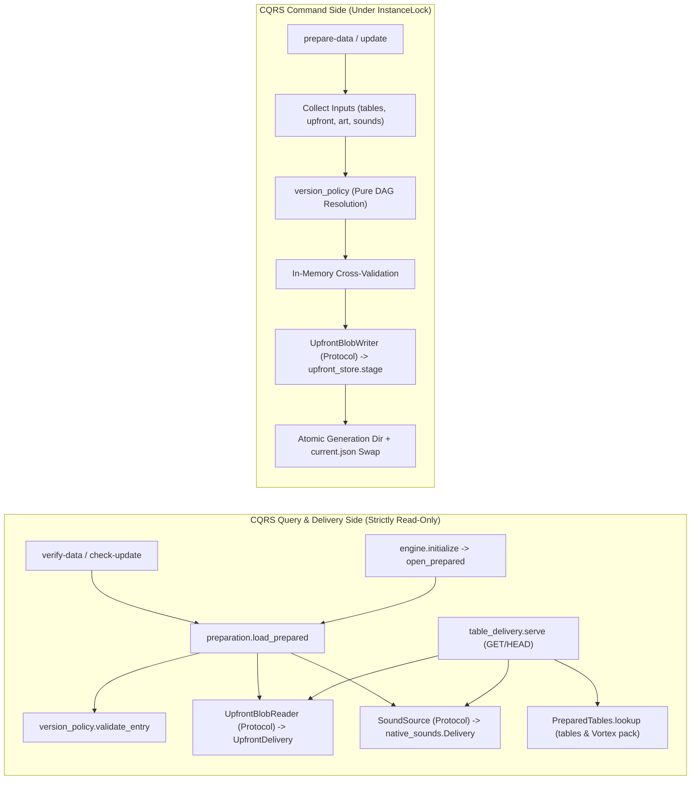
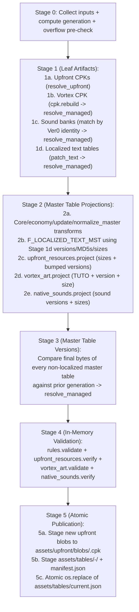

# iOS Content-Preserving Versioning & Upfront CPK Re-Versioning — SOLID / CQRS Plan

## 1. Problem Statement & Confirmed Requirements

Diagnosed in `crash_diagnosis.md` (2026-11-21) after generation 8 was published by the iOS updater:

1. **Unconditional re-versioning (Primary crash trigger)**:
   - `native_tables.build`, `native_sounds.inventory`, and `vortex_art.prepare` unconditionally assign `floor + 200000 + generation * 10000` to **every** table, sound bank, and pack on every generation, and `preparation.load_prepared` / `native_sounds.load` / `vortex_art.load` enforce that exact formula.
   - Moving from generation 7 to generation 8 re-versioned **239 byte-identical tables (138 MB)** and **all 735 byte-identical sound banks (2.2 GB)**, forcing the iPhone to discard its cache and re-download ~2.6 GB in the background.
   - During that background download window, Home icon/master lookups miss and `GateEntryScene` (Vortex) / World map dereference null master rows (`EXC_BAD_ACCESS` at `0x60`/`0x90`).
2. **In-place upfront CPK edits without version bumps (Secondary finding / AP-004)**:
   - Upstream v0.1.35 modified four upfront CPKs (`Ver36_monster3_common.cpk`, `Ver26_item2_common.cpk`, `Ver25_battleEffect4_common.cpk`, `Ver13_effectResource1_common.cpk`) without bumping their native version numbers.
   - Generation 8 updated only `F_RESOURCE_CHECKSUM_MST` (advertised sizes) while keeping the old versions (`36`, `26`, `25`, `13`). An iPhone with cached old bytes may continue using stale data or reject the mismatch.

### Confirmed Decisions

1. **Full scope**: Address both **Issue 1** (content-preserving versioning for tables, sound banks, and Vortex pack) and **Issue 2** (version-bumping for in-place changed upfront CPKs), plus operator visibility (`reused` vs. `bumped` counts in `prepare-data` / `verify-data` reports).
2. **Upfront CPK bump policy**: Publish an upfront CPK under a bumped native version whenever **`size != advertised`** (stock drift against original `F_RESOURCE_CHECKSUM_MST`) **OR** **`sha256 != previous_sha256`** (catches same-size edits and future changes). Once bumped, carry forward that bumped version across future generations while its `sha256` remains identical. This immediately repairs the four v0.1.35 CPKs already recorded in generation 8 on the very next generation (gen 9) without re-downloading them in gen 10+.
3. **Upfront CPK storage & delivery**: Store bumped upfront CPKs in an immutable, **content-addressed private blob store** under `config.root/assets/upfront/blobs/<sha256>.cpk` (streamed copy — never hardlinked into mutable `config.data` — zero duplication across generations), and serve them through a chunk-verified, file-backed `UpfrontDelivery` adapter in [table_delivery.py](../source/ios_server/table_delivery.py) (parallel to `native_sounds.Delivery`). Never mutate `CDN_ROOT`/`CDN_OVERLAY` and never retain upfront CPKs in RAM in `PreparedTables.files`.
4. **Manifest schema & specs**: Introduce **manifest schema version 6** (`PIPELINE_VERSION = 6`) while keeping schemas 1–5 strictly validated and inspectable for backward compatibility, and update [openspec/specs/ios-server/spec.md](../openspec/specs/ios-server/spec.md), [source/ios_server/README.md](../source/ios_server/README.md), and add `openspec/decisions/adr-0017-preserve-unchanged-native-versions-and-reversion-drifted-upfront-cpks.md`.

---

## 2. Architecture Overview (CQRS + SOLID)

The existing `source/ios_server/` package separates read-only queries/delivery from explicit mutating preparation commands. This plan preserves that boundary and introduces a pure versioning policy module and a content-addressed upfront CPK store with segregated read/write contracts.



### CQRS Boundary

- **Query & Delivery Side (`verify-data`, `load_prepared`, `open_prepared`, `check-update`, `table_delivery.serve`)**:
  - Strictly read-only: zero disk writes, zero locks, zero CPK/table rebuilds, zero blob staging, zero engine imports during `verify-data`/`load_prepared`.
  - Validates schema 1–5 manifests with their original strict formulas and validates schema 6 manifests using each artifact's recorded `version_generation`, floor bounds, content digests, and cross-table agreement (`F_LOCALIZED_TEXT_MST`, `F_RESOURCE_*`, `F_RESOURCE_MAP_*`).
  - `UpfrontDelivery` verifies containment (`private_path` + `os.O_NOFOLLOW`) and chunk-hashes the pinned blob on every GET and HEAD request before emitting HTTP 200 headers.
- **Command Side (`prepare-data`)**:
  - Executes exclusively under `InstanceLock(config.root)`.
  - Performs all version resolution, table/pack building, and cross-table validation purely in memory before touching disk.
  - Stages newly-bumped upfront CPK blobs atomically into `assets/upfront/blobs/<sha256>.cpk` (write temp → `fsync` → `os.replace`) **before** staging `assets/tables/<gen>-<fp>/` and atomically replacing `assets/tables/current.json`.
  - Any error before pointer replacement leaves the active generation and `current.json` completely untouched.

### SOLID Mapping

| Principle | Concrete Design in `source/ios_server/` |
|---|---|
| **Single Responsibility (S)** | `version_policy.py` owns pure monotonic version resolution and validation math; `upfront_store.py` owns content-addressed private blob staging and chunk-verified file delivery; `upfront_resources.py` owns upfront CPK input collection and table projection; `preparation.py` orchestrates the 5-stage pipeline and atomic publication. |
| **Open/Closed (O)** | Artifact families (tables, sound banks, Vortex pack, upfront CPKs) plug into the shared `version_policy` resolver via uniform `PriorArtifact` descriptors without duplicating version-bump or overflow rules. Schema 6 validation coexists with frozen schema 1–5 validators without mutating legacy rules. |
| **Liskov Substitution (L)** | `UpfrontDelivery` and `native_sounds.Delivery` uphold the same `AssetDelivery` / `SoundSource` read-only delivery contract: containment check, `O_NOFOLLOW`, per-request SHA-256 verification, 404 for unknown/stale versions in owned namespace, 500 for corrupt/missing bound files, zero fallback to stock CDN. |
| **Interface Segregation (I)** | `UpfrontBlobWriter` (command-side `stage`) is segregated from `UpfrontBlobReader` / `UpfrontDelivery` (query/HTTP-side `owns`, `verified_size`, `open_verified`), so `load_prepared`, `verify_data`, and `table_delivery` never depend on mutating blob storage operations. |
| **Dependency Inversion (D)** | `preparation.py` and `table_delivery.py` depend on narrow `typing.Protocol` abstractions (`UpfrontBlobReader`, `UpfrontBlobWriter`, `SoundSource`) with default concrete implementations, allowing deterministic offline unit and BDD tests with temporary roots and fault injection. |

---

## 3. Pure Version Resolution Policy (`source/ios_server/version_policy.py`)

A new pure domain module with **no filesystem or engine imports**.

### Data Contracts (Frozen Dataclasses)

- `PriorArtifact(version: int, sha256: str, version_generation: int, managed: bool = True)`
  - `managed=True` for tables, sound banks, Vortex pack, and already-bumped upfront CPKs.
  - `managed=False` for unbumped stock upfront CPKs (which still carry their stock `F_RESOURCE_VERSION_MST_LOCALIZE` version).
- `ResolvedVersion(version: int, version_generation: int, reused: bool, managed: bool)`
- `ArtifactDecisionSummary(reused: int, bumped: int, stock: int = 0)`

### Core Rules

1. **Generation advancement (`next_generation`)**:
   - Start at `generation = current.manifest['generation'] + 1` if `current` exists else `1`.
   - For every prior managed artifact whose current `floor` (or `source_version`) could produce a candidate `floor + VERSION_OFFSET + generation * VERSION_STEP <= prior.version`, advance:
     `generation = max(generation, (prior.version - floor - VERSION_OFFSET) // VERSION_STEP + 1)`.
   - **Pre-build overflow guard (`check_bounds`)**: Before running expensive builds (such as `cpk.rebuild` for Vortex art), verify `floor + VERSION_OFFSET + generation * VERSION_STEP <= 2_147_483_647` for every artifact family. Reject overflowing source versions immediately with `ValueError('... version generation is out of range.')`.
2. **Per-artifact resolution (`resolve_managed`)** — used by tables, sound banks, and Vortex pack:
   - Candidate minted version: `candidate = floor + VERSION_OFFSET + generation * VERSION_STEP` (must satisfy `1 <= candidate <= 2_147_483_647`).
   - **Carry forward** `ResolvedVersion(prior.version, prior.version_generation, reused=True, managed=True)` **if and only if**:
     - `prior is not None` and `prior.managed`, AND
     - `output_sha256 == prior.sha256` (exact byte identity), AND
     - `prior.version >= floor` and `prior.version >= VERSION_OFFSET + VERSION_STEP` (protects against a rising `gamedata.xml` floor exceeding a carried version).
   - **Otherwise bump** to `ResolvedVersion(candidate, generation, reused=False, managed=True)`, asserting `prior is None or candidate > prior.version`.
3. **Upfront CPK resolution (`resolve_upfront`)**:
   - Inputs: `source_version`, `size`, `advertised`, `sha256`, `prior: PriorArtifact | None`, `generation`.
   - **Three explicit states**:
     1. **Already bumped & unchanged** (`prior is not None and prior.managed and sha256 == prior.sha256 and prior.version >= source_version`):
        - Carry forward `ResolvedVersion(prior.version, prior.version_generation, reused=True, managed=True)`.
     2. **Needs bump** — ANY of:
        - `size != advertised` (stock drift vs. `F_RESOURCE_CHECKSUM_MST` — immediately catches all 4 gen-8 CPKs on gen 9!), OR
        - `prior is not None and sha256 != prior.sha256` (catches same-size edits and any future byte change!), OR
        - `prior is not None and prior.managed and prior.version < source_version` (source version overtook prior bumped version).
        - Mint `candidate = source_version + VERSION_OFFSET + generation * VERSION_STEP` (assert `candidate <= 2_147_483_647` and `prior is None or candidate > prior.version`). Return `ResolvedVersion(candidate, generation, reused=False, managed=True)`.
     3. **Unmodified stock upfront CPK** (`size == advertised`, never bumped, bytes unchanged or gen 1):
        - Keep stock version `ResolvedVersion(source_version, version_generation=0, reused=True, managed=False)`. Not copied to blob store; continues serving directly from `CDN_ROOT`/`CDN_OVERLAY`.
4. **Schema-6 verification rule (`validate_version`)** — used by `load_prepared`, `vortex_art.load`, `native_sounds.load`, `upfront_resources.verify_manifest`:
   - `type(version) is int` and `1 <= version <= 2_147_483_647`.
   - `type(version_generation) is int` and `1 <= version_generation <= manifest['generation']`.
   - `version >= floor` and `version >= VERSION_OFFSET + VERSION_STEP`.
   - If `version_generation == manifest['generation']`: enforce **exact** `version == floor + VERSION_OFFSET + manifest['generation'] * VERSION_STEP`.
   - If `version_generation < manifest['generation']`: enforce `version >= floor` (allows a carried-forward artifact whose `source_version` changed while its normalized output bytes remained identical) and exact path consistency (`table.path(version)`, `pack_path(version)`, `versioned(source, version)`, or upfront `<locale>/sd/<dir>/Ver<version>_<name>`).

---

## 4. Five-Stage Dependency-Ordered Preparation Pipeline

Because master tables embed the versions and sizes of localized tables, sound banks, Vortex art, and upfront CPKs, deciding whether a master table's bytes changed requires resolving leaf artifacts **before** finalizing dependent master tables:



### Key Behavioral Properties

- **Cascade minimality**:
  - If no localized text tables changed, every localized table keeps its prior version → `F_LOCALIZED_TEXT_MST` bytes are identical → `F_LOCALIZED_TEXT_MST` keeps its prior version too!
  - If no sound banks changed (identical SHA-256s in `sound_snapshots`), all 735 sound banks keep their prior versions → `F_RESOURCE_MAP_*` stays identical → zero sound downloads!
  - If `spdungeon1.cpk` rebuilds to the exact same bytes, it keeps its prior version → zero 253 MB Vortex re-download!
  - If only 1 table (say `F_TOWN_MST`) changes, only `F_TOWN_MST` receives a new `29xxxx` version; the other 363 tables, 735 sound banks, Vortex pack, and upfront CPKs keep their existing versions!
- **Generation 8 → Generation 9 transition (for the active iPhone)**:
  - `current.json` is currently generation 8 (schema 5). Shipping schema 6 / `PIPELINE_VERSION = 6` causes `verify-data` to mark gen 8 stale.
  - Running `prepare-data --vortex-art --sounds` extracts `PriorArtifact` descriptors from gen 8's schema-5 manifest (where `version_generation = 8` for every table, sound bank, and Vortex pack, and `managed = False` for gen 8's upfront CPKs).
  - All 364 tables, 735 sound banks, and `spdungeon1.cpk` whose bytes match gen 8 **keep their gen-8 (`28xxxx`) versions** (strictly monotonic — zero backwards version jumps!).
  - The 4 stock-drifted upfront CPKs (`monster3_common.cpk`, `item2_common.cpk`, `battleEffect4_common.cpk`, `effectResource1_common.cpk`, plus any other `size != advertised` upfront CPKs) are bumped once into `29xxxx` and staged in `assets/upfront/blobs/<sha256>.cpk`.
  - Consequently, only `F_RESOURCE_VERSION_MST_LOCALIZE` (and `F_RESOURCE_CHECKSUM_MST` if any size changed) changes bytes and bumps to `29xxxx`. The iPhone downloads only those bumped upfront CPKs + 1–2 tiny tables instead of ~2.6 GB!
- **Interrupted-publication retry determinism**:
  - If `prepare-data` fails after staging `assets/tables/00000009-<fp>` (or after staging upfront blobs) before replacing `current.json`, `current.json` still points to gen 8.
  - Re-running `prepare-data` reads the exact same `current` (gen 8) and inputs, computes the exact same carried/bumped versions and `manifest.json` bytes, verifies the existing blobs/staged directory match byte-for-byte, and completes the atomic pointer replacement cleanly.
- **Vortex / Upfront ownership isolation**:
  - When `vortex_art` is enabled, `upfront_resources.collect` excludes `vortex_art.RESOURCE_ID` (`6108101`) so `vortex_art` remains the sole owner of `spdungeon1.cpk` in `F_RESOURCE_*` and `table_delivery`.

---

## 5. Content-Addressed Private Upfront CPK Store & Delivery

### New Module: `source/ios_server/upfront_store.py`

Owns immutable private blob storage and read-only HTTP delivery for version-bumped upfront CPKs.

- **Layout**: `<config.root>/assets/upfront/blobs/<sha256>.cpk`
  - Directory mode `0o700`, blob file mode `0o600`.
  - Relative manifest path: `assets/upfront/blobs/<sha256>.cpk` (validated against `r'^assets/upfront/blobs/[a-f0-9]{64}\.cpk$'`).
- **Command-side `UpfrontBlobWriter` (Protocol) / `BlobStore`**:
  - `stage(source_path: Path, expected_sha256: str, expected_size: int) -> str`:
    - Verifies `source_path` is a contained non-symlink regular file (`os.O_RDONLY | os.O_NOFOLLOW` where supported after resolving containment against `config.data`).
    - If target blob `<sha256>.cpk` already exists: re-hashes existing blob in 1 MiB chunks (`O_NOFOLLOW`); if size and SHA-256 match, reuses it with zero disk write; if tampered/corrupt, raises `ValueError('Corrupt private upfront CPK blob')` without overwriting silently.
    - Otherwise streams `source_path` in 1 MiB chunks into a `NamedTemporaryFile` in `blobs/`, hashing while writing, verifies `written == expected_size` and `digest == expected_sha256`, `chmod(0o600)`, `fsync`, and `os.replace` to `<sha256>.cpk`.
    - Never creates hardlinks to `config.data` (protects private immutability from flat-layout in-place updates).
- **Query/Delivery-side `UpfrontBlobReader` (Protocol) / `UpfrontDelivery`**:
  - Frozen dataclass `UpfrontDelivery(root: Path, files: dict[str, dict], owned_identities: frozenset[str])`:
    - `files` maps exact published CDN relative path (e.g., `common_lang/sd/monster/Ver290036_monster3_common.cpk`) → `{'blob': 'assets/upfront/blobs/<sha256>.cpk', 'size': int, 'sha256': str}`.
    - `owned_identities` is the set of unversioned paths (`re.sub(r'^Ver[0-9]+_', 'Ver0_', basename)`) for all bumped upfront CPKs.
  - `owns(relative: str) -> bool`: returns `True` if `unversioned(relative) in self.owned_identities`.
  - `verified_size(relative: str) -> int | None`:
    - Returns `None` if `relative` is not in `self.files` (so `table_delivery.serve` returns **404** for stock/stale versions of bumped CPKs, refusing fallback to `capture_server.py`!).
    - Opens pinned blob via `private_path` + containment check + `os.open(..., os.O_RDONLY | os.O_NOFOLLOW)`.
    - Streams in `256 KiB` chunks (`HEAD_CHUNK`), reading up to `entry['size'] + 1` bytes to detect truncation/growth, verifies exact size and SHA-256, raises `ValueError` on mismatch (translated to HTTP **500** by `table_delivery.serve`).
  - `open_verified(relative: str)`:
    - Context manager that opens the pinned blob once via `O_RDONLY | O_NOFOLLOW`, performs the exact same bounded-chunk SHA-256 verification on that open file descriptor, seeks back to offset `0` on the **same descriptor** (preventing TOCTOU replacement between verification and streaming), and yields `(stream, size)` for chunked writing to `handler.wfile` in `table_delivery.serve` (bounded RAM even for large CPKs!).
  - `verify_all(config, upfront_packs)`:
    - Used by `preparation.load_prepared`: verifies every pinned blob exists, stays contained under `config.root/assets/upfront/blobs/`, is not a symlink, and matches its recorded `size` and `sha256` in bounded chunks (without loading all CPKs into RAM).

### Updates to `source/ios_server/table_delivery.py`

- Accept manifest versions `(3, 4, 5, 6)`.
- Check `snapshot.upfront`:
  ```python
  if snapshot.upfront is not None and snapshot.upfront.owns(relative):
      return _serve_upfront(handler, snapshot.upfront, relative)
  ```
- `_serve_upfront`:
  - `HEAD`: calls `upfront.verified_size(relative)` → 200 with `Content-Length`, 404 if `None`, 500 on `(OSError, ValueError)`.
  - `GET`: calls `upfront.open_verified(relative)` → streams 256 KiB chunks after sending HTTP 200 headers (`Cache-Control: no-store`, `Connection: close`), 404 if `None`, 500 on `(OSError, ValueError)` before headers are sent.
- Unbumped stock upfront CPKs are NOT in `owned_identities`, so `owns()` returns `False` and they continue flowing directly to `capture_server.py` unchanged.

---

## 6. Schema-6 Manifest Specification & Backward Compatibility

### Schema Constants

- `native_tables.PIPELINE_VERSION = 6`
- `preparation.prepare_data` emits `manifest['version'] = 6` (with optional `'packs'`, `'sounds'`, and `'upfront_packs'` sections).
- `preparation.load_prepared` accepts `version in (1, 2, 3, 4, 5, 6)`:
  - **Schemas 1–5**: keep exact existing key sets and strict `version == floor + VERSION_OFFSET + generation * VERSION_STEP` formulas untouched.
  - **Schema 6**:
    - Top-level keys: `{'version', 'scope', 'reference_commit', 'source_root', 'pipeline_version', 'generation', 'fingerprint', 'sources', 'preparation', 'tables'}` plus optional `'packs'`, `'sounds'`, `'upfront_packs'`.
    - `tables[name]`: adds `'version_generation': int` (`1 <= vg <= manifest['generation']`), validated by `version_policy.validate_version`.
    - `packs['spdungeon1.cpk']`: adds `'version_generation': int`, validated by `version_policy.validate_version` in `vortex_art.load`.
    - `sounds['banks'][source]`: adds `'version_generation': int`, validated by `version_policy.validate_version` in `native_sounds.load` (replacing the rigid `binding['banks'] != inventory(snapshot, manifest['generation'])` equality check on schema 6 while preserving exact bank set, `size`, `sha256`, `source_version`, path uniqueness, and `_project(..., verify=True)`!).
    - `upfront_packs` (present whenever at least one upfront CPK is bumped):
      ```json
      {
        "902:JwbkKrjA": {
          "path": "common_lang/sd/monster/Ver290036_monster3_common.cpk",
          "version": 290036,
          "source_version": 36,
          "version_generation": 9,
          "size": 12606984,
          "sha256": "<64-hex>",
          "advertised": 12557338,
          "blob": "assets/upfront/blobs/<64-hex>.cpk"
        }
      }
      ```
    - `sources['upfront']`: extends each `files[key]` entry to also record `'source_version': int` and `'relative': str` (canonical CDN path `<locale>/sd/<dir>/Ver<v>_<name>`, validated with `safe_path`), bump `policy` from `1` to `2` (keeping `policy == 1` valid for schemas 3–5!).
    - `preparation['upfront']` coverage: `{'checked': int, 'corrected': int, 'bumped': int, 'missing': list[str]}` (or keep `bumped` in `describe()` so `preparation` stays purely input-derived — **IMPORTANT**: keep `preparation['upfront']` strictly input-derived `{'checked', 'corrected', 'missing'}` so `verify_data` can recompute `context` from inputs alone without consulting prior generations!).
      > [!IMPORTANT]
      > **Fingerprint & freshness invariant**: `fingerprint`, `sources`, and `preparation` MUST remain 100% pure functions of the *current* inputs (`config` + shared data + campaign policy), never depending on prior generations! That guarantees `verify_data(config)` and `open_prepared(config)` remain strictly stateless, read-only freshness checks. Carry-forward decisions (`version`, `version_generation`, `upfront_packs`) live in the manifest's *output* sections (`tables`, `packs`, `sounds`, `upfront_packs`) and are verified internally by `load_prepared`.

### Operator Diagnostics (`PreparedTables.describe()`)

Extend `PreparedTables.describe()` for schema 6 with non-breaking summary counts:
- `'version_reuse': {'tables': {'reused': N, 'bumped': M}, 'packs': {...}, 'sounds': {...}, 'upfront_packs': {'reused': X, 'bumped': Y}}`
- `'upfront_packs': len(self.manifest.get('upfront_packs', {}))` (when non-empty).

---

## 7. Planned Modules & File Changes

### New Modules in `source/ios_server/`

1. **[source/ios_server/version_policy.py](../source/ios_server/version_policy.py)**
   - Pure version math, dataclasses (`PriorArtifact`, `ResolvedVersion`), `next_generation`, `check_bounds`, `resolve_managed`, `resolve_upfront`, `validate_version`, and prior-manifest extractors (`prior_tables`, `prior_pack`, `prior_sounds`, `prior_upfront`) handling both schema 1–5 and schema 6 previous manifests.
2. **[source/ios_server/upfront_store.py](../source/ios_server/upfront_store.py)**
   - `UpfrontBlobReader` and `UpfrontBlobWriter` protocols.
   - `BlobStore` (atomic streamed copy into `assets/upfront/blobs/<sha256>.cpk`, `0o600`/`0o700`, `fsync`, collision tamper check).
   - `UpfrontDelivery` (read-only `owns`, `verified_size`, `open_verified`, `verify_all` with `private_path` containment and `O_NOFOLLOW`).

### Modified Modules in `source/ios_server/`

3. **[source/ios_server/native_tables.py](../source/ios_server/native_tables.py)**
   - Bump `PIPELINE_VERSION = 6`.
   - Split `build(...)` cleanly so Stage 1 localized tables can be built and version-resolved *before* `F_LOCALIZED_TEXT_MST` is patched, and master tables can be built *before* their final versions are resolved against `prior_tables` (while keeping `build(sources, generation, ...)` backward-compatible for direct callers/unit tests when `prior=None`).
4. **[source/ios_server/upfront_resources.py](../source/ios_server/upfront_resources.py)**
   - Support `policy == 2` (recording `source_version` and canonical `relative` path on each upfront file) while keeping `validate()` backward-compatible with `policy == 1` for schemas 3–5.
   - Accept optional `exclude_resources` (so `vortex_art.RESOURCE_ID` is excluded when Vortex art is active).
   - Add `resolve(records, generation, prior_upfront)` returning `upfront_packs` descriptors (using `version_policy.resolve_upfront`).
   - Extend `project(records, outputs, *, bumped=None, verify=False)` to update **both** `F_RESOURCE_CHECKSUM_MST` (iOS size) **and** `F_RESOURCE_VERSION_MST_LOCALIZE` (bumped version for entries in `bumped`), and verify both tables when `verify=True`.
   - Add `verify_manifest(manifest, outputs)` for schema-6 manifest + cross-table verification.
5. **[source/ios_server/vortex_art.py](../source/ios_server/vortex_art.py)**
   - Update `prepare(inputs, generation, outputs, *, prior=None)`:
     1. Run `version_policy.check_bounds(inputs.version, generation)` **before** calling `cpk.rebuild(...)` (preserves overflow-before-rebuild guard!).
     2. Rebuild pack in memory, compute `sha256`, call `version_policy.resolve_managed(...)`.
     3. Project resolved version & size into `F_RESOURCE_*`, record `version_generation` in entry, validate.
   - Update `validate(...)` and `load(...)`:
     - Keep strict schema 4–5 formula validation when `manifest['version'] < 6`.
     - For schema 6, require `'version_generation'` and validate with `version_policy.validate_version`.
6. **[source/ios_server/native_sounds.py](../source/ios_server/native_sounds.py)**
   - Update `inventory(snapshot, generation, *, prior=None)`:
     - Match prior banks by unversioned identity `versioned(source, 0)`.
     - Resolve each bank's version via `version_policy.resolve_managed(...)` (reusing prior version when `bank['sha256'] == prior.sha256` and `prior.version >= base`, bumping otherwise) and record `version_generation`.
   - Update `advance(generation, inputs, previous)` to use `version_policy.next_generation`.
   - Update `load(config, manifest, outputs)`:
     - Keep exact existing validation for schema 5.
     - For schema 6, verify every bank matches `snapshot.manifest['banks']` (`size`, `sha256`, `source_version`), validate each bank's `(version, version_generation)` via `version_policy.validate_version`, ensure unique published paths, and run `_project(snapshot, binding['banks'], outputs, verify=True)`.
7. **[source/ios_server/preparation.py](../source/ios_server/preparation.py)**
   - Add `upfront: object = None` field to `PreparedTables`.
   - Refactor `prepare_data` to execute the 5-stage pipeline (Section 4), emit schema 6, stage upfront blobs via `upfront_store.BlobStore` prior to `_publish`, and include `version_reuse` summary in `describe()`.
   - Update `load_prepared`, `_validate_sources`, and `open_prepared` to support schema 6 alongside schemas 1–5, loading and verifying `UpfrontDelivery` when `upfront_packs` is present.
8. **[source/ios_server/table_delivery.py](../source/ios_server/table_delivery.py)**
   - Accept schema 6 (`manifest['version'] in (3, 4, 5, 6)`).
   - Route `snapshot.upfront.owns(relative)` to `_serve_upfront` (chunk-verified HEAD and verified-FD streamed GET; 404 on stock/stale versions; 500 on corrupt/missing/escaping blob).
9. **[source/ios_server/engine.py](../source/ios_server/engine.py)**
   - Accept `self.tables.manifest['version'] in (5, 6)` (requiring `'packs'` and `self.tables.sounds is not None`) at line 49.

### OpenSpec, ADR & Documentation Updates

10. **[openspec/specs/ios-server/spec.md](../openspec/specs/ios-server/spec.md)**
    - Document the new invariant discovered on 2026-11-21:
      - Unchanged native tables, sound banks, Vortex pack, and upfront CPKs must retain their previously published client versions across generations so routine updates do not trigger multi-gigabyte background re-downloads and mid-download null-row crashes.
      - Upfront CPKs whose bytes drift from their advertised stock size or prior generation digest must be published under a bumped managed native version from an immutable private blob store without mutating shared CDN data.
    - Add requirements & scenarios: `PreserveUnchangedNativeVersionsAcrossGenerations`, `ReversionAndDeliverDriftedUpfrontCpks`.
11. **New ADR: `openspec/decisions/adr-0017-preserve-unchanged-native-versions-and-reversion-drifted-upfront-cpks.md`**
    - Record context (gen 7 → gen 8 ~2.6 GB cache invalidation + 4 in-place upfront CPK edits), decision (schema 6, `version_policy`, content-addressed `assets/upfront/blobs/`), alternatives considered (per-gen CPK copies vs. CDN aliases vs. unconditional re-versioning), and consequences.
12. **[source/ios_server/README.md](../source/ios_server/README.md)**
    - Document schema-6 incremental versioning, `version_generation`, and `assets/upfront/blobs/` delivery semantics.

---

## 8. Verification & BDD Test Plan

### 1. New Test Suite: `source/exvius/test_ios_incremental_versioning.py`

- **Tables — unchanged vs. changed**:
  - Given a prepared schema-6 generation, when only one master table's source bytes change and `prepare_data` runs, then ONLY that table's version increases (`version_generation == 2`), all other 363 tables retain their gen-1 versions (`version_generation == 1`), and `verify_data` returns `ok: True`.
  - When a localized text table changes, ONLY that localized table and `F_LOCALIZED_TEXT_MST` bump versions; when no localized text table changes, `F_LOCALIZED_TEXT_MST` retains its prior version.
  - When `gamedata.xml` raises a table's `version_floor` above its carried version, that table bumps monotonically even if bytes are unchanged.
- **Sounds — byte-identical vs. modified**:
  - Given two sound banks in gen 1, when bank A is unchanged and bank B changes in gen 2, bank A keeps its gen-1 version and bank B gets a strictly higher gen-2 version; if neither bank changes (e.g. only a table changed), ALL sound banks keep their gen-1 versions and sound resource tables remain unchanged.
  - When a sound bank's source version decreases with identical bytes, its published version stays equal (monotonic, zero re-download); when its source version decreases with changed bytes, its published version strictly advances above the prior version.
- **Vortex pack — byte-identical vs. modified**:
  - When unrelated tables change while Vortex inputs stay identical, `spdungeon1.cpk` retains its prior version and `F_RESOURCE_*` stays byte-identical.
  - When Vortex artwork changes, `spdungeon1.cpk` and `F_RESOURCE_*` bump monotonically.
  - Overflowing Vortex source version fails **before** `cpk.rebuild` is called.
- **Upfront CPKs — drift detection, bump, carry-forward & delivery**:
  - **Stock size drift (`size != advertised`)**: upfront CPK gets bumped into managed version namespace, `F_RESOURCE_VERSION_MST_LOCALIZE` and `F_RESOURCE_CHECKSUM_MST` both reflect the bumped version and exact size, and the blob is copied to `assets/upfront/blobs/<sha256>.cpk` (`0o600`) without mutating `CDN_ROOT`/`CDN_OVERLAY`.
  - **Carry-forward**: on a subsequent generation with identical upfront CPK bytes, the bumped version and existing blob are reused with zero re-copy and zero version bump.
  - **Same-size edit**: mutating a previously stock-matching (or previously bumped) upfront CPK with the same byte length triggers a new monotonic bumped version and new blob on the next `prepare_data`.
  - **Delivery (`table_delivery.serve` + `UpfrontDelivery`)**:
    - Exact bumped GET returns 200 with exact bytes; HEAD returns 200 with exact `Content-Length` and empty body.
    - Stock or superseded version of a bumped upfront CPK returns **404** (no stock fallback to `capture_server.py`).
    - Unbumped stock upfront CPK returns `False` from `table_delivery.serve` (passes through to `capture_server.py`).
    - Corrupt, truncated, missing, or symlink-escaping blob returns **500** on both GET and HEAD without mutating files.
    - `vortex_art.RESOURCE_ID` (`6108101`) is never double-owned by `upfront_resources` when `vortex_art=True`.
- **Gen 8 (schema 5) → Gen 9 (schema 6) upgrade fixture**:
  - Build a schema-5 snapshot containing a stock-drifted upfront CPK (`size != advertised`, old stock version, as in gen 8), then run schema-6 `prepare_data`:
    - All unchanged tables, sound banks, and Vortex pack retain their schema-5 versions.
    - The drifted upfront CPK bumps to a schema-6 managed version and is served via `UpfrontDelivery`.
    - Only `F_RESOURCE_VERSION_MST_LOCALIZE` (and `F_RESOURCE_CHECKSUM_MST` if needed) bumps among tables.
- **Backward compatibility & atomicity**:
  - Existing schema 1–5 fixtures still pass `load_prepared` with strict formula checks.
  - Tampering a schema-6 manifest (`version_generation > generation`, `version_generation == generation` with wrong formula, or `version < floor`) fails `load_prepared`.
  - Interrupted publication (after blob staging or after generation dir staging before `current.json` swap) preserves the old pointer and succeeds deterministically on retry.
  - `verify_data` and `load_prepared` perform zero writes (read-only CQRS purity).

### 2. Targeted Updates to Existing Tests

A small set of existing tests explicitly assert the old unconditional-bump behavior or hardcoded schema `3`/`4`/`5` on freshly prepared snapshots:

- [source/exvius/test_ios_preparation.py](../source/exvius/test_ios_preparation.py) (line 236): update `test_given_changed_inputs_when_prepared_then_increase_versions_and_keep_old_generation` to verify unchanged tables preserve versions on a pipeline-only refresh and changed tables strictly increase versions.
- [source/exvius/test_ios_vortex_art.py](../source/exvius/test_ios_vortex_art.py) (lines 338, 362, 431–434): accept schema 6 on newly prepared snapshots; test both byte-identical (version preserved `==`) and byte-changed (version strictly advances `>`) source version decreases.
- [source/exvius/test_ios_sound_delivery.py](../source/exvius/test_ios_sound_delivery.py) (lines 147, 180, 183, 188–196, 244): accept schema 6 on newly prepared snapshots; split source-version-decrease test into byte-identical (`==`) vs. byte-changed (`>`).
- [source/exvius/test_ios_hosting.py](../source/exvius/test_ios_hosting.py) (line 365): assert `engine.tables.manifest['version'] == 6` (and retain schema-5 load acceptance).
- [source/exvius/test_ios_full_tables.py](../source/exvius/test_ios_full_tables.py) (lines 198–223, 233–279): verify bumped upfront CPKs also update `F_RESOURCE_VERSION_MST_LOCALIZE` and populate `upfront_packs` when `size != advertised`.

### 3. Regression & Validation Commands

Run via `.venv-ios/bin/python -B` after implementation:

- New suite: `source/exvius/test_ios_incremental_versioning.py`
- Existing iOS suites: `test_ios_preparation.py`, `test_ios_full_tables.py`, `test_ios_native_labels.py`, `test_ios_vortex_art.py`, `test_ios_sounds.py`, `test_ios_sound_delivery.py`, `test_ios_hosting.py`, `test_ios_pack_install.py`, `test_ios_updater.py`, `test_ios_launcher.py`, `test_ios_home_banners.py`, `test_ios_banner_fitting.py`
- Live host check (read-only first, then explicit upgrade):
  1. `python3 source/exvius/macos_ios_server.py verify-data --data source/out/browser-data` → reports stale due to `PIPELINE_VERSION = 6`.
  2. `python3 source/exvius/macos_ios_server.py prepare-data --data source/out/browser-data --vortex-art --sounds` → publishes generation 9 with `version_reuse` showing ~362–363 reused tables, 735 reused sound banks, 1 reused Vortex pack, and the drifted upfront CPKs bumped & staged in `assets/upfront/blobs/`.
  3. `python3 source/exvius/macos_ios_server.py check-update --data source/out/browser-data` → exit `0`, `"update_needed": false`.
