# iOS Native News List Performance — SOLID / CQRS Plan

Status: proposed, plan only. Baseline measured November 24, 2026 against the
current worktree. This plan targets one native gameplay query and preserves the
existing HTTP and encrypted reply contracts.

## 1. Goals & Measured Bottleneck

The native News list is a read-only query. For reply `CQ4jTm2F`,
[`revival_notices.add_rows`](../source/server/revival_notices.py) currently calls
the full `summary()` projection once for every retained week. The native carrier
uses each summary's caption, while `summary()` also selects Vortex events,
deep-copies detailed summon and event rows, prepares bundle/mail rows, and builds
the HTML view model.

The affected native path is
`macos_ios_server.py start` → `ios_server.cli.serve` → `Service.start` →
`Gameplay.start` → `Engine(config, prepared=True)` → `Engine.initialize(lease=...)` →
`ios_server.game_http.handler` (`GameHandler.do_POST`) →
`capture_server.Handler.do_POST` → `ffbe_pipeline.reply_pipeline` →
`exvius_actions.serve_actions` → `notice_state` → (currently
`revival_notice_commands.serve`, to be segregated to `revival_notices.project_query`) →
`revival_notices.add_rows`. The POST handler holds the canonical `STATE_LOCK`
while this projection runs. In addition to running the full `summary()` per week,
`add_rows()` currently evaluates `_context()` redundantly (`indices()`, then
`summary() -> identity()`, then `native_row() -> identity()` — 17 times for
eight weeks).

For a synthetic initialized campaign retaining eight weeks, seven fresh Python
workers measured a cold-application-cache first query at **646.7 ms median
(642.7–651.8 ms)** and warm repeated queries at **53.1 ms median per worker
(52.8–53.5 ms across worker medians)**. A warm query reached a **689,076-byte
median peak of traced Python allocations (688,529–689,444 bytes)**. The native
reply was 5,300 JSON bytes and contained eight notice rows. This is an inner
reply-pipeline measurement, not an encrypted HTTP round trip or an iPhone timing.

The warm `cProfile` sample recorded about 1.09 million calls, eight
`revival_summons.plan` calls, eight `revival_events.plan` calls, 7,008 annual
event-occurrence calculations, and about 116,000 recursive `deepcopy` calls.
The native reply only needs the caption plus its existing date and read-mask
fields, so this is a bounded projection opportunity with direct lock-hold impact.

**Implementation targets (not measured gains):**

- Reduce the warm eight-week query median to **35 ms or less** on the same host
  and fixture, while returning byte-identical JSON.
- Keep the application-cache-cold first query at or below **680 ms**; the
  expected work is to remove event/detail projection from the native list path,
  while retaining first-use loading of the pinned summon catalogue.
- Keep warm per-query peak traced allocations at or below **500,000 bytes**.
- The native list query must not call `revival_events.plan` or construct the
  full HTML `summary()` view model. The HTML detail route continues to use the
  full summary.

**Non-goals:** changing News content, replay dates, caption wording, notice read
receipts, event or summon eligibility, saved campaign data, Android/browser
behavior, HTTP methods, encrypted payloads, assets, preparation, startup, or
physical device configuration.

## 2. Baseline Measurements & Reproduction

Environment: Python 3.12.13 from the existing `.venv-ios`, macOS ARM64, standard
library only. The fixture comes from
[`test_ios_summons.campaign`](../source/exvius/test_ios_summons.py), receives
explicit notice and mail settings, and is saved under a disposable
`/tmp/bolt-notices-*` runtime before being loaded into memory. It is anchored
twelve weeks before the fixed query time, producing the default eight retained
weeks. No real save is opened.

Each of seven sequential child processes imports the policy modules and warms
the action-handler registry before timing. Its first query has cold Python
catalogue/application caches; eight subsequent queries are warm. Filesystem
page caches are not flushed, so “cold” means application-cache-cold, not
cold-disk or full process startup. The query runs through
`exvius_actions.serve_actions` while holding the existing `offline_menu.STATE_LOCK`.
An audit hook rejects file writes and socket bind/connect; the synthetic save,
campaign object, and global RNG state are checked unchanged. Tracing is sampled
for one separate warm query. `cProfile` is collected on another warm query and
is used for call attribution only; its instrumented duration is excluded from
latency statistics.

| Measurement | Baseline |
|---|---:|
| Cold application-cache first query, median (min–max) | 646.7 ms (642.7–651.8 ms) |
| Warm median per worker (min–max of worker medians) | 53.1 ms (52.8–53.5 ms) |
| Warm peak traced Python allocations, median (min–max) | 689,076 bytes (688,529–689,444 bytes) |
| Native rows / serialized reply | 8 / 5,300 bytes |
| Per warm query | 8 summon plans, 8 event plans |

The cold query also loads pinned JSON catalogues and builds the existing
summon-offer identity cache; the narrow implementation does not promise to move
that work out of the first query. `tracemalloc` reports Python allocations, not
process RSS. The profile and benchmark omit request decryption, response
encryption, TLS, network transfer, contention from other requests, and iPhone
rendering. They demonstrate host-side projection cost and repeated work, not an
end-to-end device speedup.

Reproduce the timing, allocation, purity, and call-count baseline from the
repository root:

```sh
.venv-ios/bin/python -B - <<'PY'
import json, statistics, subprocess, sys

worker = r'''
import cProfile, gc, hashlib, io, json, os, pstats, random, sys, tempfile, time, tracemalloc
from datetime import datetime, timedelta, timezone
from pathlib import Path
from types import SimpleNamespace
from unittest.mock import patch
sys.path[:0] = ['source/server', 'source/exvius']
import engine_profile
engine_profile.select_profile('ios-revival')
import test_ios_summons as harness
import revival_notices as notices
import revival_summons as summons
import revival_events as events
from revival_mail_rewards import initialize as initialize_mail
import ffbe_state, exvius_actions, offline_menu, revival_notice_commands, exvius_colosseum
exvius_actions._all_handlers()
now = datetime(2026, 11, 24, 17, tzinfo=timezone.utc)
data = harness.campaign(now - timedelta(weeks=12))
notices.initialize(data)
initialize_mail(data)
ffbe_state.State.player = SimpleNamespace(data=data, mode='live')
with tempfile.TemporaryDirectory(prefix='bolt-notices-') as temp:
    save = Path(temp) / 'runtime' / 'state' / 'campaign.json'
    save.parent.mkdir(parents=True)
    save.write_text(json.dumps(data), encoding='utf-8')
    data = json.loads(save.read_text(encoding='utf-8'))
    ffbe_state.State.player.data = data
    before, save_before, rng_before = json.dumps(data, sort_keys=True), save.read_bytes(), random.getstate()
    counts = {'add_rows': 0, 'summon_plan': 0, 'event_plan': 0}
    def counted(key, function):
        def call(*args, **kwargs):
            counts[key] += 1
            return function(*args, **kwargs)
        return call
    notices.add_rows = counted('add_rows', notices.add_rows)
    summons.plan = counted('summon_plan', summons.plan)
    events.plan = counted('event_plan', events.plan)
    def readonly(event, args):
        if event == 'open' and len(args) > 2 and args[2] & (os.O_WRONLY | os.O_RDWR | os.O_CREAT | os.O_TRUNC | os.O_APPEND):
            raise AssertionError('query attempted a file write')
        if event in ('socket.bind', 'socket.connect'):
            raise AssertionError('query attempted network access')
    sys.addaudithook(readonly)
    def query():
        with offline_menu.STATE_LOCK:
            with patch.object(notices, 'clock', return_value=now):
                return exvius_actions.serve_actions({}, 'CQ4jTm2F', None)
    start = time.perf_counter(); result = query(); cold = time.perf_counter() - start
    cold_counts = dict(counts)
    assert len(result[notices.TAG]) == 8
    warm = []
    for _ in range(8):
        start = time.perf_counter(); again = query(); warm.append(time.perf_counter() - start)
        assert again == result
    calls_per_warm = {key: (counts[key] - cold_counts[key]) // len(warm) for key in counts}
    assert json.dumps(data, sort_keys=True) == before
    assert save.read_bytes() == save_before and random.getstate() == rng_before
    gc.collect(); tracemalloc.start(); assert query() == result
    _, peak = tracemalloc.get_traced_memory(); tracemalloc.stop()
    profile = cProfile.Profile(); profile.runcall(query)
    report = io.StringIO()
    pstats.Stats(profile, stream=report).strip_dirs().sort_stats('cumtime').print_stats(18)
    body = json.dumps(result).encode()
    print(json.dumps({'cold_seconds': cold, 'warm_median': __import__('statistics').median(warm),
        'warm_min': min(warm), 'warm_max': max(warm), 'peak_traced_bytes': peak,
        'notice_rows': len(result[notices.TAG]), 'json_bytes': len(body),
        'reply_sha256': hashlib.sha256(body).hexdigest(), 'cold_calls': cold_counts,
        'calls_per_warm': calls_per_warm, 'profile_top': report.getvalue()}))
'''

rows = []
for _ in range(7):
    run = subprocess.run([sys.executable, '-B', '-c', worker], check=True,
                         capture_output=True, text=True)
    rows.append(json.loads(run.stdout))
for key in ('cold_seconds', 'warm_median', 'peak_traced_bytes'):
    values = [row[key] for row in rows]
    print(json.dumps({'metric': key, 'median': statistics.median(values),
                      'min': min(values), 'max': max(values)}))
assert len({row['reply_sha256'] for row in rows}) == 1
assert len({row['json_bytes'] for row in rows}) == 1
print(json.dumps({'notice_rows': rows[0]['notice_rows'], 'json_bytes': rows[0]['json_bytes'],
                  'cold_calls': rows[0]['cold_calls'], 'calls_per_warm': rows[0]['calls_per_warm'],
                  'profile_top_warm': rows[0]['profile_top']}))
PY
```

## 3. Architecture Overview (CQRS + SOLID)

```mermaid
flowchart LR
    Entry["macos_ios_server.py start"] --> CLI["ios_server.cli.serve"]
    CLI --> Service["ios_server.service.Service"]
    Service --> Gameplay["ios_server.hosting.Gameplay"]
    Gameplay --> Engine["Engine(prepared=True).initialize"]
    Engine --> GameHttp["ios_server.game_http.GameHandler"]
    GameHttp --> Handler["capture_server.Handler"]

    subgraph NativeQuery["CQRS Query Side: Native News & Masks (POST under STATE_LOCK, Read-Only)"]
        Pipeline["ffbe_pipeline.reply_pipeline"] --> Actions["exvius_actions.serve_actions / notice_state"]
        Actions -->|"CQ4jTm2F / mask carriers"| ProjQuery["revival_notices.project_query"]
        ProjQuery --> AddRows["revival_notices.add_rows"]
        AddRows --> Caption["NativeCaptionProjector"]
        Caption --> Summons["revival_summons.plan"]
        Caption --> Bundles["revival_economy.bundles"]
        Caption --> Mail["revival_mail_rewards read models"]
        ProjQuery --> MaskProj["revival_notices.project"]
    end

    subgraph NativeCmd["CQRS Command Side: Read Receipts (POST under STATE_LOCK, Atomic Save)"]
        Actions -->|"pC3a2JWU"| NoticeCmd["revival_notice_commands.serve"]
        NoticeCmd --> MaskProj
    end

    subgraph HtmlQuery["CQRS Query Side: HTML Detail Page (GET/HEAD under STATE_LOCK, Read-Only)"]
        CdnFetch["capture_server.Handler._cdn_fetch"] --> Page["revival_notice_pages.page"]
        Page --> Full["revival_notices.summary"]
        Full --> Summons
        Full --> Bundles
        Full --> Mail
        Full --> Events["revival_events.plan"]
        Page --> Render["revival_notice_pages.render"]
    end

    Handler -->|"POST /actionSymbol/..."| Pipeline
    Handler -->|"GET/HEAD /exvius/notices/{week}.html"| CdnFetch
```



### CQRS Boundary

- Treat native reply `CQ4jTm2F` (and user-state mask carriers such as `X07iYtp5`)
  as read-only queries even though their transport is POST. They read the
  already-loaded campaign and return projected rows/masks without advancing
  replay time, initializing policy, changing receipts, saving state, downloading
  content, or creating caches.
- Segregate the read query and write command dispatch in `exvius_actions.notice_state`:
  route read-only replay notice queries (`reply_id != 'pC3a2JWU'`) directly to
  `revival_notices.project_query(spec, State.player.data, reply_id)` (keeping
  `revival_notices.py` free of `ffbe_state`/engine imports), and route only the
  mutating `pC3a2JWU` read-receipt command to `revival_notice_commands.serve`
  (mirroring the `revival_boot` CQRS split in `ffbe_pipeline.py`). Retain a
  backwards-compatible fallback in `revival_notice_commands.serve` for non-live
  or direct callers.
- Keep the existing `STATE_LOCK` around the request because the query reads the
  live campaign object. Add no locks; reduce work while that lock is held.
- Keep the `pC3a2JWU` read-receipt command's staged save before publish
  unchanged. Keep diagnostics in `ios_server.queries` isolated from engine
  imports; this gameplay query remains on the already initialized engine path.
- Keep legacy-profile behavior untouched (under `legacy`, `exvius_actions.notice_state`
  retains its existing read-time index recording). Also note that
  `revival_notices.initialize(data)` remains an explicit campaign-initialization
  helper per existing repo convention and is never called on query paths.
- The new caption projection reads the same pinned summon, bundle, and mail
  policies. It performs no network I/O. Existing one-entry/process content
  memoization may read pinned JSON on a cache miss; the new path adds no disk
  cache or query-time file writes.

### SOLID Mapping

| Principle | Concrete design |
|---|---|
| **Single Responsibility (S)** | In `source/server/revival_notices.py`, separate calendar window facts (`NoticeWindow(index, start, end)`) from native wire identity (`NoticeIdentity(notice_id, window, flag)`). Keep `summary()` as the detailed HTML News view model, add a caption-only native projector, and keep `add_rows()` responsible for mapping windows and captions into native rows. Route read queries through `revival_notices.project_query()` so `revival_notice_commands.py` owns only the `pC3a2JWU` read-receipt command; `revival_notice_pages.py` continues HTML rendering. |
| **Open/Closed (O)** | Extend the native projection behind `add_rows()` via `NativeCaptionProjector` while leaving the full `summary()` behavior available to HTML pages and existing callers. Share the caption formatter and lightweight caption-source helpers so `summary()` and the default projector stay aligned without altering transport, event selection, or legacy routing. |
| **Liskov Substitution (L)** | Every `NativeCaptionProjector` implements `project(self, data: Mapping[str, Any], window: NoticeWindow) -> NativeNoticeCaption`, treats `data` as strictly read-only (no state, save, or RNG mutation; no cross-request caching), and fails visibly (`ValueError`) on malformed recorded campaign/mail/update policy rather than returning silent fallback text. Default and test projectors are safely interchangeable under `add_rows()`. |
| **Interface Segregation (I)** | Define a one-method `NativeCaptionProjector(Protocol)` accepting `(data, window: NoticeWindow)` and returning frozen `NativeNoticeCaption(text)`. It exposes no wire read-mask `flag`, `notice_id`, save, lock, network, filesystem, HTML, or preparation concerns. `NoticeWindow`, `NoticeIdentity`, and `NativeNoticeCaption` are frozen dataclasses. |
| **Dependency Inversion (D)** | `add_rows()` accepts an optional `projector: NativeCaptionProjector` collaborator, defaulting to the pure policy implementation. Validated window facts are passed explicitly; tests can inject a deterministic projector without patching transport or persistence. The default projector accesses `summons.plan`, `economy.bundles`, `mail.read_state`, and `mail.catalogue` via module attributes (not bound function imports) so existing `unittest.mock.patch` seams continue to work cleanly. |

### Cache, Concurrency & Compatibility Invariants

- The new `NoticeWindow` and caption DTOs are request-scoped and released after
  `add_rows()` returns. No campaign, eligibility, event, caption, or time result
  is retained across requests. The configured retention limit remains bounded
  by the existing 1–52-week validation.
- Recompute selection from the current campaign, recorded replay settings,
  notice/mail policy, and query time on every request. Root and prepared asset
  generation do not affect this catalogue-only projection. The selected
  `ios-revival` profile determines whether the native path is used; `legacy`
  behavior remains as-is.
- Existing process-local pinned-catalogue caches remain owned by their source
  modules and retain their current bounds. No cache key is added or widened to
  include mutable save state. If a later implementation proposes shared
  selection caching, it must separately key every policy, catalogue identity,
  state, and time dependency and remain bounded.
- Keep `STATE_LOCK`, output row order, exact native fields, Eastern/DST calendar
  boundaries, featured-name suffix handling, deal sorting, bundle/mail caption
  ordering, and read masks unchanged. Do not change save format, receipts,
  encryption, CLI JSON, GET/HEAD, asset bytes, or shared legacy projections.
- `summary()` remains the full source for `/exvius/notices/<week>.html`, including
  escaped text and existing local artwork paths.

## 4. Planned Modules & File Changes

1. **Modify `source/server/revival_notices.py`**
   - Add frozen dataclasses `NoticeWindow(index, start, end)`,
     `NoticeIdentity(notice_id, window, flag)`, and `NativeNoticeCaption(text)`
     plus the one-method `NativeCaptionProjector(Protocol)` defining
     `project(self, data: Mapping[str, Any], window: NoticeWindow) -> NativeNoticeCaption`.
   - Add a pure default caption projector. For each `NoticeWindow`, it calls
     `summons.plan(data, window.start + timedelta(hours=1))`, then reads only
     the banner names, dated permanent/deal names, bundle names (`economy.bundles()`),
     and enabled replay-mail titles (`mail.read_state(data)` + `mail.catalogue()`)
     needed by the caption. It does not call `revival_events.plan`, deep-copy
     full catalogue rows, construct mail item payloads (`mail.items_for`), or
     build the HTML view model.
   - Keep `mail.read_state(data)` inside the per-window projector (do not hoist
     it before checking whether any retained windows exist) so disabled notices
     or pre-anchor timestamps retain exact validation parity with `summary()`.
   - Access collaborator policy functions via module attributes (`summons.plan`,
     `economy.bundles`, `mail.read_state`, `mail.catalogue`) so existing
     `unittest.mock.patch` tests continue to intercept them cleanly.
   - Extract a shared caption-formatting helper (and shared deal/permanent/bundle/mail
     window predicates where practical) so `summary()` and the native caption
     projector use identical name ordering, `" Featured Summon"` handling,
     holiday text, fallback text, and count grammar.
   - Add an internal row formatter `_format_native_row(ident: NoticeIdentity, caption: str)`
     shared by `native_row()` and `add_rows()`. Change `add_rows()` to compute
     `_context(data, now)` once, iterate retained `NoticeIdentity` values one
     week at a time (releasing each `SummonPlan` before the next week to stay
     within the peak allocation budget), request each `NativeNoticeCaption` via
     the injected/default projector, and map through `_format_native_row()`.
     Preserve `summary()`, `identity()`, and `native_row()` caller behavior.
   - Add `project_query(spec, data, reply_id, now=None, *, projector=...)` as
     the engine-free read-only query entry point (`settings(data)`, optional
     `add_rows(...)` for `CQ4jTm2F`, then `project(spec, data)`).
   - Keep all selection tied to the request's `data` and `now`; do not introduce
     a result cache.

2. **Modify `source/server/exvius_actions.py` & `source/server/revival_notice_commands.py`**
   - In `exvius_actions.notice_state()`, route read-only replay notice queries
     (`reply_id != 'pC3a2JWU'`) directly to `revival_notices.project_query(spec, State.player.data, reply_id)`
     and route only the `pC3a2JWU` read-receipt command to
     `revival_notice_commands.serve(spec, req, reply_id)`. Preserve existing
     CRLF line endings in `source/server/exvius_actions.py`.
   - Narrow `revival_notice_commands.serve()` to own the `pC3a2JWU` command
     (keeping a thin fallback delegation to `policy.project_query(...)` for
     non-live players or any direct non-command callers).

3. **Modify `source/exvius/test_ios_notices.py`**
   - Add BDD coverage for exact caption and serialized native-row equality with
     the current full-summary reference across ordinary weeks, historical deals,
     permanent offers, bundles, replay mail, holiday weeks, finished history,
     and upgraded (`ios_revival_update`) campaigns (`full_runs`, `late_banners`,
     `summon_mode='all'`, and held-ticket permanent banners).
   - Assert the native list path does not call `revival_events.plan` or the full
     `summary()` builder; separately retain HTML summary/render coverage.
   - Assert CQRS dispatch separation: `CQ4jTm2F` and `X07iYtp5` queries run via
     `revival_notices.project_query` without invoking `revival_notice_commands.serve`,
     while `pC3a2JWU` continues to commit receipts atomically via `revival_notice_commands.serve`.
   - Assert LSP/DIP substitutability by injecting a custom deterministic
     `NativeCaptionProjector` into `add_rows()`.
   - Cover malformed policy/anchor/mail-ledger errors (including parity when
     notices are disabled or `now < anchor` and `indices()` is empty),
     campaign/save immutability, unchanged global RNG, explicit time changes,
     configured retention changes, and concurrent calls with distinct
     campaign/time inputs.
   - Keep legacy notice display/receipt behavior covered by the existing
     `notice_state` legacy scenario.

No CLI, launcher, asset, preparation, save-schema, or dependency changes are
planned.

## 5. Verification, Benchmark & BDD Test Plan

### Given / When / Then Scenarios

- **Given** a campaign whose configured replay window includes several weeks
  (both baseline and `ios_revival_update`-enabled with `full_runs`,
  `late_banners`, `summon_mode='all'`, and held-ticket banners),
  **when** the native list reply is projected, **then** every native row and
  caption matches the full-summary reference byte-for-byte and retains the same
  order, dates, holiday wording, and read-mask fields.
- **Given** the native list request (`CQ4jTm2F`) or user-state mask carrier
  (`X07iYtp5`), **when** `exvius_actions.notice_state()` runs under
  `ios-revival`, **then** it routes through `revival_notices.project_query()`
  without invoking `revival_notice_commands.serve()`, `revival_events.plan()`,
  or `revival_notices.summary()`, while a detail-page request still produces
  the full event and artwork view model.
- **Given** replay mail enabled or disabled, dated and undated bundles, featured
  banners, step deals, and permanent offers, **when** captions are projected,
  **then** their existing ordering, eligibility, and visible names are preserved.
- **Given** an invalid anchor, notice ledger, or active-notice mail ledger,
  **when** the query runs, **then** it fails visibly without repairing or
  changing the save; and **given** disabled notices or a pre-anchor clock where
  no windows are listed, **when** `add_rows()` runs, **then** empty-window
  parity is preserved.
- **Given** a custom `NativeCaptionProjector` injected into `add_rows()`,
  **when** projected, **then** it receives only `(data, NoticeWindow)` and its
  `NativeNoticeCaption` populates the native row without mutating campaign state.
- **Given** two concurrent queries with different campaign anchors, saved mail
  policy, retention settings, and query times, **when** both run, **then** each
  result uses only its own input and leaves campaign data, save bytes, and RNG
  unchanged.
- **Given** a legacy-profile native notice request, **when** it is projected,
  **then** the existing legacy row and receipt behavior is unchanged.

### Exact Verification Commands for the Implementation Phase

Run the foundation suite first, then the affected iOS, calendar/content, and
shared-engine suites:

```sh
.venv-ios/bin/python -B source/exvius/test_ios_server.py
.venv-ios/bin/python -B source/exvius/test_ios_notices.py
.venv-ios/bin/python -B source/exvius/test_ios_summons.py
.venv-ios/bin/python -B source/exvius/test_ios_events.py
.venv-ios/bin/python -B source/exvius/test_event_calendar.py
.venv-ios/bin/python -B source/exvius/test_ios_authored_content.py
.venv-ios/bin/python -B source/exvius/test_ios_hosting.py
.venv-ios/bin/python -B source/exvius/test_local_game.py
PYTHONPATH=source/server:source/exvius .venv-ios/bin/python -B -m unittest test_summon_transactions
```

The hosting suite needs loopback socket permission in the implementation
environment. No suite is represented as passed based on a host benchmark.
This change does not alter CLI output; existing CLI commands continue to emit
one JSON document on stdout and diagnostics on stderr.

### Before / After Benchmark Protocol

Use the reproduction command in section 2 against the same checkout data and
synthetic campaign (note that the baseline runs `CQ4jTm2F` through
`revival_notice_commands.serve`, whereas the post-implementation query routes
directly through `revival_notices.project_query` while keeping the same
`exvius_actions.serve_actions` entry point and assertions). Keep Python version,
fixed query time, eight-week fixture, handler-registry warmup, seven fresh child
processes, eight warm repetitions, and tracing/profile placement identical. Run
no other benchmarks or test suites at the same time. Compare full JSON bytes and
purity assertions in every trial; report cold application-cache latency
separately from warm repeated latency and report `tracemalloc` allocations as
traced Python bytes. Do not infer an iPhone latency improvement from this
projection-only measurement. After implementation, run
`git -c core.whitespace=cr-at-eol diff --check` (since `source/server/exvius_actions.py`
uses pre-existing CRLF line endings).

## 6. Risks, Tradeoffs & Manual iPhone Validation

Caption construction duplicates some of the source selection logic that the HTML
summary uses. Share the caption formatter (and lightweight window/source
helpers where practical) and compare both paths in BDD tests—including
`ios_revival_update` campaigns—so future caption rules do not drift. The most
sensitive cases are holiday wording, featured-name trimming, dated permanent
offers, ordering of deals/bundles/mail, exclusive historical window ends, and
preserving empty-window validation parity (not hoisting `mail.read_state(data)`
ahead of an empty `indices()` result).

Peak traced Python allocation headroom is intentionally tight: each
`revival_summons.plan()` call still constructs temporary `by_id`, `aliases`,
`seen`, and `sets` containers (~460 KB peak). To stay below the 500,000-byte
warm peak target, `add_rows()` must project one week at a time so each
`SummonPlan` can be released before planning the next week rather than holding
all retained plans simultaneously.

Similarly, because `revival_summons.plan()` still scans and deduplicates the
banner catalogue once per retained week, latency scales linearly with the
configured `weeks` retention (1–52). For the default eight weeks this drops
well below 35 ms, whereas a 52-week configuration remains proportionally slower;
optimizing `revival_summons.plan()` itself is explicitly out of scope for this
change.

The benchmark uses pinned catalogues and a synthetic save under `/tmp`; it does
not include request parsing, encryption, TLS, network contention, or the physical
client's list rendering. The existing global state lock remains necessary for a
consistent view of live campaign state. The proposed optimization shortens CPU
work within that critical section but does not change lock ownership or provide
a quantified iPhone speedup.

After implementation and during a normal reviewed gameplay start, manually open
the News board on the iPhone and confirm the same visible rows and captions over
multiple retained weeks, including a holiday or deal week when available. Check
that viewing the list does not mark notices read or alter saved campaign bytes.
Host tests and benchmark results alone do not establish physical-iPhone
acceptance.
