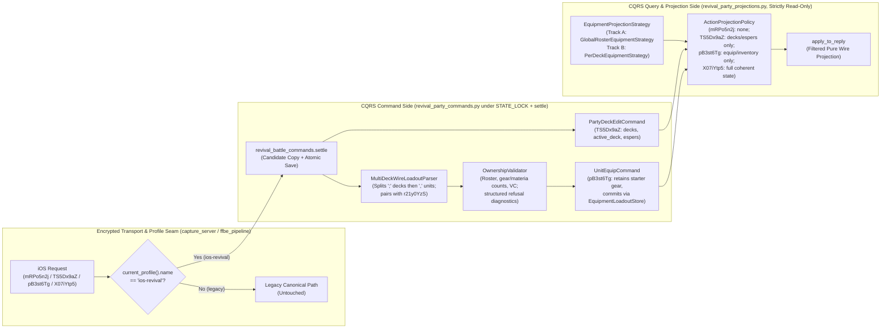

# iOS Normal Party 2 Equipment Persistence (`Manage Party`) — SOLID / CQRS Plan

**Status**: Track A verified on iPhone (`Party 2` saved, confirming client keys `UserUnitEquipInfoList` per `r21y0YzS` and requiring Track B because `active_deck`-stamped `TJ9eL80N` cleared `Party 1`); **Track B (`PerDeckLoadoutStore` + `PerDeckEquipmentStrategy`) implemented** with ADR-0019 and automated BDD/integration tests; physical iPhone re-test pending. Updated with live iPhone `Manage Party` evidence (`20261127T213535_0020.json` and post-Track-A Party 2 test).
**Scope**: `ios-revival` profile only (`current_profile().name == 'ios-revival'`). The `legacy` profile (Android, browser, macOS emulator) MUST remain byte-for-byte unchanged.
**Target Symptom**: In `Manage Party` on iOS (Global `ver.9100`, build 1167), equipment assigned to units in **Normal Party 2** (deck slot 2, `r21y0YzS="1"`, `xBi3L6yR="1"`) appears saved initially, then disappears after leaving and re-entering `Manage Party` or after restarting the app/server.

---

## 1. Live Log Evidence & Confirmed Root Causes

A live iPhone capture from leaving `Manage Party` (`iPhone17,1_ios27.2.1`, request log `20261127T213535_0020.json`) confirmed **two compounding bugs firing in the exact same exit sequence**, plus **one `TJ9eL80N` `r21y0YzS` projection check** to verify on-device once both bugs are fixed.

### Captured Live Exit Sequence

1. **`TS5Dx9aZ` (`PartyDeckEditRequest`) runs FIRST**:
   ```json
   {
     "CN92arJK": [{"r21y0YzS":"2", "Kgvo5JL2":"2", "xBi3L6yR":"1", "...": "..."}],
     "5Eb0Rig6": [
       {"r21y0YzS":"0", "2A6fYiEC":"1:0:1794412175477,0:1:1794412175476,1:2:1795228800708,1:3:1794542362189,1:4:1794520200072"},
       {"r21y0YzS":"1", "2A6fYiEC":"1:0:1795309024709,0:1:1795309024719,1:2:1795309024714,1:3:1795309024697,1:4:1795309024685", "w1JG7i9j":"1795309024709:0..."}
     ]
   }
   ```
2. **`pB3st6Tg` (`UnitEquipRequest`) runs IMMEDIATELY SECOND** — and fails server-side:
   ```json
   {
     "Er92Kdhm": [{
       "93Y6evuT": "1795309024709:1-0@2-0@3-0@4-0@5-0@6-0;1795309024699:1-0@2-0@3-0@4-0@5-0@6-0|1-0@2-0@3-0@4-0@5-0@6-0",
       "80NUYFMJ": "1795309024709:1-0@2-0@3-0@4-0;1795309024699:1-0@2-0@3-0@4-0|1-0@2-0@3-0@4-0",
       "nQ1iAGf3": "1795309024709:0-0;1795309024699:0-0",
       "2c8nqLrM": "1795309024709:0;1795309024699:0",
       "xBi3L6yR": "1",
       "r21y0YzS": "1;2"
     }]
   }
   ```
   Server log immediately printed:
   ```text
   note: unit-equip: invalid equipment update
   ```

### Confirmed Root Cause 1 — `TS5Dx9aZ` (`PartyDeckEditRequest`) Clobbers Unsaved Client Equipment Before `pB3st6Tg` Serializes

In [source/server/player_state.py](../source/server/player_state.py#L5171-L5257):

- `mRPo5n2j` (`UpdateSwitchInfoRequest`) returns early without player groups so it cannot clobber pending edits.
- `pB3st6Tg` (`UnitEquipRequest`) strips `('5Eb0Rig6', 'fqTUI1z6', 'GV7Ej6n0', 'zeucwm6H')`, **but still emits** `49rQB3fP` (esper decks), `REbh19u0`/`qVX5Lab8`/`g8ZuTVvQ` (special esper decks), and `8PEB5o7G` (active deck).
- **`TS5Dx9aZ` (`PartyDeckEditRequest`) strips nothing.** Because `responses.json["TS5Dx9aZ"]` carries `LhVz6aD2`, `apply_to_reply` injects **every** player group—including **`TJ9eL80N` (`UnitEquipResponse`)**, whose `UnitEquipResponse::onReadStarted()` (`0x197101c`) clears `UserUnitEquipInfoList` and rebuilds it from the server's pre-edit state, plus `B71MekS8` and special-party `UnitEquipResponse` tags (`DW7uH6Mn`, `VE7KZ8CY`, `wc8vSHPS`).

**Direct proof in the captured log**:
- `TS5Dx9aZ` ran first with deck `1` containing `1795309024709` and `active_deck = 2`.
- When `pB3st6Tg` serialized right after receiving `TS5Dx9aZ`'s reply, the client still remembered that `1795309024709` (deck `1`) and `1795309024699` (deck `2`) were dirty (`"r21y0YzS": "1;2"`), **but every single equipment, materia, and vision-card slot had already been wiped back to `0` (`1-0@2-0@3-0@4-0@5-0@6-0`, `1-0@2-0@3-0@4-0`, `0-0`)** by `TS5Dx9aZ`'s stale `TJ9eL80N` reply!
- Editing equipment on Party 1 alone (no deck switch/edit) does not send `TS5Dx9aZ`, which is why Party 1 can appear unaffected while Party 2 loses its gear.

### Confirmed Root Cause 2 — `Er92Kdhm` Uses `;` as a Multi-Deck Delimiter, Breaking `_wire_loadouts` and Dropping the Entire `UnitEquipRequest`

In [source/server/exvius_actions.py](../source/server/exvius_actions.py#L196-L255) and [source/server/exvius_actions_expedition.py](../source/server/exvius_actions_expedition.py#L892-L940):

- The live `Er92Kdhm` payload proves the actual multi-deck wire grammar of `UnitEquipRequest`:
  - `r21y0YzS` is a **`;`-delimited list of deck IDs** (`"1;2"`).
  - `93Y6evuT`, `80NUYFMJ`, `nQ1iAGf3`, `2c8nqLrM` (and `w1JG7i9j` if present) are **parallel `;`-delimited per-deck segments**, where each deck segment contains **`,`-delimited per-unit entries** (`<iid>:<base>[|<shift>]`).
- `_wire_loadouts` splits **only on `,`**, never on `;`. On `"1795309024709:1-0@...@6-0;1795309024699:1-0@..."`, `pair` becomes `"6-0;1795309024699:1-0"`, `item.isdigit()` is `False`, and `_wire_loadouts` raises `ValueError('invalid saved equipment slot')`.
- `unit_equip` catches `(AttributeError, TypeError, ValueError)`, logs only `note: unit-equip: invalid equipment update` (matching the live log verbatim), discards the entire request, and returns `_refresh(spec)` with stale `TJ9eL80N`.
- Additionally, `unit_equip` rejects the whole batch on any unsupported `xBi3L6yR` outside `{"1", "7", "8", "11", "50"}`, ignores `r21y0YzS`, and mutates `State.player` outside `revival_battle_commands.settle`.

### Secondary Structural Check — `_equip_rows` `r21y0YzS` Stamping & Global vs. Per-Deck Normal Storage

In [source/server/player_state.py](../source/server/player_state.py#L5337-L5372):

```python
rows.append({"og2GHy49": str(u["instance_id"]),
             "r21y0YzS": str(party["active_deck"]),
             "93Y6evuT": slots, "80NUYFMJ": mat,
             "nQ1iAGf3": card})
```

- Notice in the live log that `UnitEquipRequest` explicitly grouped dirty units **by deck** (`"r21y0YzS": "1;2"`), while `_equip_rows` currently emits one row per roster unit all stamped with `party["active_deck"]` (`"2"` in the captured log).
- Because Root Causes 1 and 2 prevented Party 2 equipment from ever reaching `state.json` cleanly, once **Track A** (fixing Root Causes 1 & 2) is running on the iPhone, a quick verification test (equip Party 2 while Party 1 or Party 3 is active, leave `Manage Party`, re-enter and restart) will immediately confirm whether iOS `ver.9100`'s `UnitEquipResponse::readParam` (`0x1971034`):
  - **Mode A (Global per-unit `TJ9eL80N`)**: ignores `r21y0YzS` or reads one global `UserUnitEquipInfo` per `og2GHy49` -> **Track A alone completely resolves the issue**.
  - **Mode B (Per-deck `TJ9eL80N` keyed by `(og2GHy49, r21y0YzS)`)**: filters or stores `UserUnitEquipInfo` per deck ID -> activate **Track B** (`PerDeckEquipmentStrategy`) via Open/Closed substitution with zero pipeline rewrite.

---

## 2. Architecture Overview (CQRS + SOLID)



### CQRS Boundary

- **Command Side (`source/server/revival_party_commands.py`) — Explicit Atomic Writes Only**:
  - Executes exclusively under `capture_server.STATE_LOCK` and `revival_battle_commands.settle` (deep-copied candidate `PlayerState`, atomic `save()`, full rollback on validation or disk write failure).
  - **`apply_party_deck_edit(player, req)` (`TS5Dx9aZ`)**: Validates and mutates only party decks, deck names, active deck, and esper links. Never mutates unit equipment.
  - **`MultiDeckWireLoadoutParser` + `OwnershipValidator` + `apply_unit_equip(player, req)` (`pB3st6Tg`)**:
    - Parses the confirmed multi-deck `Er92Kdhm` grammar:
      1. Splits `r21y0YzS` on `;` into `deck_ids` (e.g., `"1;2"` -> `["1", "2"]`; absent/empty defaults to `[str(party["active_deck"])]`).
      2. Splits each loadout field (`93Y6evuT`, `80NUYFMJ`, `nQ1iAGf3`, `2c8nqLrM`, `w1JG7i9j`) on `;` into parallel per-deck segments, allowing absent fields or empty deck segments without failing.
      3. Within each deck segment, splits on `,` into per-unit `<iid>:<value>` entries and decodes base + optional `|` Brave Shift forms into typed `DeckEquipSegment(party_kind, deck_id, unit_loadouts)`.
      4. Rejects only genuinely malformed syntax (e.g., non-numeric item ID, duplicate slot within one form, >2 forms, or more `;` segments than declared `deck_ids`), logging the exact `xBi3L6yR`, `r21y0YzS`, field token, unit ID, and reason.
    - Isolates unsupported `xBi3L6yR` rows (logging the exact `wire_kind` and `r21y0YzS`) instead of letting an unrelated party-type row drop valid Normal (`xBi3L6yR="1"`) updates.
    - Validates unit ownership, per-unit equipment/materia counts, and vision card ownership via `OwnershipValidator`.
    - Retains inferred starter equipment via `_retain_owned_equipment()` *before* overwriting slots so unequipped starter items remain owned (`MBPCGT84`) and visible.
    - Records quest action `'13'` when materia changes.
    - Delegates state mutation to an injected `EquipmentLoadoutStore`:
      - **Track A (`GlobalRosterLoadoutStore`)**: Writes normal loadouts (`xBi3L6yR="1"`) to `roster[iid]` (preserving deck order across `;` segments) and special loadouts (`7`/`8`/`11`) to `special_party(kind)["loadouts"][iid]`.
      - **Track B (`PerDeckLoadoutStore`, conditional on post-Track-A verification)**: Writes normal loadouts per `(deck_id, iid)` under `party["deck_loadouts"][deck_id][iid]` and mirrors the active deck into `roster[iid]` for battle/arena consumers.

- **Query & Projection Side (`source/server/revival_party_projections.py`) — Strictly Read-Only, Zero Persistence**:
  - Performs **zero** mutations to `State.player.data`, `dirty`, or disk (`save()` is never called from projections).
  - **`ActionProjectionPolicy` (immutable reply-boundary registry keyed by `reply_id`)**:
    - `mRPo5n2j` (`UpdateSwitchInfoRequest`): suppresses all clear-and-rebuild player groups (preserves existing behavior).
    - `TS5Dx9aZ` (`PartyDeckEditRequest`): suppresses clear-and-rebuild **unit and equipment** groups (`B71MekS8`, `TJ9eL80N`, `DW7uH6Mn`, `VE7KZ8CY`, `wc8vSHPS`, `IqkX0gV1`) while projecting committed deck/esper/active-deck groups (`5Eb0Rig6`, `49rQB3fP`, `8PEB5o7G`, plus special-party deck/esper groups). **Eliminates Confirmed Root Cause 1.**
    - `pB3st6Tg` (`UnitEquipRequest`): suppresses clear-and-rebuild **party-deck, esper-deck, and active-deck** groups (`5Eb0Rig6`, `fqTUI1z6`, `GV7Ej6n0`, `zeucwm6H`, `49rQB3fP`, `REbh19u0`, `qVX5Lab8`, `g8ZuTVvQ`, `8PEB5o7G`) while projecting committed equipment and ownership groups (`TJ9eL80N`, `MBPCGT84`, `rL81fVUI`, `4hPYneL3`, plus special-party equip groups).
    - Full refresh replies (`X07iYtp5`, `75fYdNxq`, etc.): projects the full coherent player group map using `EquipmentProjectionStrategy`.
  - **`EquipmentProjectionStrategy`**:
    - **Track A (`GlobalRosterEquipmentStrategy`)**: Emits one `TJ9eL80N` row per roster unit from `roster[i]`.
    - **Track B (`PerDeckEquipmentStrategy`, conditional)**: Emits deck-tagged `TJ9eL80N` rows per `(og2GHy49, r21y0YzS)` for normal decks `0..9` from `party["deck_loadouts"]` falling back to `roster[i]`, plus read-only inventory count reconciliation for `equip_item_rows()` / `materia_rows()` so `UnitEquipUtil::checkEquipCountAddUnitForParty` never triggers `EQUIP_REMOVE_CONFIRM`.

### SOLID Mapping

| Principle | Concrete Design |
|---|---|
| **Single Responsibility (S)** | `revival_party_commands.py` owns multi-deck `;` wire parsing, ownership validation, structured diagnostics, and atomic state mutation for `TS5Dx9aZ` and `pB3st6Tg`; `revival_party_projections.py` owns pure read-only reply filtering (`ActionProjectionPolicy`) and `TJ9eL80N` projection (`EquipmentProjectionStrategy`); `player_state.py` delegates iOS action projection and equipment row generation instead of accumulating inline `if str(reply_id) == ...` branches. |
| **Open/Closed (O)** | Activating Track B (per-deck normal equipment storage/projection) or adding another `Manage Party` reply boundary requires registering a new `EquipmentLoadoutStore` / `EquipmentProjectionStrategy` implementation or `ActionProjectionPolicy` entry—zero edits to `ffbe_pipeline.py` step order or `legacy` paths. |
| **Liskov Substitution (L)** | `GlobalRosterLoadoutStore` / `GlobalRosterEquipmentStrategy` (Track A) and `PerDeckLoadoutStore` / `PerDeckEquipmentStrategy` (Track B) obey the exact same command/projection contract: committing a valid multi-deck `UnitEquipCommand` and projecting `TJ9eL80N` + `MBPCGT84` preserves `state_coherence_issues == []` and survives JSON reload. |
| **Interface Segregation (I)** | Narrow interfaces separate `MultiDeckWireLoadoutParser` (wire JSON -> typed `DeckEquipSegment`s), `OwnershipValidator` (read-only inventory/roster checks), `EquipmentLoadoutStore` (state write), and `ActionProjectionPolicy` (reply group filter). No HTTP, encryption, or filesystem concerns enter these modules. |
| **Dependency Inversion (D)** | `revival_party_commands.py` and `revival_party_projections.py` depend on abstract store/strategy/policy protocols and accept `player`, `req`, and `groups` explicitly (no hidden `State` globals in core logic), enabling deterministic offline unit and BDD testing without device or network I/O. |

---

## 3. Planned File Changes

### New Production Modules (2 files, `ios-revival` only)

1. **`source/server/revival_party_commands.py`**
   - Typed value objects: `DeckEquipSegment`, `EquipValidationError`, `PartyCommandResult`.
   - `MultiDeckWireLoadoutParser`: Parses `;`-delimited deck lists (`r21y0YzS`) and parallel `;`-delimited / `,`-delimited loadout strings (`93Y6evuT`, `80NUYFMJ`, `nQ1iAGf3`, `2c8nqLrM`, `w1JG7i9j`), including base + `|` Brave Shift forms and empty deck segments.
   - `OwnershipValidator`: Validates roster membership, equipment/materia counts, and vision card ownership with structured diagnostic messages (`party_kind`, `deck_id`, `iid`, `field`, reason).
   - `GlobalRosterLoadoutStore` (Track A) and (conditional) `PerDeckLoadoutStore` (Track B).
   - `handle_unit_equip(spec, req)` and `handle_party_deck_edit(plaintext)` adapters wired under `revival_battle_commands.settle`.

2. **`source/server/revival_party_projections.py`**
   - `ActionProjectionPolicy` dataclass + `IOS_ACTION_PROJECTIONS` table for `mRPo5n2j`, `TS5Dx9aZ`, `pB3st6Tg` (and pass-through for full refreshes).
   - `filter_reply_groups(reply_id, out, groups)` pure function called from `PlayerState.apply_to_reply` when `current_profile().name == 'ios-revival'`.
   - `project_equip_rows(player, party=None, *, strategy=...)` pure function called from `PlayerState._equip_rows` when `current_profile().name == 'ios-revival'`.
   - (Conditional Track B) `reconcile_equipped_counts(player)` pure helper used by `equip_item_rows()` / `materia_rows()` on `ios-revival`.

### Narrow Profile-Gated Integration Seams (4 existing files — zero `legacy` behavior change)

3. **[source/server/exvius_actions.py](../source/server/exvius_actions.py#L196-L255)**
   - At the top of `unit_equip(spec, req)`, gate on `current_profile().name == 'ios-revival'` (matching `unit_class_up` lines 86–89 and `sacrifice` lines 260–264) and delegate to `revival_party_commands.handle_unit_equip(spec, req)`. Legacy path remains untouched.

4. **[source/server/ffbe_player.py](../source/server/ffbe_player.py#L303-L464)**
   - In `apply_party_edit(plaintext)`, gate on `current_profile().name == 'ios-revival'` to delegate to `revival_party_commands.handle_party_deck_edit(plaintext)`. Legacy path remains untouched.

5. **[source/server/ffbe_pipeline.py](../source/server/ffbe_pipeline.py#L592-L607)**
   - Add `'TS5Dx9aZ'` and `'pB3st6Tg'` to the `ios-revival` `roster_command` atomic `revival_battle_commands.settle` set so party-deck and unit-equipment mutations commit atomically to disk or roll back cleanly on failure. Confirm `validate_pipeline()` reports zero `PIPELINE_EDGES` problems.

6. **[source/server/player_state.py](../source/server/player_state.py#L5164-L5372)**
   - In `apply_to_reply`: when `current_profile().name == 'ios-revival'`, delegate action-boundary group filtering (`mRPo5n2j`, `TS5Dx9aZ`, `pB3st6Tg`) to `revival_party_projections.filter_reply_groups`. Legacy `apply_to_reply` remains byte-for-byte unchanged (preserving `player_state.py` selftest lines 5909–5912).
   - In `_equip_rows` (and `equip_item_rows` / `state_coherence_issues` if Track B activates): delegate `ios-revival` projection to `revival_party_projections.project_equip_rows`.

### Tests, OpenSpec & Acceptance Documentation (3 files)

7. **`source/exvius/test_ios_party_equipment.py`** (new BDD test suite)
   - Dedicated `ios-revival` + `legacy` non-regression BDD tests covering all scenarios in Section 4, including the exact captured multi-deck `;` wire payload.

8. **[openspec/specs/ios-server/spec.md](../openspec/specs/ios-server/spec.md)**
   - Add `ManagePartyEditAndEquipPersistence` requirement and BDD scenarios documenting symmetric `TS5Dx9aZ` / `pB3st6Tg` projection boundaries, multi-deck `;`-delimited `Er92Kdhm` parsing, atomic persistence, and Party 2 reload invariants.

9. **[plans/IOS_DEVICE_ACCEPTANCE.md](IOS_DEVICE_ACCEPTANCE.md)** (plus an ADR under `openspec/decisions/` if Track B introduces `party.deck_loadouts` save schema)
   - Add a physical-iPhone acceptance row for Normal Party 2 equipment persistence across `Manage Party` exit/re-entry and full app/server restart.

---

## 4. Staged Delivery & BDD Verification Plan

### Phase 1 — Track A Implementation (Fixes Both Confirmed Root Causes)

Implement `revival_party_commands.py`, `revival_party_projections.py`, the 4 profile-gated seams, and `test_ios_party_equipment.py`:
- Symmetric action-scoped projections on `mRPo5n2j`, `TS5Dx9aZ` (omits `TJ9eL80N`/`B71MekS8`/special equip tags), and `pB3st6Tg` (omits `5Eb0Rig6`/`49rQB3fP`/`8PEB5o7G`/special deck & esper tags).
- Full multi-deck `;` + `,` + `|` parser for `Er92Kdhm` (`r21y0YzS: "1;2"` and parallel `;`-delimited `93Y6evuT`, `80NUYFMJ`, `nQ1iAGf3`, `2c8nqLrM`, `w1JG7i9j`).
- Atomic `revival_battle_commands.settle` transaction wrapping `TS5Dx9aZ` and `pB3st6Tg`, plus structured refusal diagnostics.

### Phase 2 — Device Verification & Conditional Track B Gate

Run the physical iPhone check against Phase 1:
- Equip units on **Party 2** (`r21y0YzS="1"`) while **Party 1** (`0`) or **Party 3** (`2`) is active, leave `Manage Party`, verify `pB3st6Tg` now transmits non-zero equipment slots with **zero** `unit-equip: invalid equipment update` notes, then re-enter `Manage Party` and restart app/server.
- **If Party 2 equipment persists across re-entry and restart**: Track A is complete; no schema change needed.
- **If Party 2 equipment is persisted in `state.json` yet displays empty when a different deck is active**: activate **Track B** (`PerDeckLoadoutStore` + `PerDeckEquipmentStrategy`) behind the `ios-revival` seam so `TJ9eL80N` projects deck-tagged rows per `(og2GHy49, r21y0YzS)` with reconciled `equip_item_rows()` / `materia_rows()` counts, and record an ADR under `openspec/decisions/`.

### Phase 3 — Automated BDD Test Scenarios (`source/exvius/test_ios_party_equipment.py`)

All tests run offline against disposable save roots using `.venv-ios/bin/python`:

- **Scenario 1 (Exact captured multi-deck `;` wire payload on `TS5Dx9aZ -> pB3st6Tg`)**:
  - **Given** an initialized `ios-revival` save with units across Party 1 (`0`), Party 2 (`1`), and Party 3 (`2`, including a Brave Shift NV unit),
  - **When** `mRPo5n2j`, then `TS5Dx9aZ` (switching active deck and editing decks `0`/`1`), then `pB3st6Tg` with `"xBi3L6yR": "1"`, `"r21y0YzS": "1;2"`, and `;`-delimited `93Y6evuT` (base + `|` shift), `80NUYFMJ`, `nQ1iAGf3`, `2c8nqLrM` execute in sequence,
  - **Then** `TS5Dx9aZ` commits the decks and **omits** `TJ9eL80N`, `B71MekS8`, and special-party `UnitEquipResponse` tags; `pB3st6Tg` parses both deck segments without error, commits all equipped items/materia/vision cards/skins for both Party 2 and Party 3 units, **omits** `5Eb0Rig6`, `49rQB3fP`, `8PEB5o7G`, and special-party deck/esper tags; and a subsequent `X07iYtp5` (`GetUserInfoRequest`) plus fresh server reload returns all Party 2 and Party 3 equipment intact.
- **Scenario 2 (Multi-unit within a deck + empty deck segment in `;` payload)**:
  - **Given** an `Er92Kdhm` row with `"r21y0YzS": "0;1;2"` where deck `1` has two `,`-separated units and deck `0` has an empty `nQ1iAGf3` segment (`";iidA:cardA;iidB:0-0"`),
  - **When** `pB3st6Tg` executes on `ios-revival`,
  - **Then** every unit in every non-empty segment updates cleanly without raising a parser error.
- **Scenario 3 (`pB3st6Tg -> TS5Dx9aZ` reverse exit chain)**:
  - **Given** pending esper/deck edits on Party 2 alongside equipment edits,
  - **When** `pB3st6Tg` runs before `TS5Dx9aZ`,
  - **Then** `pB3st6Tg` does not emit `5Eb0Rig6`, `49rQB3fP`, or `8PEB5o7G`, and both equipment and Party 2 esper/deck edits survive reload.
- **Scenario 4 (Mixed `Er92Kdhm` party types in one `UnitEquipRequest`)**:
  - **Given** a `pB3st6Tg` request containing a valid `xBi3L6yR="1"`, `r21y0YzS="1"` row alongside an unsupported `xBi3L6yR` row (e.g., `"2"`),
  - **When** processed on `ios-revival`,
  - **Then** the unsupported row is logged with its `xBi3L6yR`/`r21y0YzS` without silently discarding the valid Normal Party 2 row.
- **Scenario 5 (Atomic rollback on save failure & unowned item rejection)**:
  - **Given** an unowned equipment/materia/vision card OR a simulated `PlayerState.save()` `OSError`,
  - **When** `pB3st6Tg` or `TS5Dx9aZ` runs on `ios-revival`,
  - **Then** in-memory `State.player.data` and on-disk save bytes remain unchanged and a structured diagnostic note identifies the failing field/unit/deck.
- **Scenario 6 (Read-only projection purity)**:
  - **Given** an initialized `ios-revival` `PlayerState`,
  - **When** `filter_reply_groups`, `project_equip_rows`, or `apply_to_reply` runs,
  - **Then** `player.data`, `player.dirty`, and save-file bytes/mtime are completely unchanged (zero filesystem writes).
- **Scenario 7 (Starter equipment retention & `EQUIP_REMOVE_CONFIRM` safety)**:
  - **Given** starter units whose initial gear is inferred from worn slots,
  - **When** Party 2 units swap or unequip starter items,
  - **Then** `MBPCGT84` (`equip_item_rows`) continues reporting owned counts `>=` worn counts across units/decks.
- **Scenario 8 (Track B conditional — distinct per-deck loadouts across Party 1 & Party 2)**:
  - **Given** Track B is active and units are equipped differently on Party 1 (`r21y0YzS="0"`) and Party 2 (`r21y0YzS="1"`),
  - **When** leaving `Manage Party` and reloading from disk (`X07iYtp5`),
  - **Then** both Party 1 and Party 2 retain their distinct loadouts and `state_coherence_issues()` is empty.
- **Scenario 9 (`legacy` profile non-regression)**:
  - **Given** `current_profile().name == 'legacy'`,
  - **When** existing suites run (`test_local_game.py`, `test_feature_completion.py`, `test_actions_expedition.py`, `player_state.py --selftest`, `ffbe_pipeline.validate_pipeline()`),
  - **Then** all legacy tests pass with byte-identical legacy reply shapes (`TS5Dx9aZ` and `pB3st6Tg` unchanged on `legacy`).

### Phase 4 — Physical iPhone Device Acceptance

1. Start the iOS server with `ios-revival` profile against an existing save.
2. Open `Manage Party`, switch to **Party 2**, add/verify units, equip weapons, armor, accessories, materia, and (if owned) a vision card, and optionally touch another party (e.g., Party 3) so `r21y0YzS` sends a multi-deck `;` list.
3. Tap Back to Home: verify server logs show **no** `unit-equip: invalid equipment update` and `pB3st6Tg` carries the real non-zero equipped item IDs (not clobbered to `0`).
4. Immediately re-enter `Manage Party` -> swipe to **Party 2**: verify all Party 2 equipment, materia, vision cards, and espers remain equipped.
5. Force-close the FFBE iOS app, restart the Mac iOS server, relaunch FFBE, open `Manage Party` -> **Party 2**, and enter a battle with Party 2: verify all Party 2 equipment persists across full restart and appears in battle.
6. Verify **Party 1** equipment and deck membership remain intact and no `EQUIP_REMOVE_CONFIRM` stripping dialog appears.

---

## 5. Non-Goals, Risks & Rollback

### Non-Goals
- Modifying `legacy` profile behavior (Android, browser, macOS emulator).
- Changing Arena (`IqkX0gV1`), Dark Visions (`VE7KZ8CY`), Clash of Wills (`wc8vSHPS`), or Party Register save slots (`Q7jV6pno`/`CE98eghN`).
- Client binary patching or Frida hooks (server-only fix).

### Key Risks & Mitigations
- **Risk: Omitting `B71MekS8` on `TS5Dx9aZ` or `8PEB5o7G` on `pB3st6Tg` breaks a client callback expecting them.**
  - *Mitigation*: Keep `ActionProjectionPolicy` data-driven so individual tags (`B71MekS8`, `8PEB5o7G`, `49rQB3fP`) can be toggled cleanly per `reply_id` without touching command code, and verify on the physical iPhone in Phase 2/4.
- **Risk: Track B (per-deck storage) implemented unnecessarily if client ignores `r21y0YzS` in `TJ9eL80N`.**
  - *Mitigation*: Phase 2 physical-iPhone check after Track A is an explicit gate before enabling Track B; emitting duplicate `og2GHy49` rows into a single-list `UserUnitEquipInfoList` is avoided by design unless proven necessary.
- **Rollback**: Because all new logic lives in `revival_party_commands.py` and `revival_party_projections.py` behind explicit `current_profile().name == 'ios-revival'` guards, reverting the 4 seam calls restores prior behavior with zero save-file breakage.
