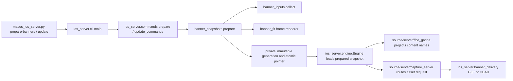

# iOS Summon Banner Preparation Performance — SOLID / CQRS Plan

**Status:** Proposed, plan only

**Date:** 2026-11-27

**Scope:** Small to medium; reduce CPU time in the explicit iOS summon-art preparation command.

## 1. Goals & Measured Bottleneck

`prepare-banners` spends most of its cold generation time encoding fitted PNG frames. Three fresh private-runtime preparations of the current read-only artwork corpus measured **122.006 s median (121.9998–122.1284 s)**. A focused profile of 24 large source images and both frame modes attributed **9.074 s of 10.217 s** to Pillow's PNG save/encoder path. Source inventory collection alone measured about **1.011 s median**. This is a preparation cost, not a measured gameplay-request delay.

The affected paths are:

- **Preparation:** `source/exvius/macos_ios_server.py prepare-banners` → `ios_server.cli.main()` → `ios_server.commands.prepare()` → `ios_server.banner_snapshots.prepare()` → `banner_inputs.collect()` → `banner_fit.render()` → immutable snapshot publication. The explicit `update` orchestrator (`ios_server.update_commands.DefaultSnapshotPreparer.prepare_stale()`) also invokes `banner_snapshots.prepare(config)` when the banner snapshot is stale.
- **Verification:** `verify-banners` (`ios_server.commands.prepare()`) and `check-update` (`ios_server.update_queries.DefaultSnapshotVerifier.verify_all()`) call read-only `banner_snapshots.verify(config)`.
- **Consumption:** `ios_server.engine.Engine.initialize()` loads the already prepared banner snapshot; shared `source/server/ffbe_gacha.py` projects its content-addressed names, and `source/server/capture_server.py` routes image GET/HEAD requests through `ios_server.banner_delivery.serve()`. Separately, `ios_server.home_banners` imports `banner_fit.inspect()` for read-only PNG validation.

The implementation should replace the current high-cost PNG optimization mode for fitted outputs with a faster lossless encoder setting, while preserving source pixels, frame dimensions, source bytes for images that need no fit, and all manifest and delivery checks. A temporary in-memory encoder comparison used to select the candidate setting is not a production benchmark or an implementation result; implementation-phase targets remain unmeasured.

### Targets for the implementation phase

| Metric | Baseline | Falsifiable target |
|---|---:|---:|
| Fresh-root `prepare-banners` median, same corpus and host | 122.006 s | ≤85 s and at least 30% below a paired remeasured baseline |
| Verified no-op `prepare-banners` median | 4.232 s | ≤4.44 s and no more than 5% above its paired baseline median |
| Total unique prepared PNG bytes | Measured from the same-input before/after manifests | ≤1.05× the current total |
| Rendered output pixels and dimensions | Current renderer contract | Exact decoded pixel and dimension parity for both frames; unchanged-frame outputs remain the original source bytes |
| Snapshot and delivery integrity | Current SHA-256, size, dimensions, and path checks | Retain all checks; each published content name, recorded digest/size, and GET bytes agree |

The candidate encoder is `optimize=False, compress_level=6`. On a temporary sample of 24 large sources and 48 frame outputs, decoded pixels matched exactly and aggregate sample output bytes increased by 4.55%. A subsequent read-only in-memory verification across the full 652-source / 1,304-frame corpus (1,146 encoded frames, 158 passthrough frames, 1,302 unique files) confirmed 0 decoded pixel mismatches and 346,448,182 unique output bytes vs 347,708,852 bytes for `optimize=True` (-0.363%). These read-only probes validate the size ceiling and pixel parity on the current corpus; they do **not** replace the paired end-to-end before/after `prepare()` benchmark or establish a device speedup.

### Non-goals

- No gameplay, summon eligibility, replay calendar, RNG, economy, campaign, save-format, or shared catalogue change.
- No automatic image fitting during `start`, gameplay requests, `verify-banners`, or diagnostics.
- No source artwork, shared game data, generated pack, dependency, CLI, HTTP route/method/header, or JSON-field schema change. Content-addressed image path values may change with the new image hashes.
- No process-wide image cache, skipped freshness/integrity check, runtime asset cache, or unrelated preparation refactor.
- No change to Android/browser behavior, the canonical legacy engine, active campaign, certificate identity, DNS, or host lifecycle.

## 2. Baseline Measurements & Reproduction

### Environment and workload

- `.venv-ios/bin/python -B`, Python **3.12.13**, macOS ARM64, Pillow **13.0.0** already present in the prepared environment; no package was installed.
- Input: the current `source/out/browser-data` read as shared input plus the repository's current `gacha_*.json` metadata. The inventory requested 959 unique names, found 652 source PNGs totaling 80,115,511 bytes, and reported 307 missing names. The combined metadata selected 1,342 deduplicated banner identities. The cold build produced 1,304 frame entries backed by 1,302 unique content-addressed files.
- Each cold sample ran in a fresh child process with a different empty runtime root under `tempfile.TemporaryDirectory()`. Imports happen before timing; the application snapshot is cold, but the OS page cache was not flushed and the input tree had already been read. The timer covers `banner_snapshots.prepare(config)`, including source collection/validation, frame rendering, output validation, and immutable publication. It excludes interpreter startup and module imports.
- Each child then called `prepare()` again against its newly prepared snapshot. This is the warm no-op case: it loads and verifies the existing snapshot and recollects/fingerprints sources before returning `prepared_now: false`; it does not render or publish a new generation.
- All writable outputs and the temporary lock were confined to disposable `/tmp` roots. An audit hook rejected writes outside each root and socket activity. No campaign save, server, iPhone setting, or shared source file was used as output.

### Baseline results

| Measurement | Result |
|---|---:|
| Cold fresh-process generation, 3 samples, median (min–max) | 122.006 s (121.9998–122.1284 s) |
| Warm verified no-op, 3 samples, median (min–max) | 4.232 s (4.2269–4.3904 s) |
| Source `collect()` alone, 5 same-process passes, median (min–max) | 1.011 s (1.0025–1.2333 s) |
| PNG source inventory | 652 available / 959 requested; 80,115,511 source bytes |
| Prepared frame inventory | 1,304 frame entries / 1,302 unique output files |
| Profile subset, uninstrumented, 24 largest sources × 2 modes, 3 samples | 10.204 s median (10.2029–10.2105 s), 48 frame results |
| Same subset, one cProfile run | 10.217 s instrumented; 9.074 s in PNG save/encoding, including 9.068 s in `ImagingEncoder.encode` |

The profile subset encoded 32 frames; the other 16 were already within the fit tolerance and retained source bytes. In that subset, the two `render()` calls per source repeatedly inspect and reopen the source, but PNG encoding was the dominant measured sub-cost. The full input inventory was not the bottleneck.

An in-memory selection probe (no repository or snapshot writes) compared PNG settings on the same 24-source/48-frame subset. The current `optimize=True` baseline produced 40,421,490 output bytes at 10.203 s median. `optimize=False, compress_level=6` produced pixel-identical PNGs in 2.301 s median with 42,259,445 bytes (+4.55%); level 3 produced 1.801 s and 43,873,545 bytes (+8.54%). A follow-up read-only in-memory verification across all 652 sources (1,304 frame entries: 1,146 encoded, 158 passthrough; 1,302 unique files) measured 347,708,852 unique bytes for `optimize=True` vs 346,448,182 unique bytes for `optimize=False, compress_level=6` (-0.363%) with 0 decoded pixel mismatches. These are exploratory read-only measurements used to validate the candidate setting and size tradeoff; they are **not** full-preparation snapshot results or measured production gains.

`perf_counter` measures elapsed preparation time and `cProfile` attributes CPU calls. No RSS or `tracemalloc` claim is made. The benchmark excludes CLI process startup, encrypted requests, HTTP/TLS transfer, client decoding, and physical iPhone rendering/download behavior.

### Reproduce the cold and warm preparation measurements

Run from the repository root. Each worker has a fresh private runtime and validates that writes stay inside it; all output is removed when the outer temporary directory closes.

```sh
.venv-ios/bin/python -B - <<'PY'
import json, os, statistics, subprocess, sys, tempfile
from pathlib import Path

repo = Path.cwd()
data = (repo / 'source/out/browser-data').resolve()
worker = r'''
import json, os, sys, time
from pathlib import Path
repo, runtime, data = map(Path, sys.argv[1:4])
sys.path[:0] = [str(repo/'source'), str(repo/'source/server')]
from ios_server.config import Configuration
from ios_server import banner_snapshots
config = Configuration(runtime, data)
root = runtime.resolve()
def inside(value):
    if isinstance(value, int): return True  # fdopen follows the checked os.open
    path = Path(os.fsdecode(value))
    if not path.is_absolute(): path = Path.cwd() / path
    return path.resolve(strict=False).is_relative_to(root)
def audit(event, args):
    if event.startswith('socket.'):
        raise AssertionError('unexpected socket activity: ' + event)
    if (event == 'open' and len(args) > 2 and isinstance(args[2], int)
            and args[2] & (1|2|8|64|512|1024) and not inside(args[0])):
        raise AssertionError('write outside disposable root: ' + str(args[0]))
    if event in ('os.mkdir','os.remove','os.unlink','os.rmdir') and args and not inside(args[0]):
        raise AssertionError('mutation outside disposable root: ' + event)
    if event in ('os.rename','os.replace') and any(not inside(v) for v in args[:2]):
        raise AssertionError('rename outside disposable root: ' + event)
sys.addaudithook(audit)
for phase in ('cold', 'warm'):
    started = time.perf_counter()
    result = banner_snapshots.prepare(config)
    print(json.dumps({'phase': phase, 'ms': (time.perf_counter()-started)*1000,
                      'sources': result['sources'], 'images': result['images'],
                      'files': result['files'], 'prepared_now': result['prepared_now']}), flush=True)
'''
records = []
with tempfile.TemporaryDirectory(prefix='bolt-ios-banner-') as temporary:
    for index in range(3):
        command = [sys.executable, '-B', '-c', worker, str(repo),
                   str(Path(temporary)/f'run-{index}'), str(data)]
        result = subprocess.run(command, text=True, capture_output=True, check=True)
        rows = [json.loads(line) for line in result.stdout.splitlines()]
        cold = next(row['ms'] for row in rows if row['phase'] == 'cold')
        warm = next(row['ms'] for row in rows if row['phase'] == 'warm')
        records.append((cold, warm))
cold = [row[0] for row in records]
warm = [row[1] for row in records]
print(json.dumps({'cold_ms': cold, 'cold_median': statistics.median(cold),
                  'cold_min': min(cold), 'cold_max': max(cold),
                  'warm_ms': warm, 'warm_median': statistics.median(warm),
                  'warm_min': min(warm), 'warm_max': max(warm)}))
PY
```

The collection-only and focused profile can be reproduced with this read-only workload. `cProfile` time is used only for attribution.

```sh
.venv-ios/bin/python -B - <<'PY'
import cProfile, hashlib, pstats, statistics, sys, tempfile, time
from pathlib import Path
sys.path[:0] = ['source', 'source/server']
from ios_server.config import Configuration
from ios_server import banner_fit, banner_inputs
config = Configuration(Path(tempfile.gettempdir())/'ios-bolt-banner-profile',
                       Path('source/out/browser-data'))
collection = []
for _ in range(5):
    start = time.perf_counter(); inputs = banner_inputs.collect(config)
    collection.append((time.perf_counter()-start)*1000)
print({'collect_ms': collection, 'median_ms': statistics.median(collection)})
samples = sorted(inputs.images.items(), key=lambda item: len(item[1]), reverse=True)[:24]
def run():
    for _, raw in samples:
        for mode in banner_fit.FRAMES:
            rendered = banner_fit.render(raw, mode)
            hashlib.sha256(rendered).digest()
            banner_fit.inspect(rendered)
times = []
for _ in range(3):
    start = time.perf_counter(); run(); times.append((time.perf_counter()-start)*1000)
print({'profile_subset_ms': times, 'median_ms': statistics.median(times),
       'sources': len(samples), 'source_bytes': sum(len(raw) for _, raw in samples),
       'frames': len(samples)*len(banner_fit.FRAMES)})
profile = cProfile.Profile(); profile.enable(); run(); profile.disable()
pstats.Stats(profile).strip_dirs().sort_stats('cumtime').print_stats(24)
PY
```

## 3. Architecture Overview (CQRS + SOLID)



### CQRS Boundary

- **Command:** Explicit snapshot preparation (`prepare-banners`, plus the explicit `update` command's `update_commands.DefaultSnapshotPreparer.prepare_stale()` when the banner snapshot is stale) is the only path that invokes the renderer. `banner_snapshots.prepare()` acquires the existing per-runtime `InstanceLock`, reads source metadata/art, validates every image, creates a new immutable snapshot if inputs or the renderer pipeline changed, and publishes the pointer atomically. It does not initialize or mutate a campaign, start a service, download files, or import `capture_server`.
- **Queries:** `verify-banners` and `check-update` (`update_queries.DefaultSnapshotVerifier.verify_all()`) remain read-only. They may read source and published files to check their hashes, paths, dimensions, and freshness, but they do not create directories, fit images, repair a snapshot, acquire a writer lock, make network requests, initialize a campaign, or import the game engine. Existing diagnostics retain their no-engine contract.
- **Gameplay reads:** startup consumes only a validated prepared snapshot. `ffbe_gacha` rewrites native banner detail names from the snapshot; `banner_delivery.serve` serves those exact in-memory bytes for GET and their exact length for HEAD. These paths do not walk source trees, invoke Pillow, generate files, or initiate outbound network I/O. A missing or corrupt prepared snapshot remains a visible startup/verification failure, not a reason for lazy preparation.
- The optimization is restricted to the explicit image command. It adds no result cache and does not change saved time, calendar state, game queries, or native response fields. The normal inbound HTTP exchange remains the transport for a native image GET.

### SOLID Mapping

| Principle | Concrete mapping |
|---|---|
| **S — Single Responsibility** | `banner_inputs.py` continues to select names and source provenance; `banner_fit.py` owns pure frame rendering/encoding; `banner_snapshots.py` owns freshness, locking, validation, and publication; `banner_delivery.py` owns GET/HEAD response behavior. |
| **O — Open/Closed** | Add a frame-renderer implementation in `banner_fit.py` behind `BannerFrameRenderer`; keep `banner_snapshots.prepare()`'s inventory and publication flow unchanged when encoder settings or a future supported renderer are added. The `PIPELINE` fingerprint changes when rendering semantics change. |
| **L — Liskov Substitution** | `PillowBannerFrameRenderer` and a test fake implement the same `render_frames(raw, modes)` iterator contract and produce valid lossless PNGs with the requested mode dimensions; frames within tolerance return the source bytes unchanged. Neither implementation controls snapshot paths or publication. |
| **I — Interface Segregation** | `BannerFrameRenderer` accepts bytes and frame modes and yields frozen `RenderedFrame(mode, raw)` DTOs one at a time. It has no filesystem, runtime, engine, network, or campaign methods. `banner_inputs.Inputs` and `banner_snapshots.Banners` remain the separate input and read-side snapshot DTOs. |
| **D — Dependency Inversion** | `banner_snapshots.prepare(config, *, renderer: BannerFrameRenderer = ...)` depends on the narrow renderer protocol; production binds the Pillow implementation and BDD tests inject a deterministic fake. Existing `banner_inputs.collect()` and `_publish()` retain responsibility for source I/O and atomic storage, so no new storage framework is introduced. |

### Cache, Concurrency & Compatibility Invariants

- Add no process-local or cross-request cache. Render one source at a time and release its decoded Pillow image before moving to the next source. The existing output-byte collection remains owned by `banner_snapshots.prepare()` only until publication completes; do not retain decoded sources or `RenderedFrame` objects after each source is consumed, and do not increase output retention beyond current behavior.
- Keep the exact existing freshness inputs: configured data root, source document digests, source paths and image digests/dimensions, missing/requested names, Pillow version, and renderer `PIPELINE`. Increment `PIPELINE` for the new encoder so an old snapshot cannot be mistaken for current output. Root and generation remain owned by `banner_snapshots`; no clock, campaign state, or profile result cache is needed.
- Continue checking each source image, every published output digest/size/dimension, and source freshness. Do not replace integrity checks with file timestamps, cached hashes, or a stat-only shortcut. The warm no-op baseline includes this work and its target prohibits a material regression.
- Preserve the `InstanceLock`, immutable generation directory, atomic pointer publication, prior-pointer behavior on failure, old-generation byte retention, and visible errors for bad inputs or outputs.
- Preserve both native frame dimensions and all decoded source pixels, including center placement and blurred padding. Keep raw source bytes for a mode already within tolerance. Since encoded PNG bytes change, the new image digest/path and recorded size must describe the actual prepared output. GET returns exactly those bytes; HEAD reports exactly their length. Keep aliases, content-type, cache headers, unknown-path handling, and path containment unchanged.
- Do not modify `ffbe_gacha`, `capture_server`, the legacy profile, or shared gameplay policy. The iOS snapshot pipeline version is the only invalidation signal for this rendering change; table versions, campaign generation, and save contents are independent.

## 4. Planned Modules & File Changes

1. **Modify `source/ios_server/banner_fit.py`.** Add frozen `RenderedFrame` and the narrow `BannerFrameRenderer(Protocol)` with `render_frames(raw: bytes, modes: tuple[str, ...]) -> Iterator[RenderedFrame]`. Add a Pillow-backed implementation (`PillowBannerFrameRenderer`) that validates/loads one source for the requested frame set, yields frames one at a time, and writes transformed PNGs with `optimize=False, compress_level=6`. Keep `render(raw, mode)` as a compatibility wrapper over the same single-mode contract and keep `inspect(raw)` unchanged (shared with `banner_inputs.py`, `banner_snapshots.py`, and `home_banners.py`). Preserve the exact current image geometry, `image.convert('RGB')` vs `image.convert('RGBA')` conversion semantics (including for `P`-mode paletted PNGs with byte transparency, so decoded pixels stay bit-for-bit identical), and Pillow imports' lazy behavior. Increment `PIPELINE` so the source fingerprint invalidates previous fitted output.
2. **Modify `source/ios_server/banner_snapshots.py`.** Inject an optional keyword-only `BannerFrameRenderer` into `prepare(config, *, renderer: BannerFrameRenderer = ...)`, defaulting to the Pillow renderer so existing single-argument callers (`commands.py` and `update_commands.py`) remain unchanged. Call `render_frames()` once per source for both `banner_fit.FRAMES` and consume its iterator before advancing to the next source; keep the current source metadata cross-checks, output `inspect()`, SHA-256 naming, sizes, immutable publish flow, and no-op provenance equality checks. Do not change `verify()` or startup loading into a repair/preparation path.
3. **Modify `source/exvius/test_ios_banner_fitting.py`.** Add BDD assertions for pair rendering, pixel/dimension parity, unchanged-frame source-byte identity, renderer call counts, lossless output, and renderer-pipeline invalidation. Update the three existing `patch.object(fit, 'render', ...)` sites so they stay accurate once `prepare()` calls `renderer.render_frames()`:
   - `test_given_corrupt_source_or_invalid_render_when_preparing_then_keep_active_generation` (currently patches `fit.render` to return a `1×1` PNG): inject a fake `BannerFrameRenderer` returning invalid dimensions so the dimension-validation guard is still directly exercised.
   - The read-only query guards on `verify()` and `GachaEntryRequest` (currently patching only `fit.render` with `AssertionError`): guard `PillowBannerFrameRenderer.render_frames` alongside `fit.render` so they cannot become silent false-positive guards.
   Enforce the full-corpus size ceiling in the before/after benchmark. Extend existing snapshot and delivery scenarios only where the new PNG encoder changes bytes; retain GET/HEAD and publication failure coverage.

No edits are planned for `source/ios_server/commands.py`, `cli.py`, `update_commands.py`, `update_queries.py`, `home_banners.py`, `banner_inputs.py`, `banner_delivery.py`, `source/server/ffbe_gacha.py`, `capture_server.py`, launchers, data, or dependencies. The existing command, updater, and read/delivery adapters already provide the required seams.

## 5. Verification, Benchmark & BDD Test Plan

### Given / When / Then Scenarios

- **Given** a valid source PNG needing both frame shapes, **when** explicit preparation renders it, **then** one renderer call yields both outputs, each output has the established dimensions and exact decoded pixels, and its manifest digest, size, and content-addressed name match its bytes.
- **Given** an image already within a mode's tolerance, **when** either the standalone renderer or snapshot command handles it, **then** the output bytes are exactly the source bytes and no transformed file is encoded for that mode.
- **Given** a same-size source edit or changed renderer pipeline, **when** `verify-banners` runs and then `prepare-banners` is explicitly invoked, **then** verification reports stale content, preparation publishes a new content identity, and immutable prior files and the saved campaign remain unchanged.
- **Given** a current prepared snapshot, **when** `verify-banners` or a native image GET/HEAD runs, **then** it does not invoke rendering or mutate the runtime; GET bytes and HEAD length exactly match the prepared manifest. Missing/corrupt data and escaping paths retain their existing failure behavior.
- **Given** a corrupt input image, invalid rendered output, or failed image/pointer write, **when** preparation fails, **then** the old active pointer remains unchanged and a retry can complete after the input/failure is corrected.
- **Given** another preparation holds the runtime lease, **when** a second preparation starts, **then** it is refused before publication; there is no partial generation or unlocked concurrent writer.
- **Given** banner preparation and verification run under the iOS profile, **when** the test audits imports and I/O, **then** only explicit preparation writes below the disposable runtime root; verification has no writes, network activity, writer lock, campaign initialization, or `capture_server`/engine import.
- **Given** the legacy profile and its existing art behavior, **when** the iOS snapshot change is present, **then** legacy requests and shared summon selection remain unchanged.

### Verification Commands for the Implementation Phase

Run from the repository root with the prepared Python 3.12 interpreter:

```sh
.venv-ios/bin/python -B source/exvius/test_ios_server.py
.venv-ios/bin/python -B source/exvius/test_ios_preparation.py
.venv-ios/bin/python -B source/exvius/test_ios_full_tables.py
.venv-ios/bin/python -B source/exvius/test_ios_sound_delivery.py
.venv-ios/bin/python -B source/exvius/test_ios_banner_fitting.py
.venv-ios/bin/python -B source/exvius/test_ios_home_banners.py
.venv-ios/bin/python -B source/exvius/test_ios_updater.py
git diff --check
```

The foundation, prepared-content, and updater suites protect the runtime, `update`/`check-update` callers, and snapshot boundaries; banner fitting covers pixel, generation, and asset-delivery behavior; home-banner tests ensure the adjacent prepared-art path (which shares `banner_fit.inspect()`) remains separate. CLI stdout remains one JSON document for `prepare-banners` / `verify-banners`; diagnostics stay on stderr.

**Known pre-existing test baseline on `main`:** Four of the suites above (`test_ios_banner_fitting.py`, `test_ios_full_tables.py`, `test_ios_sound_delivery.py`, and `test_ios_home_banners.py`) currently have one pre-existing failure each at `source/ios_server/engine.py:51` (`ValueError: Gameplay requires prepare-sounds, then prepare-data --vortex-art --sounds.`) because their prepared-engine integration fixtures invoke `prepare_data(self.config)` without `vortex_art=True, sounds=True` (and without `sound_snapshots.prepare` / `home_banners.prepare`). Meanwhile `test_ios_server.py` (24/24), `test_ios_preparation.py` (22/22), and `test_ios_updater.py` (9/9) pass cleanly. During implementation verification, record exact before/after pass/fail counts so no new regression is introduced and pre-existing `engine.py:51` fixture drift in unrelated suites is not conflated with banner-preparation changes (handle fixing `PreparedBannerEngine` or those shared fixtures separately unless explicitly approved in scope).

### Before / After Benchmark Protocol

- Re-run the cold/warm command above before and after the implementation on the same host, corpus, `.venv-ios` Python/Pillow versions, and sequential three-worker arrangement. Use fresh disposable private roots and remove them afterward. Keep the same application-cache definitions: empty snapshot for cold, then a verified no-op repeat for warm. Report medians and min–max, source count/bytes, output-entry/file counts, and aggregate unique output bytes.
- Run the focused cProfile separately from latency samples and report its workload and instrumentation. It identifies CPU attribution but does not substitute for the full-generation timing. Do not clear or claim to clear the OS page cache. Do not include process startup in the preparation timer or call an encoder subset an end-to-end improvement.
- Compare decoded pixels, dimensions, unchanged source bytes, output manifest hashes/sizes, and total unique output bytes on identical inputs. Fail the implementation target if the full output size exceeds the 5% ceiling or the cold timing misses its target; do not relax validation to make the benchmark pass.
- Keep benchmark writes under `/tmp`, audit the shared data root as read-only, and confirm the active save, prepared shared content, certificate files, and service are untouched. Run `git diff --check` and inspect status so only planned files are present.

## 6. Risks, Tradeoffs & Manual iPhone Validation

The encoder setting changes compressed PNG bytes and therefore content hashes and paths, even when decoded pixels are identical. `PIPELINE` must change so explicit preparation (`prepare-banners` or `update`) creates a fresh snapshot instead of reusing old fitted bytes, and so `verify-banners` and `check-update` visibly report existing snapshots as stale until re-prepared. Atomic publication and the previous active snapshot must survive any failed render or write. Although the 24-sample probe increased bytes by +4.55%, the full-corpus read-only verification measured -0.363% unique output bytes (346,448,182 vs 347,708,852 bytes) with 0 pixel mismatches; implementation must still enforce the 5% output-size ceiling on the full before/after manifests.

The measured 122 s is a Mac preparation baseline. It does not prove faster gameplay startup, lower download time, or faster rendering on an iPhone. After implementation, prepare and verify a disposable generation, then on the physical iPhone check that summon list/detail/carousel art still loads and displays at the native dimensions, that ordinary and fitted images download completely, and that the client reports no new missing-art or required-data error. Keep that acceptance separate from host tests and do not use those checks to alter the active campaign or network configuration.
