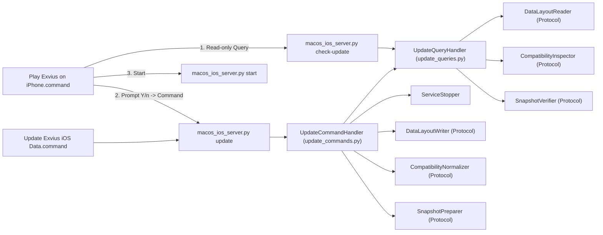

# iOS Data Updater & Launcher Detection — SOLID / CQRS Plan

## 1. Goals & Confirmed Requirements

Automate updating the local iOS game-data tree and prepared iOS snapshots whenever [data/latest.json](../data/latest.json) or prepared snapshot inputs change, and detect stale data/snapshots automatically in [Play Exvius on iPhone.command](../Play%20Exvius%20on%20iPhone.command).

Confirmed decisions:
1. **Launcher behavior**: When [Play Exvius on iPhone.command](../Play%20Exvius%20on%20iPhone.command) detects an update is needed, prompt interactively (`Update now? [Y/n]`), run the updater if accepted, and then start the server (or print manual update instructions and exit cleanly if declined).
2. **Detection scope**: Local-only (offline-safe) read-only check comparing local [data/latest.json](../data/latest.json) pack hashes/sizes against installed receipts **and** running the four read-only snapshot verifiers (`verify-sounds`, `verify-banners`, `verify-home-banners`, `verify-data`).
3. **Supported data layouts**: Support both flat (`source/out/browser-data` with `.web_setup/installed.json`) and managed (`ios-current.json`) layouts via a pluggable strategy interface auto-detected from `--data`.
4. **Upstream pack compatibility**: Keep [source/ios_server/native_inputs.py](../source/ios_server/native_inputs.py) strict; handle Android-pack differences (e.g., unregistered `mst` `Ver*_*.dat` tokens and localized-index checksum drift such as `F_TEXT_QUEST` in `Ver710_i5QEJpua.dat`) in an isolated post-extract compatibility normalization step inside the updater.
5. **Entrypoints**: Modular CQRS modules inside `source/ios_server/`, exposed as `check-update` and `update` subcommands on [source/exvius/macos_ios_server.py](../source/exvius/macos_ios_server.py) plus a clickable `Update Exvius iOS Data.command` launcher at the repository root.

---

## 2. Architecture Overview (CQRS + SOLID)

The `source/ios_server/` package already enforces a read/write boundary ([queries.py](../source/ios_server/queries.py) vs. [commands.py](../source/ios_server/commands.py)). This plan extends that architecture with an isolated update subsystem:

### CQRS Boundary

- **Query Side (`check-update`)** — strictly read-only (zero disk writes, zero network I/O, zero locks, zero engine imports):
  1. Compares local [data/latest.json](../data/latest.json) pack definitions (revision, version, pack IDs, SHA-256s, sizes) against the active data layout's receipt (`.web_setup/installed.json` for flat layouts, or `ios-current.json` + `installation.json` for managed layouts).
  2. Audits post-extract iOS compatibility invariants (unregistered `Ver*_*.dat` files in `mst/`, MD5/size drift in `F_LOCALIZED_TEXT_MST`, `gamedata.xml` vs. `registry.json` drift).
  3. Runs all four read-only snapshot verifiers: `sound_snapshots.verify`, `banner_snapshots.verify`, `home_banners.verify`, and `preparation.verify_data`.
- **Command Side (`update`)** — explicit mutations (under `InstanceLock`, atomic file replacements, progress on `stderr`, JSON receipt on `stdout`):
  1. Stops any running iOS server cleanly (`commands.lifecycle(..., stop)`).
  2. Re-runs the read-only query to determine which packs, normalizations, and snapshots need work.
  3. Downloads only missing/changed packs (reusing [pack_download.py](../source/ios_server/pack_download.py)'s Range-resumable, SHA-256-verified transfer) and applies them through the active layout strategy.
  4. Runs the isolated post-extract iOS compatibility normalizer (without relaxing [native_inputs.py](../source/ios_server/native_inputs.py)).
  5. Rebuilds only stale/missing snapshots in dependency order (`prepare-sounds` → `prepare-banners` → `prepare-home-banners` → `prepare-data --vortex-art --sounds`).
  6. Runs final read-only verification across all four snapshot gates and fails clearly if any gate is not `"ok": true`.

### SOLID Mapping

| Principle | Concrete Design in `source/ios_server/` |
|---|---|
| **Single Responsibility (S)** | Separate modules for contracts/DTOs (`update_types.py`), layout strategies (`update_layouts.py`), compatibility normalization (`update_normalize.py`), read-only detection (`update_queries.py`), and command orchestration (`update_commands.py`). |
| **Open/Closed (O)** | New data layouts (strategy registry) or new upstream normalization rules (rule list in `update_normalize.py`) can be added without modifying query/command orchestration or [native_inputs.py](../source/ios_server/native_inputs.py). |
| **Liskov Substitution (L)** | `FlatBrowserDataStrategy` and `ManagedPackStrategy` uphold identical inspection/installation contracts, path-containment rules, atomic receipt updates, and offline read-only inspection. |
| **Interface Segregation (I)** | Read protocols (`DataLayoutReader`, `CompatibilityInspector`, `SnapshotVerifier`) are segregated from write protocols (`DataLayoutWriter`, `CompatibilityNormalizer`, `SnapshotPreparer`), preventing queries from accessing mutating operations. |
| **Dependency Inversion (D)** | `UpdateQueryHandler` and `UpdateCommandHandler` depend only on narrow `typing.Protocol` abstractions with default concrete bindings, enabling deterministic offline unit/BDD tests with fakes and temporary directories. |

---

## 3. Planned Modules & File Changes

### New Modules in `source/ios_server/`

1. **`source/ios_server/update_types.py`**
   - Frozen dataclasses:
     - `PackDelta(id, url, size, unpacked_size, sha256, reason)`
     - `LayoutInspection(layout, installed_version, target_version, target_revision, packs_needed, download_bytes, unpacked_bytes, valid, error)`
     - `NormalizationReport(unregistered_mst_files, localized_index_mismatches, registry_sync_needed)`
     - `SnapshotCheck(name, ok, error)`
     - `UpdateStatus(ok, update_needed, layout, installed_version, target_version, target_revision, packs_needed, download_bytes, unpacked_bytes, normalization, snapshots, reasons, recommended_command)`
   - Segregated `Protocol` interfaces:
     - `DataLayoutReader` (`inspect(config, manifest_path) -> LayoutInspection`)
     - `DataLayoutWriter` (`apply(config, manifest_path, *, archive_dir, opener, emit) -> dict`)
     - `CompatibilityInspector` (`inspect(config) -> NormalizationReport`)
     - `CompatibilityNormalizer` (`normalize(config) -> dict`)
     - `SnapshotVerifier` (`verify_all(config) -> dict[str, SnapshotCheck]`)
     - `SnapshotPreparer` (`prepare_stale(config, checks, *, emit) -> dict`)

2. **`source/ios_server/update_layouts.py`**
   - `detect_layout(config) -> Literal["managed", "flat", "uninstalled"]`:
     - `ios-current.json` → `managed`
     - `client/shared_prefs/gamedata.xml`, `.web_setup/installed.json`, or `client/files` → `flat`
     - empty / manifest-only directory → `uninstalled`
   - **`FlatBrowserDataStrategy`** (`DataLayoutReader` + `DataLayoutWriter`):
     - **Inspect**: Reads [data/latest.json](../data/latest.json) and `<data>/.web_setup/installed.json`, compares each pack by `(id, sha256, unpackedSize)`, and verifies referenced files exist when receipt metadata is missing or version differs. Never writes to disk.
     - **Apply**:
       - Downloads only missing/changed packs via [pack_download.py](../source/ios_server/pack_download.py) (`pack_download.fetch`) into `<data>/.web_setup/` (with optional `--archive-dir` local reuse).
       - Enforces path-containment and symlink checks on ZIP entries, verifies expanded byte totals, extracts atomically via temp file + `os.replace`, checkpoints progress in `.web_setup/upgrade_progress.json`, deletes verified archives after extraction, removes superseded `.dat` files not owned by the active pack set, and writes `.web_setup/installed.json` atomically.
   - **`ManagedPackStrategy`** (`DataLayoutReader` + `DataLayoutWriter`):
     - **Inspect**: Delegates to [pack_install.py](../source/ios_server/pack_install.py) `plan()` and `verify()` (`managed_content.load`).
     - **Apply**: Delegates to `pack_install.fetch(...)` to publish the next immutable generation under `.ios-generations/` and atomically replace `ios-current.json`.
   - **Update [source/ios_server/pack_manifest.py](../source/ios_server/pack_manifest.py)**:
     - Extend `destination()` allowlist for `v0.1.35`/`v0.1.36` pack paths (`native/exvius/equipment-enhancement/.+` and `static/prepared_tables/.+`) while preserving all existing rejection rules in [test_ios_pack_install.py](../source/exvius/test_ios_pack_install.py) (rejects `game-assets.apk`, saves, traversal, etc.).

3. **`source/ios_server/update_normalize.py`**
   - Isolated post-extract iOS compatibility rules (keeping [native_inputs.py](../source/ios_server/native_inputs.py) strict):
     - **Rule 1 — Unregistered `mst` `.dat` pruning**: Detects/removes `Ver*_*.dat` in `mst/` whose 8-character token is not in `{t.token for t in native_tables.TABLES if not t.localized}` ([client_tables.json](../source/ios_server/client_tables.json)).
     - **Rule 2 — `F_LOCALIZED_TEXT_MST` checksum reconciliation**: Checks every localized table in `native_tables.INPUT_TABLES` against the latest `Ver*_i5QEJpua.dat`. If a localized file's size or MD5 disagrees with its index row (e.g., `F_TEXT_QUEST` / `Ver6_NMwfx1lf.dat`), re-encodes only the affected row(s) using `localized_text_versions` semantics and replaces `Ver*_i5QEJpua.dat` atomically.
     - **Rule 3 — Registry XML sync**: Ensures `client/shared_prefs/gamedata.xml` matches `registry.json` and covers all 364 registered tables in [client_tables.json](../source/ios_server/client_tables.json).
     - **Receipt sync**:
       - Flat layouts: atomically updates `.web_setup/installed.json` to drop pruned files and refresh `size`/`sha256`/`mtime_ns` for modified files.
       - Managed layouts: runs normalization inside the staged generation directory *before* writing `installation.json` and flipping `ios-current.json`, keeping published generations immutable and `verify-packs`-clean.

4. **`source/ios_server/update_queries.py`**
   - `UpdateQueryHandler.check(config, manifest_path=pack_manifest.DEFAULT) -> dict`:
     - Pure read-only aggregation of `DataLayoutReader.inspect`, `CompatibilityInspector.inspect`, and `SnapshotVerifier.verify_all`.
     - Computes `update_needed = bool(layout.packs_needed or norm.any_needed or any(not s.ok for s in snapshots.values()))`.
     - Produces human-readable `reasons` and `summary_line` for terminal/launcher display.

5. **`source/ios_server/update_commands.py`**
   - `UpdateCommandHandler.execute(config, manifest_path=..., *, archive_dir=None, opener=..., emit=...) -> dict`:
     1. Stop running service (`commands.lifecycle(config, stop)`).
     2. Inspect via `UpdateQueryHandler`; if already current, return `{"ok": true, "updated_now": false, ...}`.
     3. Apply missing/changed packs via `DataLayoutWriter.apply(...)` under an update lock.
     4. Apply compatibility normalization via `CompatibilityNormalizer.normalize(...)` when needed or after pack updates.
     5. Re-check snapshots and prepare only stale/missing ones in dependency order:
        - `sound_snapshots.prepare(config)` (if `verify-sounds` is not `ok`)
        - `banner_snapshots.prepare(config)` (if `verify-banners` is not `ok`)
        - `home_banners.prepare(config)` (if `verify-home-banners` is not `ok`)
        - `preparation.prepare_data(config, vortex_art=True, sounds=True)` (if `verify-data` is not `ok` or sounds/packs changed)
     6. Run final read-only verification across all four gates and fail with structured diagnostics if any gate is not `"ok": true`.

### CLI & Launcher Integration

6. **[source/exvius/macos_ios_server.py](../source/exvius/macos_ios_server.py) & [source/ios_server/cli.py](../source/ios_server/cli.py)**
   - Register `check-update` and `update` in the `.venv-ios` auto-exec list in [macos_ios_server.py](../source/exvius/macos_ios_server.py) and `choices` in [cli.py](../source/ios_server/cli.py).
   - Options:
     - `check-update`: `--data`, `--manifest`, `--root`, `--slot`, `--summary` (prints compact human-readable reasons to `stderr` while keeping structured JSON on `stdout`).
     - `update`: `--data`, `--manifest`, `--archive-dir`, `--root`, `--slot`.
   - Exit codes:
     - `check-update`: `0` = up to date (`ok: true, update_needed: false`), `2` = update needed (`ok: true, update_needed: true`), `1` = error (`ok: false`).
     - `update`: `0` = updated/verified (`ok: true`), `1` = error.

7. **New Launcher: `Update Exvius iOS Data.command`** (repo root, `chmod +x`)
   - Resolves `DATA_DIR` with the exact same rules as [Play Exvius on iPhone.command](../Play%20Exvius%20on%20iPhone.command).
   - Runs `python3 "$SCRIPT_DIR/source/exvius/macos_ios_server.py" update --data "$DATA_DIR" "$@"`.
   - Pauses with `Press Return to close this window.` on completion/error when interactive.

8. **Modify [Play Exvius on iPhone.command](../Play%20Exvius%20on%20iPhone.command)**
   - After resolving `DATA_DIR`:
     1. Run `python3 "$SCRIPT_DIR/source/exvius/macos_ios_server.py" check-update --data "$DATA_DIR" --summary "$@" >/dev/null` (so `start`'s `stdout` stays clean and existing launcher tests remain compatible).
     2. Branch on exit code:
        - **`0` (up to date)**: proceed directly to `start --data "$DATA_DIR" "$@"`.
        - **`2` (update needed)**: display summary reasons and prompt `Update now? [Y/n] `:
          - Accepted (`""`, `y`, `Y`, `yes`): run `macos_ios_server.py update --data "$DATA_DIR" "$@"`; on `0`, proceed to `start`; on failure, show error and pause.
          - Declined (`n`, `N`, or non-interactive EOF): print manual update instructions (`./Update Exvius iOS Data.command` or `python3 source/exvius/macos_ios_server.py update --data "$DATA_DIR"`), pause if interactive, and exit without starting a stale server.
        - **`1` (check error)**: display error/setup instructions and exit non-zero.

---

## 4. Verification & BDD Test Plan

1. **New test suite: `source/exvius/test_ios_updater.py`**
   - **CQRS query purity**: Given an outdated flat or managed tree, `check-update` returns `update_needed: true` (exit `2`) with accurate `packs_needed` and `snapshots` status, without writing files, creating directories, or opening network sockets.
   - **Flat incremental update**: Given unchanged + changed + new local test archives, `update` skips unchanged packs, extracts only changed/new packs, removes superseded `.dat` files, atomically updates `.web_setup/installed.json`, and is idempotent on rerun (`updated_now: false`).
   - **Compatibility normalization**: Given a pack with an unregistered `mst/Ver1_XXXXXXXX.dat` and a localized `F_TEXT_QUEST` mismatch in `F_LOCALIZED_TEXT_MST`, `update` prunes the unregistered `.dat`, reconciles the index row, keeps [native_inputs.py](../source/ios_server/native_inputs.py) strict, and passes `native_inputs.collect`.
   - **Managed layout compatibility**: Verify `pack_manifest.destination()` accepts `native/exvius/equipment-enhancement/...` and `static/prepared_tables/...` while rejecting unsafe/excluded paths; verify `ManagedPackStrategy` normalizes inside the staged generation before atomic publication.
   - **Dependency-ordered snapshot refresh**: Verify `UpdateCommandHandler` skips already-valid snapshots (e.g., skips `prepare-sounds` when `verify-sounds` is `ok`), rebuilds stale snapshots in order, and fails cleanly if any final verification gate returns `"ok": false`.
2. **Extend [source/exvius/test_ios_launcher.py](../source/exvius/test_ios_launcher.py)**
   - Keep all 6 existing `DATA_DIR` selection tests passing.
   - Add BDD tests for:
     - `check-update` exit `0` → directly runs `start` with no prompt.
     - `check-update` exit `2` + user enters `y` (or Enter) → runs `update`, then `start`.
     - `check-update` exit `2` + user enters `n` (or EOF) → skips `update` and `start`, prints update instructions.
     - `check-update` exit `2` + `update` fails → does not launch `start`, exits non-zero.
     - `Update Exvius iOS Data.command` invokes `update` with the resolved `--data`.
3. **Regression checks**
   - Run existing iOS suites (`test_ios_launcher.py`, `test_ios_pack_install.py`, `test_ios_preparation.py`, `test_ios_full_tables.py`, `test_ios_sounds.py`, `test_ios_vortex_art.py`, `test_ios_home_banners.py`, `test_ios_banner_fitting.py`) via `.venv-ios/bin/python`.
   - Run real read-only `check-update --data source/out/browser-data` against the updated local tree and confirm exit `0` with `"update_needed": false`.
